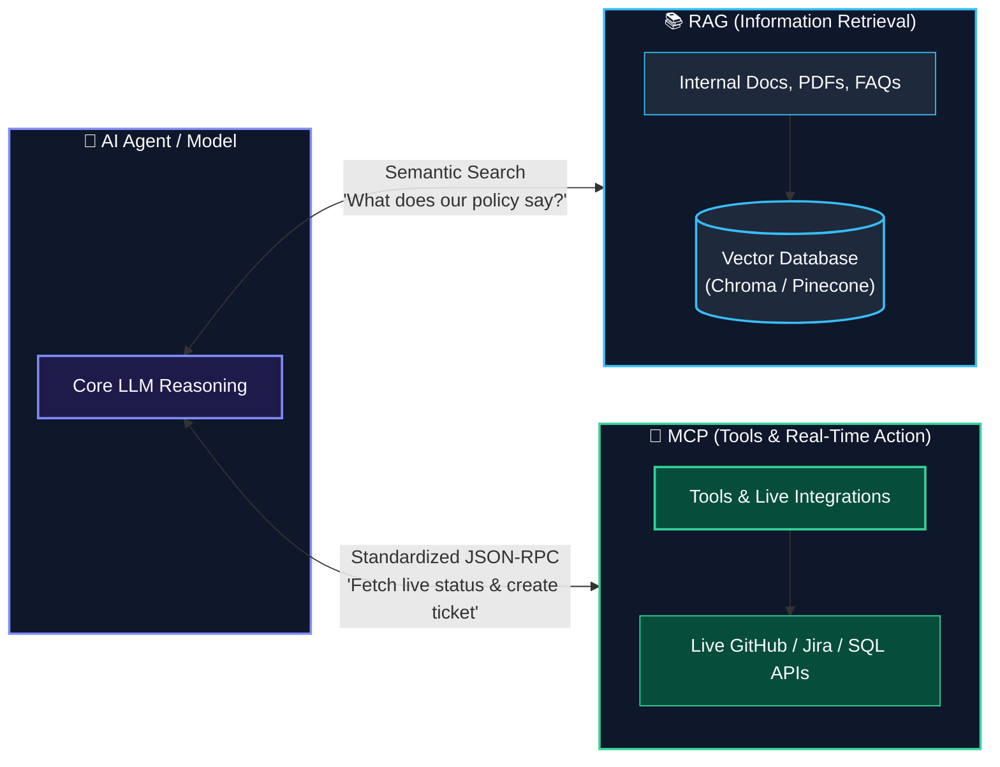
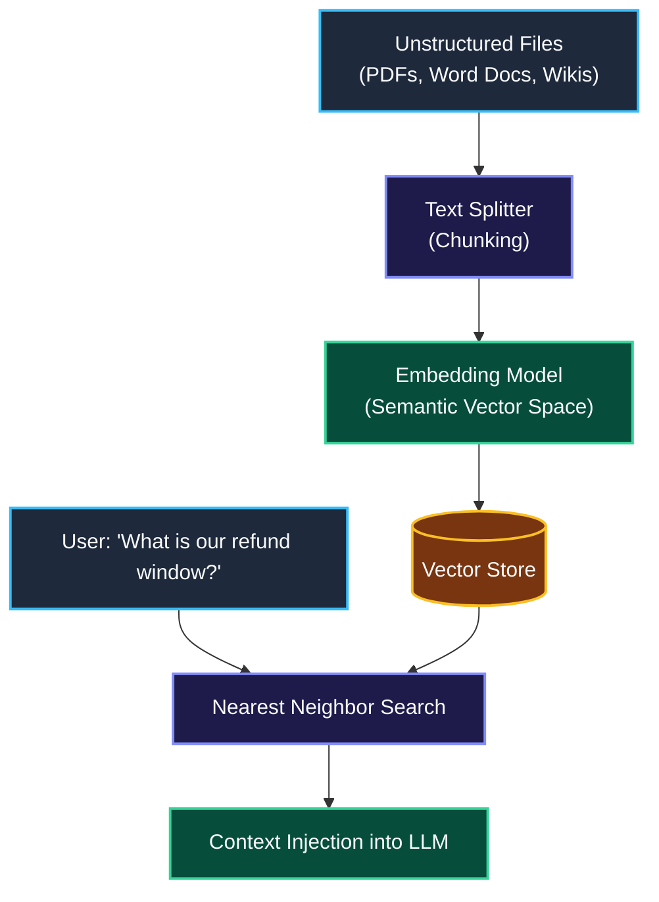
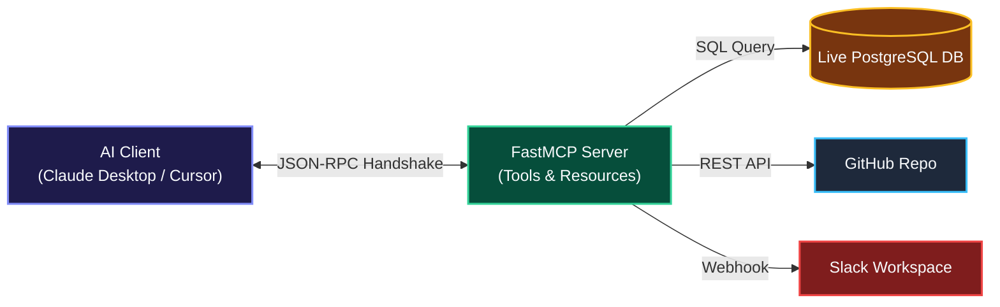
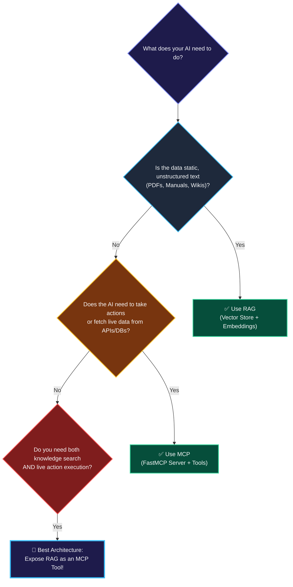
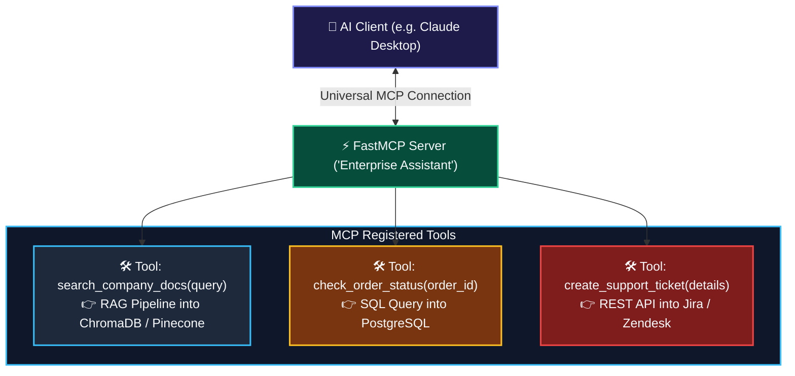

# MCP vs. RAG: When to Use Which?

If you have been building with AI recently, you have likely run into two massive acronyms: **RAG** (*Retrieval-Augmented Generation*) and **MCP** (*Model Context Protocol*).

A common point of confusion is thinking you have to choose between them:

> *"Should I build a RAG pipeline for my project, or should I build an MCP server?"*

Here is the quick truth: **They are not rivals.** They solve two completely different problems, and when used together, they turn a simple chatbot into a superpower.

---

## 1. The Simple Mental Model

To never confuse them again, remember this simple analogy:

* **RAG is the AI's Library Card (Reading & Memory):**  
  It allows the AI to search through thousands of pages of text (PDFs, docs, policies, books) and read only the paragraphs relevant to your question.
* **MCP is the AI's Hands and Universal USB Port (Tools & Action):**  
  It gives the AI a standardized protocol to connect to real-world systems — reading live database records, creating Jira tickets, sending Slack alerts, or running code in a terminal.



---

## 2. Side-by-Side Comparison

Let's look at how RAG and MCP compare across the key dimensions that matter in production:

| Feature | **RAG (Retrieval-Augmented Generation)** | **MCP (Model Context Protocol)** |
| :--- | :--- | :--- |
| **Primary Goal** | Ground answers in unstructured knowledge | Connect AI clients to tools and live data |
| **Nature of Data** | Static or semi-static documents (PDFs, Markdown, Webpages) | Live, dynamic systems (SQL databases, APIs, Filesystem, Git) |
| **Interaction Mode** | **Read-Only** (Retrieves text chunks) | **Read + Write** (Can execute commands, insert records, mutate state) |
| **Under the Hood** | Chunking, Embeddings, Vector Similarity Search | JSON-RPC 2.0 messages over `stdio` or `HTTP/SSE` |
| **Latency Profile** | Moderate (Vector lookup + embedding compute) | Low to High (Depends on the external API or SQL query latency) |
| **Token Usage** | Adds retrieved text chunks into the prompt context | Adds tool definitions; injects tool execution results only when invoked |
| **Best Analogy** | Looking up an answer in an encyclopedia | Plugging a mouse, keyboard, or flash drive into a computer |

---

## 3. When Should You Use RAG?

Choose **RAG** when your primary challenge is **knowledge discovery across massive, unstructured text**.



### Ideal RAG Use Cases:
1. **Company Policy & HR Handbooks:**  
   *"Can I carry over my unused vacation days to next year?"*  
   The LLM retrieves the 2 relevant paragraphs from a 200-page policy PDF and quotes them accurately.
2. **Technical Product Documentation:**  
   *"How do I configure mutual TLS in version 2.4?"*  
   The retriever searches thousands of markdown docs and pulls the exact configuration sample.
3. **Legal & Contract Analysis:**  
   *"Does this vendor agreement contain an indemnification clause?"*  
   Semantic search scans multiple agreements for conceptual equivalents without requiring exact keyword matching.

{: .tip}
> **RAG Limitation:** RAG cannot change things. If a user asks *"Can you cancel my order and issue a refund?"*, standard RAG can only read the refund policy — it has no ability to call Stripe or modify your PostgreSQL database. That is where MCP steps in.

---

## 4. When Should You Use MCP?

Choose **MCP** when your AI needs to **interact with live systems, run tools, or query structured data**.



### Ideal MCP Use Cases:
1. **Live Database Operations:**  
   *"How many paying customers signed up in the last 2 hours?"*  
   The AI calls a `get_recent_signups` tool exposed by your local MCP server and runs a live SQL query.
2. **Actionable DevOps & System Admin:**  
   *"Check Kubernetes pod status in namespace prod-backend and restart any crashing pods."*  
   The AI inspects pod status via an MCP tool and executes an action with human confirmation.
3. **Personal Productivity Tools:**  
   *"Add ₹850 for groceries to my local SQLite expense tracker."*  
   The AI parses the prompt and invokes your FastMCP `add_expense` tool directly on disk.

{: .tip}
> **MCP Limitation:** MCP is an open protocol, not a storage engine. If you ask an MCP server to read a 10,000-page unstructured document, dumping all 10,000 pages into the AI's prompt context will blow up token limits and slow down responses. That is where RAG shines.

---

## 5. The Decision Framework: Which One Do You Need?

Use this simple decision tree to determine the right architectural choice for your project:



---

## 6. The Sweet Spot: Exposing RAG as an MCP Tool

In real-world enterprise architectures, the answer is rarely *"either/or"*. The most powerful pattern is **wrapping your RAG pipeline inside an MCP Server**.

When you do this:
1. Any MCP-compatible client (Claude Desktop, Cursor, Antigravity, custom agent) can query your RAG knowledge base without custom code.
2. The agent can seamlessly switch between **reading knowledge** and **taking action**.



### FastMCP Code Example: RAG as an MCP Tool

Here is how simple it is to turn a RAG retriever into an MCP tool using Python:

```python
from fastmcp import FastMCP
from langchain_chroma import Chroma
from langchain_openai import OpenAIEmbeddings

# 1. Initialize FastMCP Server
mcp = FastMCP("Knowledge & Action Hub")

# 2. Connect to existing RAG Vector Store
embeddings = OpenAIEmbeddings(model="text-embedding-3-small")
vector_store = Chroma(
    collection_name="company_policies",
    embedding_function=embeddings,
    persist_directory="./chroma_db"
)
retriever = vector_store.as_retriever(search_kwargs={"k": 3})

# 3. Expose RAG as a standard MCP Tool
@mcp.tool()
def search_company_knowledge(query: str) -> str:
    """Search internal company documentation, policies, and architecture guides."""
    docs = retriever.invoke(query)
    if not docs:
        return "No relevant company documentation found."
    
    # Format relevant excerpts for the LLM
    results = []
    for i, doc in enumerate(docs, 1):
        source = doc.metadata.get("source", "Unknown")
        results.append(f"--- Excerpt {i} (Source: {source}) ---\n{doc.page_content}")
    return "\n\n".join(results)

# 4. Expose a Live Action Tool alongside it
@mcp.tool()
def create_jira_issue(summary: str, description: str, priority: str = "Medium") -> dict:
    """Create a new ticket in Jira for engineering follow-up."""
    # Action logic calling Jira REST API
    return {"status": "created", "ticket_id": "OPS-402", "url": "https://jira.company.com/browse/OPS-402"}

if __name__ == "__main__":
    mcp.run()
```

### What Happens When a User Asks:
> *"What is our policy on server reboot downtime, and please file a ticket to reboot server prod-db-01 tonight."*

1. The AI calls `search_company_knowledge("server reboot downtime policy")` $\rightarrow$ reads the policy (RAG).
2. The AI verifies that maintenance windows are permitted after 11 PM.
3. The AI then calls `create_jira_issue("Scheduled reboot of prod-db-01", ...)` $\rightarrow$ executes the action (MCP).

**Knowledge + Action working together in perfect harmony.**

---

## 7. Key Takeaways

* **RAG = Retrieval (Memory):** Best for searching large volumes of text, documents, and historical knowledge where semantic matching is required.
* **MCP = Protocol (Interactivity):** Best for real-time data access, connecting AI to tools, databases, and modifying external state.
* **They are Complementary:** The highest-performing agentic applications use MCP as their communication layer, with RAG plugged in as one of their primary tools.

---

## Navigation & Next Steps

* ⬅️ **Previous:** [Build Local MCP Server](/docs/ai/MCP/Build-local-mcp-server/)
* 🏠 **Hub:** [All MCP Topics](/docs/ai/MCP/)
* 📚 **Deep Dive into RAG:** [What, Why & How of RAG](/docs/ai/RAG/what-why-how/) | [Retrievers](/docs/ai/RAG/Retrievers/)
