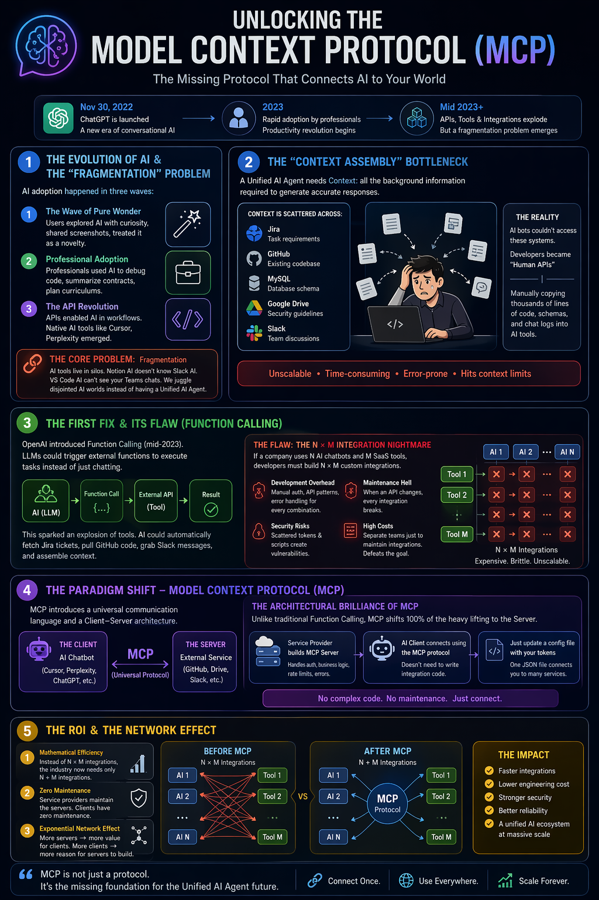
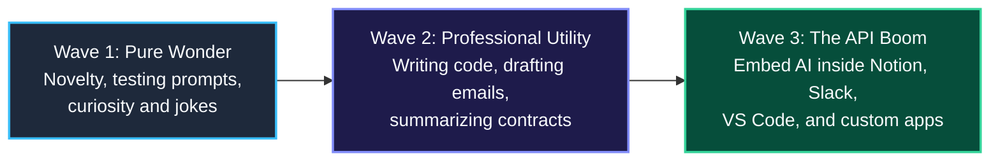
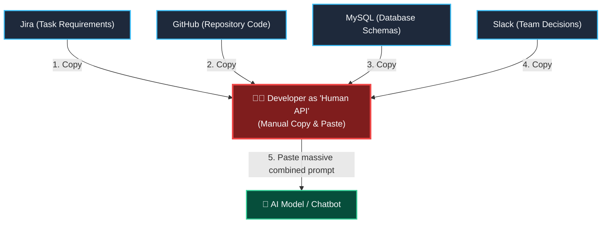
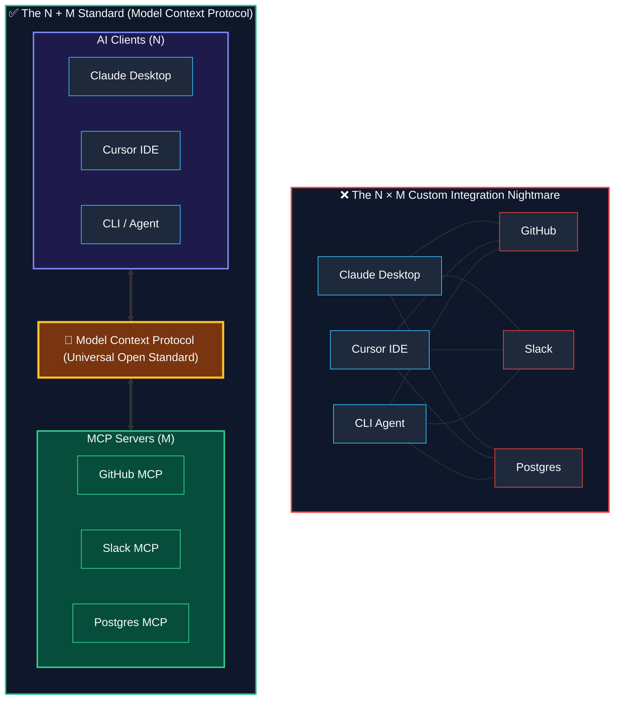
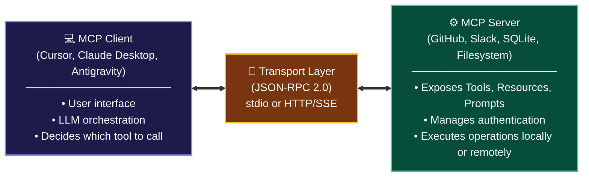

  

# Why Model Context Protocol (MCP)?

To understand why the **Model Context Protocol (MCP)** was created, we need to understand the fundamental dilemma of modern AI: Large Language Models are brilliant reasoners, but they are completely blind to your private tools, databases, and enterprise data.

In this guide, we'll explore how AI connectivity evolved, why early approaches broke down, and how MCP introduces a universal open standard for AI integrations.

---

## 1. The Evolution of AI and the "Fragmentation" Problem

Following the release of ChatGPT in late 2022, AI adoption progressed through three distinct waves:

### The Problem: Walled Gardens & Tool Fragmentation
While AI was suddenly everywhere, it created a fragmented experience:
* The AI in Notion had zero idea what was being discussed in Slack.
* The AI in your IDE had no visibility into Jira tickets or GitHub PRs.
* Instead of a **unified AI assistant**, users ended up juggling 10 separate disconnected chatbots.

---

## 2. The "Context Assembly" Bottleneck: The Human API

To answer complex questions accurately, an AI needs **context**—the relevant code, schemas, documents, and business rules.

In real-world software engineering, context is scattered across multiple services:

Because AI chatbots lacked direct access to these systems, developers were forced to act as **"Human APIs"**—manually copying hundreds of lines of code, database schemas, and chat logs into prompt boxes. This was tedious, error-prone, and didn't scale.

---

## 3. The First Fix: Function Calling and the $N \times M$ Trap

In 2023, model providers introduced **Function Calling (Tool Use)**. Models could now request external data: *“Run `get_github_file()`”* or *“Query `search_slack()`”*.

This was a major leap forward, but it led directly into an architectural trap: **The $N \times M$ Integration Nightmare**.

If an engineering team uses $N$ different AI clients (Claude Desktop, Cursor, ChatGPT, custom CLI agents) and connects to $M$ different data systems (GitHub, Slack, Jira, Postgres), developers have to write and maintain **$N \times M$ custom integrations**:

### Why $N \times M$ Integrations Break Down:
* **Duplicated Engineering**: Every single AI client has to reinvent authentication, schema mapping, and error handling for the same APIs.
* **Fragile Maintenance**: Whenever Slack or GitHub updates an API endpoint, dozens of custom scripts break across different tools.
* **Security Nightmare**: API secrets and access tokens are scattered across multiple individual tools and local configurations.

---

## 4. The Solution: Model Context Protocol (MCP)

To solve the integration explosion, **Anthropic** open-sourced the **Model Context Protocol (MCP)** in late 2024.

MCP is to AI applications what **HTTP** was to the World Wide Web or what **LSP (Language Server Protocol)** was to code editors. It defines a clean, standardized **Client-Server architecture**:

### The Architectural Shift
* **Build Once, Run Anywhere**: A developer or SaaS provider writes an MCP server **once**. It immediately works with Claude Desktop, Cursor, Continue, Antigravity, and any other MCP-compliant client.
* **Zero Client Maintenance**: The client doesn't need to know how GitHub's REST API works; it only needs to speak MCP.
* **Granular Security**: The MCP server controls what resources are exposed, requiring user confirmation for sensitive actions.

---

## 5. Summary & Key Takeaways

{: .note}
> **The One-Line Takeaway:**  
> MCP transforms AI connectivity from brittle, point-to-point integrations into a plug-and-play universal open standard.

| Aspect | Traditional Function Calling | Model Context Protocol (MCP) |
| :--- | :--- | :--- |
| **Architecture** | Point-to-point, bespoke per tool | Standardized Client-Server protocol |
| **Complexity** | $N \times M$ custom integrations | $N + M$ universal interfaces |
| **Transport** | Custom HTTP scripts | Standardized `stdio` or `HTTP with SSE` |
| **Maintenance** | Client developers maintain every API | Server authors maintain their own service |
| **Ecosystem** | Walled gardens | Open, interoperable community standard |

---

## Next Steps

Now that you understand the motivation behind MCP:
* Learn how clients and servers establish connections in [The MCP Lifecycle](/docs/ai/MCP/MCP-Lifecycle/).
* Build and test your own server in [Build a Local MCP Server with FastMCP](/docs/ai/MCP/Build-local-mcp-server/).
