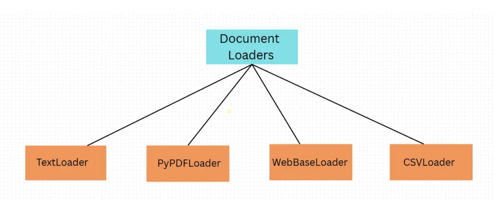
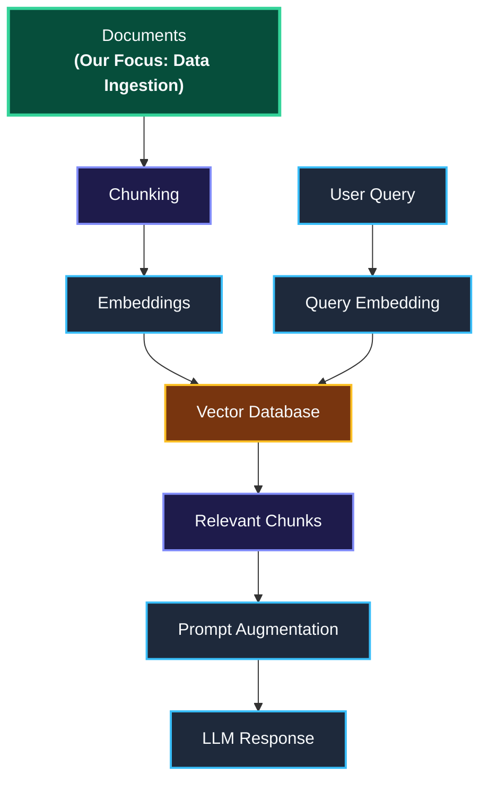
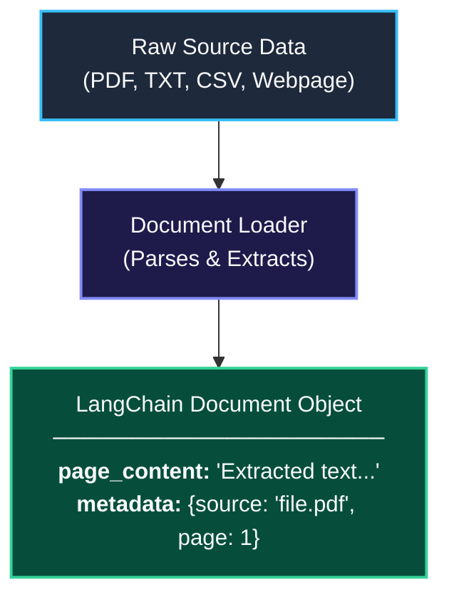

<p align="center">
  
</p>

# Document Loaders in RAG: Ingesting Data for LLMs

To build any Retrieval-Augmented Generation (RAG) system, the very first step is getting your data from real-world sources—PDFs, text files, web pages, or databases—into a format your AI pipeline can process.

In LangChain, this ingestion phase is handled by **Document Loaders**.

---

## The Big Picture: RAG & Ingestion

Notice where Document Ingestion fits into the overall RAG architecture:



1. **Document Loaders**: Connect to different data sources and extract text into standardized objects.
2. [**Text Splitters**](/docs/ai/RAG/Text-Splitters/): Split large text into smaller, meaningful chunks.
3. [**Text Embeddings**](/docs/ai/RAG/Embeddings/) & [**Vector Databases**](/docs/ai/RAG/Vector-Stores/): Convert chunks to vectors and store them for similarity search.
4. [**Retrievers**](/docs/ai/RAG/Retrievers/): Fetch the most relevant chunks matching the user's query.

---

## What is a Document Loader?

A **Document Loader** is a utility designed to load raw content from a specific source (files, cloud storage, web APIs) and convert it into a standardized LangChain **`Document`** object.



### The Structure of a `Document` Object
Every document loader in LangChain produces objects with two key attributes:
* **`page_content`**: A string containing the extracted text.
* **`metadata`**: A Python dictionary holding useful context about the document (such as file path, page number, title, author, or creation date).

---

## Popular Document Loaders

LangChain provides loaders for hundreds of formats. Let's look at the most common ones you'll use in everyday projects.

### 1. Text Loader (`TextLoader`)
The simplest loader in LangChain. It takes raw text files (`.txt`, `.md`, `.py`, logs) and converts each file into a single `Document`.

```python
from langchain_community.document_loaders import TextLoader

# 1. Initialize the loader
loader = TextLoader("notes.txt", encoding="utf-8")

# 2. Load the document
documents = loader.load()

# 3. Inspect the loaded data
print(f"Loaded {len(documents)} document(s).")
print("Content:\n", documents[0].page_content)
print("Metadata:\n", documents[0].metadata)
```

{: .note}
> **Key Takeaway:** Regardless of which loader you use, `.load()` always returns a Python `list` of `Document` objects.

---

### 2. PDF Loader (`PyPDFLoader`)
PDFs are found everywhere across business operations in enterprise data. **`PyPDFLoader`** reads PDF files and generates **one `Document` object per page**.

```python
from langchain_community.document_loaders import PyPDFLoader

# Initialize loader with PDF path
loader = PyPDFLoader("annual_report.pdf")

# Returns a list of Document objects (one per page)
pages = loader.load()

print(f"Total pages loaded: {len(pages)}")
print(f"Page 1 content preview:\n{pages[0].page_content[:200]}")
print(f"Page 1 metadata: {pages[0].metadata}")
# Metadata output: {'source': 'annual_report.pdf', 'page': 0, 'total_pages': 25}
```

{: .tip}
> **Which PDF Loader Should You Choose?**
> * **`PyPDFLoader`**: Fast, lightweight, ideal for standard digital text PDFs.
> * **`PDFPlumberLoader`**: Best when you need to extract tables and structured data.
> * **`PyMuPDFLoader`**: Exceptionally fast for bulk extraction from large PDF books.
> * **`UnstructuredPDFLoader`**: Handles complex layouts and scanned files.

---

### 3. Directory Loader (`DirectoryLoader`)
When you need to ingest an entire folder of files (such as an internal documentation folder or a library of PDFs), use **`DirectoryLoader`** to batch-load them.

```python
from langchain_community.document_loaders import DirectoryLoader, PyPDFLoader

# Batch-load all PDFs inside the 'manuals/' directory
loader = DirectoryLoader(
    path="manuals/",
    glob="*.pdf",
    loader_cls=PyPDFLoader,
    show_progress=True
)

documents = loader.load()
print(f"Total pages loaded across all PDFs: {len(documents)}")
```

---

## Eager vs. Lazy Loading

When working with large collections of documents (such as 1,000 PDFs), loading everything into RAM at once using `.load()` can crash your application with an Out-of-Memory (OOM) error.

LangChain provides two execution modes:

```mermaid
flowchart TD
    subgraph Eager["Eager Loading (.load())"]
        E1["Read File"] --> E2["Load ALL 10,000 Pages into RAM"] --> E3["Return List[Document]"]
    end
    
    subgraph Lazy["Lazy Loading (.lazy_load())"]
        L1["Read Page 1"] --> L2["Yield Page 1"] --> L3["Process & Discard from RAM"]
        L3 --> L4["Read Page 2..."]
    end

    style Eager fill:#0f172a,stroke:#ef4444,stroke-width:2px,color:#f8fafc
    style E1 fill:#7f1d1d,stroke:#ef4444,stroke-width:2px,color:#f8fafc
    style E2 fill:#7f1d1d,stroke:#ef4444,stroke-width:2px,color:#f8fafc
    style E3 fill:#7f1d1d,stroke:#ef4444,stroke-width:2px,color:#f8fafc

    style Lazy fill:#0f172a,stroke:#10b981,stroke-width:2px,color:#f8fafc
    style L1 fill:#064e3b,stroke:#34d399,stroke-width:2px,color:#f8fafc
    style L2 fill:#064e3b,stroke:#34d399,stroke-width:2px,color:#f8fafc
    style L3 fill:#064e3b,stroke:#34d399,stroke-width:2px,color:#f8fafc
    style L4 fill:#064e3b,stroke:#34d399,stroke-width:2px,color:#f8fafc
```



| Feature | Eager Loading (`.load()`) | Lazy Loading (`.lazy_load()`) |
| :--- | :--- | :--- |
| **Execution** | Reads all documents into memory immediately | Loads and yields (produce) one document at a time |
| **Return Type** | `List[Document]` | `Generator[Document]` |
| **Memory Footprint** | High (grows with file size) | Minimal (constant memory) |
| **Best Used For** | Small files, quick scripts | Large folders, massive PDFs, cloud streams |

### Lazy Loading Example
```python
from langchain_community.document_loaders import PyPDFLoader

loader = PyPDFLoader("huge_textbook.pdf")

# lazy_load returns a generator; only one page stays in memory at a time
for page_doc in loader.lazy_load():
    page_num = page_doc.metadata.get("page", 0)
    print(f"Processing and chunking Page {page_num}...")
```

---

### 4. Web Page Loader (`WebBaseLoader`)
To scrape text directly from public web pages, use **`WebBaseLoader`**. It uses `urllib`/`requests` to fetch HTML and `BeautifulSoup` to extract clean readable text.

```python
from langchain_community.document_loaders import WebBaseLoader

# Fetch article text from a URL
loader = WebBaseLoader("https://docs.python.org/3/tutorial/index.html")
docs = loader.load()

print(f"Page Title & Metadata: {docs[0].metadata}")
print(f"Extracted Text Preview:\n{docs[0].page_content[:300]}")
```

{: .tip}
> **JavaScript-Heavy Websites:**  
> `WebBaseLoader` parses static HTML. For client-side Single Page Apps (React/Vue), use **`PlaywrightURLLoader`** or **`SeleniumURLLoader`** so JavaScript executes before extracting text.

---

### 5. CSV Loader (`CSVLoader`)
The **`CSVLoader`** parses tabular data by converting **each row into one `Document` object**, with columns represented as readable key-value text.

```python
from langchain_community.document_loaders import CSVLoader

# Load a CSV file (e.g. 500 rows)
loader = CSVLoader("products.csv")
docs = loader.load()

print(f"Total rows loaded: {len(docs)}")
print("Row 1 Content:\n", docs[0].page_content)
# Output format:
# product_id: 101
# name: Wireless Mouse
# price: $25.99
# in_stock: True
```

---

## Building a Custom Document Loader

If your company uses a custom internal API, legacy database, or specialized file format (like proprietary encrypted XML), you can easily write your own loader by subclassing `BaseLoader`:

```python
from typing import Iterator
from langchain_core.document_loaders import BaseLoader
from langchain_core.documents import Document

class CustomJSONLLoader(BaseLoader):
    """Simple custom loader that yields Document objects line-by-line."""
    def __init__(self, file_path: str):
        self.file_path = file_path

    def lazy_load(self) -> Iterator[Document]:
        import json
        with open(self.file_path, "r", encoding="utf-8") as f:
            for line_number, line in enumerate(f, start=1):
                record = json.loads(line)
                yield Document(
                    page_content=record.get("text", ""),
                    metadata={
                        "source": self.file_path,
                        "line": line_number,
                        "category": record.get("category", "general")
                    }
                )

# Usage
loader = CustomJSONLLoader("data.jsonl")
for doc in loader.lazy_load():
    print(doc.metadata, doc.page_content[:50])
```

---

## Summary

* **Document Loaders** are the bridge between real-world files and LangChain.
* Every loader returns standard **`Document`** objects containing `page_content` and `metadata`.
* Use **`load()`** for small files and **`lazy_load()`** for memory-efficient processing of large datasets.
* Next step in the pipeline: [Text Splitters](/docs/ai/RAG/Text-Splitters/) to break these documents into semantically coherent chunks!
