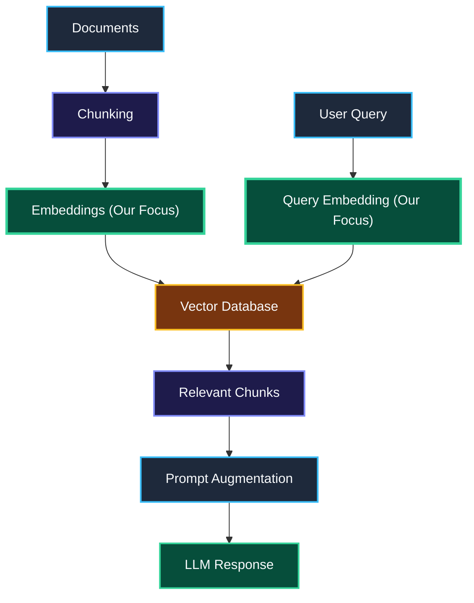
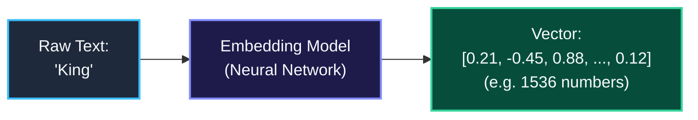
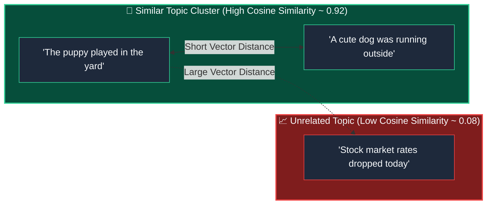
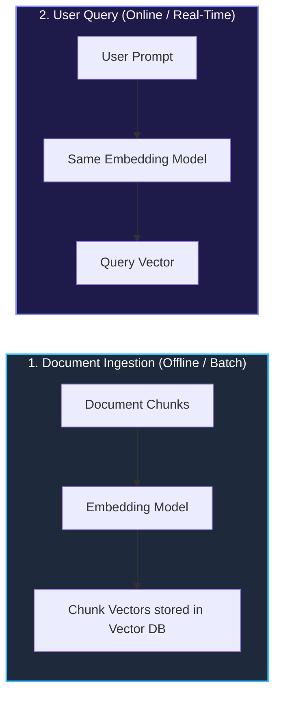

# Text Embeddings in RAG: Giving Meaning to Numbers

After [loading documents](/docs/ai/RAG/Document-loaders/) and [splitting them into chunks](/docs/ai/RAG/Text-Splitters/), our pipeline has hundreds of text passages. But computers and machine learning models cannot understand raw English text directly—they only understand numbers.

This is where **Text Embeddings** come in. Embeddings convert human words and sentences into rich mathematical vectors, allowing us to measure meaning geometrically.

---

## The Big Picture: RAG & Embeddings

Notice how embeddings sit right at the center of both the **indexing** pipeline and the **querying** pipeline:



---

## What is an Embedding?

{: .important }
> **Definition:**  
> A **Text Embedding** is a list of floating-point numbers (a vector) that captures the **semantic meaning** of a piece of text.



### The GPS Coordinates Analogy
Think of an embedding like **GPS coordinates for ideas**:
* On Earth, two points near each other (like Paris and Lyon) have similar latitudes and longitudes.
* In vector space, two sentences with similar meanings (like *"How to reset my password"* and *"I forgot my login credentials"*) have coordinates that sit very close together.
* Two sentences with unrelated meanings (like *"How to reset my password"* and *"The weather is rainy today"*) have coordinates that sit far apart.



---

## Document Embedding vs. Query Embedding

Notice in the RAG diagram that we embed text at two different stages:



* **Document Embedding**: Run once during indexing. Every chunk is converted into a vector and stored in your [Vector Database](/docs/ai/RAG/Vector-Stores/).
* **Query Embedding**: Run dynamically whenever a user asks a question. The user's query is converted into a vector using the **exact same model** so both live in the same coordinate space.

{: .warning }
> **Crucial Rule:** You **must** use the same embedding model for both documents and queries. You cannot index chunks with OpenAI's `text-embedding-3-small` (1,536 dimensions) and search them with a Google or HuggingFace model (768 dimensions)!

---

## Popular Embedding Models

Different models offer tradeoffs between embedding quality, dimension size, speed, and cost:

| Model | Provider | Dimensions | Best For |
| :--- | :--- | :--- | :--- |
| **`text-embedding-3-small`** | OpenAI | 1,536 | Great default; fast, cost-effective, high quality |
| **`text-embedding-3-large`** | OpenAI | 3,072 | Highest accuracy for enterprise search |
| **`text-embedding-004`** | Google | 768 | Fast, high quality on Gemini / Vertex AI |
| **`bge-small-en-v1.5`** | BAAI / HuggingFace | 384 | Excellent open-source model; runs locally on CPU |
| **`all-MiniLM-L6-v2`** | Sentence-Transformers | 384 | Super lightweight for fast local testing |

---

## Hands-on Code: Generating Embeddings in LangChain

In LangChain, all embedding models implement two simple methods:
1. `embed_documents(texts)`: Embeds a list of multiple chunks.
2. `embed_query(text)`: Embeds a single query string.

### 1. Generating Embeddings with OpenAI
```python
from langchain_openai import OpenAIEmbeddings

# Initialize the embedding model
embeddings = OpenAIEmbeddings(model="text-embedding-3-small")

# 1. Embed a single query
query_vector = embeddings.embed_query("What is machine learning?")
print(f"Query vector dimensions: {len(query_vector)}")
print("Sample numbers:", query_vector[:5])

# 2. Embed multiple document chunks
documents = [
    "Machine learning is a subset of artificial intelligence.",
    "Baking sourdough bread requires flour, water, salt, and yeast."
]
doc_vectors = embeddings.embed_documents(documents)
print(f"Generated {len(doc_vectors)} vectors, each with {len(doc_vectors[0])} dimensions.")
```

---

### 2. Measuring Semantic Similarity in Python
Once text is converted into vectors, calculating similarity is pure math using **Cosine Similarity**:

```python
import numpy as np

def cosine_similarity(a, b):
    return np.dot(a, b) / (np.linalg.norm(a) * np.linalg.norm(b))

# Compute similarity between query and both documents
sim_ml = cosine_similarity(query_vector, doc_vectors[0])
sim_bread = cosine_similarity(query_vector, doc_vectors[1])

print(f"Similarity with ML chunk:    {sim_ml:.4f}")
print(f"Similarity with Bread chunk: {sim_bread:.4f}")
```

#### Output:
```text
Similarity with ML chunk:    0.8341
Similarity with Bread chunk: 0.1192
```
As expected, the machine learning query has a very high similarity score ($\approx 0.83$) with the ML passage and a near-zero score with the baking recipe!

---

## Summary & Next Step

* **Embeddings** turn qualitative text into quantitative vectors that capture semantic meaning.
* Chunks that mean similar things end up geometrically close in vector space.
* Both your **documents** and **user query** are embedded using the same model so their distance can be measured.
* Next step in the pipeline: Storing and indexing these vectors in [Vector Stores](/docs/ai/RAG/Vector-Stores/)!
