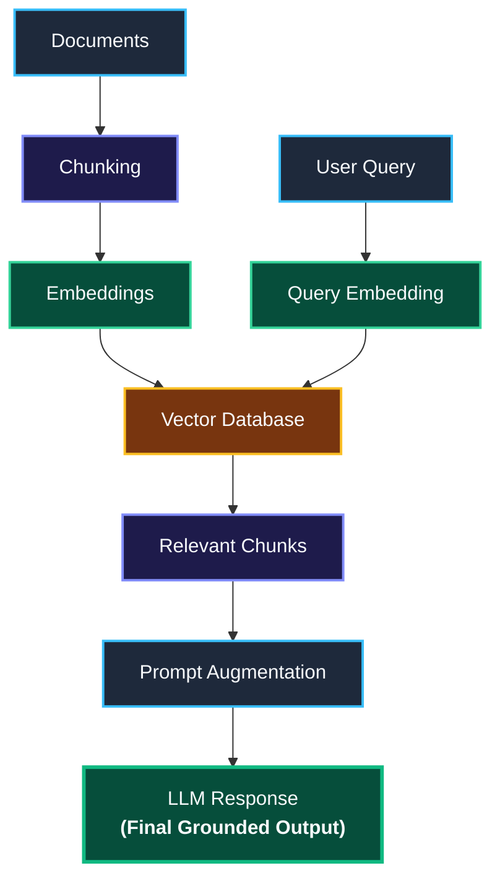
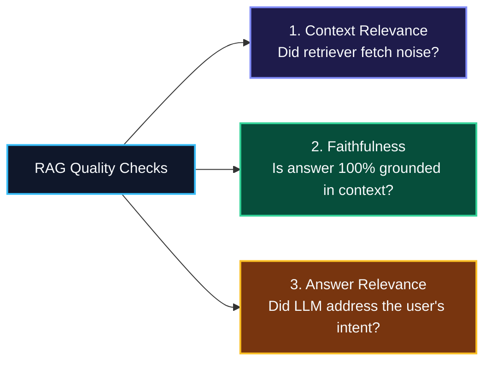

# Building an End-to-End RAG Pipeline

Throughout this series, we explored every foundational component of Retrieval-Augmented Generation:
1. [What, Why & How of RAG](/docs/ai/RAG/what-why-how/)
2. [Document Loaders](/docs/ai/RAG/Document-loaders/)
3. [Text Splitters](/docs/ai/RAG/Text-Splitters/)
4. [Text Embeddings](/docs/ai/RAG/Embeddings/)
5. [Vector Stores](/docs/ai/RAG/Vector-Stores/)
6. [Retrievers](/docs/ai/RAG/Retrievers/)

Now, let's assemble all these pieces into a complete, working RAG application using **LangChain Expression Language (LCEL)**, complete with grounded responses and **source citations**.

---

## The End-to-End Architecture

Here is the complete end-to-end architecture connecting both the offline preparation flow and the online real-time question answering loop:



---

## Prerequisites & Installation

Install the required packages:

```bash
pip install langchain-core langchain-community langchain-chroma langchain-openai
```

Ensure your API key is set in your environment:
```bash
export OPENAI_API_KEY="your-api-key-here"
```

---

## Step-by-Step Implementation

### Step 1: Create Sample Knowledge Documents
Imagine you are building an AI assistant for an internal company policy manual:

```python
from langchain_core.documents import Document

documents = [
    Document(
        page_content="Employees receive 20 days of paid vacation per year. Unused days roll over up to a maximum of 5 days.",
        metadata={"source": "hr_policy.pdf", "page": 4}
    ),
    Document(
        page_content="Health insurance benefits begin on the first day of the calendar month following 30 days of employment.",
        metadata={"source": "benefits_guide.pdf", "page": 12}
    ),
    Document(
        page_content="Remote work is permitted up to 2 days per week with manager approval. Core working hours are 10 AM to 4 PM.",
        metadata={"source": "remote_work_policy.pdf", "page": 2}
    ),
    Document(
        page_content="Travel expenses for business trips must be submitted via Concur within 14 calendar days of trip completion.",
        metadata={"source": "finance_expenses.pdf", "page": 8}
    )
]
```

---

### Step 2: Index into ChromaDB
We embed and index our document chunks into a Chroma vector store:

```python
from langchain_chroma import Chroma
from langchain_openai import OpenAIEmbeddings

# Initialize embedding model
embeddings = OpenAIEmbeddings(model="text-embedding-3-small")

# Create persistent Chroma store
vector_store = Chroma.from_documents(
    documents=documents,
    embedding=embeddings,
    collection_name="company_handbook"
)

# Convert to a retriever that fetches top 2 most relevant chunks
retriever = vector_store.as_retriever(search_kwargs={"k": 2})
```

---

### Step 3: Build the Prompt Template
In RAG, prompt engineering is vital: we instruct the LLM to base its answers strictly on the retrieved context and acknowledge if it doesn't know the answer:

```python
from langchain_core.prompts import ChatPromptTemplate

prompt = ChatPromptTemplate.from_template("""
You are a helpful HR assistant. Answer the user's question using ONLY the context provided below.
If the answer cannot be found in the context, say "I am sorry, but that information is not available in the company policy."
Do not attempt to make up answers.

Context:
{context}

Question:
{question}

Answer:
""")
```

---

### Step 4: Build the LCEL Chain with Source Citations

We want our RAG pipeline to output both the answer and the exact source documents so users can verify the information:

```python
from langchain_openai import ChatOpenAI
from langchain_core.runnables import RunnableParallel, RunnablePassthrough
from langchain_core.output_parsers import StrOutputParser

# Initialize the chat LLM
llm = ChatOpenAI(model="gpt-4o-mini", temperature=0)

# Helper function to format retrieved documents for prompt injection
def format_docs(docs):
    return "\n\n".join(doc.page_content for doc in docs)

# Create the RAG chain using LangChain Expression Language (LCEL)
rag_chain_from_docs = (
    RunnablePassthrough.assign(context=(lambda x: format_docs(x["context"])))
    | prompt
    | llm
    | StrOutputParser()
)

# Parallel step: fetch context documents and pass the question through
rag_chain_with_source = RunnableParallel(
    {"context": retriever, "question": RunnablePassthrough()}
).assign(answer=rag_chain_from_docs)
```

---

### Step 5: Test the Pipeline

Now, run a query against your knowledge base:

```python
query = "How many remote work days do I get, and when are core hours?"
response = rag_chain_with_source.invoke(query)

print("=" * 60)
print("QUESTION:", query)
print("=" * 60)
print("\nANSWER:")
print(response["answer"])

print("\nSOURCES USED:")
for idx, doc in enumerate(response["context"], 1):
    print(f"[{idx}] {doc.metadata['source']} (Page {doc.metadata.get('page', 'N/A')})")
    print(f"    Excerpt: \"{doc.page_content}\"")
```

#### Example Output:
```text
============================================================
QUESTION: How many remote work days do I get, and when are core hours?
============================================================

ANSWER:
You are permitted to work remotely up to 2 days per week with manager approval. The core working hours are from 10 AM to 4 PM.

SOURCES USED:
[1] remote_work_policy.pdf (Page 2)
    Excerpt: "Remote work is permitted up to 2 days per week with manager approval. Core working hours are 10 AM to 4 PM."
[2] hr_policy.pdf (Page 4)
    Excerpt: "Employees receive 20 days of paid vacation per year. Unused days roll over up to a maximum of 5 days."
```

#### What happens if the data is not in the knowledge base?
```python
query = "Can I bring my pet iguana to the office?"
response = rag_chain_with_source.invoke(query)
print(response["answer"])
# Output: "I am sorry, but that information is not available in the company policy."
```
Because of our prompt guardrail, the model refuses to hallucinate!

---

## Production Best Practices for RAG



1. **Evaluate with the RAG Triad**:
   - **Context Relevance**: Are the retrieved passages actually relevant to the question?
   - **Faithfulness / Groundedness**: Can every claim in the answer be traced back to the retrieved context?
   - **Answer Relevance**: Did the answer directly address the user's inquiry?
   - Use automated evaluation frameworks like **Ragas** to track these metrics over time.

2. **Metadata Filtering**:
   - Store access control lists (ACLs), department names, and document versions in chunk metadata so users can only retrieve documents they are authorized to see.

3. **Monitor Query Latency**:
   - Indexing and embedding search take time. Use in-memory or connection-pooled vector databases (like Qdrant or Pinecone) and keep chunk sizes balanced (typically 500–1000 characters).

---

## Summary of the RAG Series

Congratulations! You have completed the full RAG fundamentals learning path:

1. **Foundations**: Why parametric memory fails and how context injection resolves hallucinations.
2. **Ingestion**: Loading disparate sources with [**Document Loaders**](/docs/ai/RAG/Document-loaders/).
3. **Chunking**: Preserving semantic meaning with [**Text Splitters**](/docs/ai/RAG/Text-Splitters/).
4. **Embeddings**: Converting meaning into vectors with [**Text Embeddings**](/docs/ai/RAG/Embeddings/).
5. **Storage**: Indexing high-dimensional vectors with [**Vector Stores**](/docs/ai/RAG/Vector-Stores/) (HNSW, ChromaDB).
6. **Retrieval**: Smart search with [**Retrievers**](/docs/ai/RAG/Retrievers/) (MMR, Reranking, Hybrid Search).
7. **Synthesis**: Binding everything into a robust **End-to-End Pipeline** using LCEL.

You now possess the foundational knowledge and code patterns to build real-world, production-ready AI applications powered by your own data!
