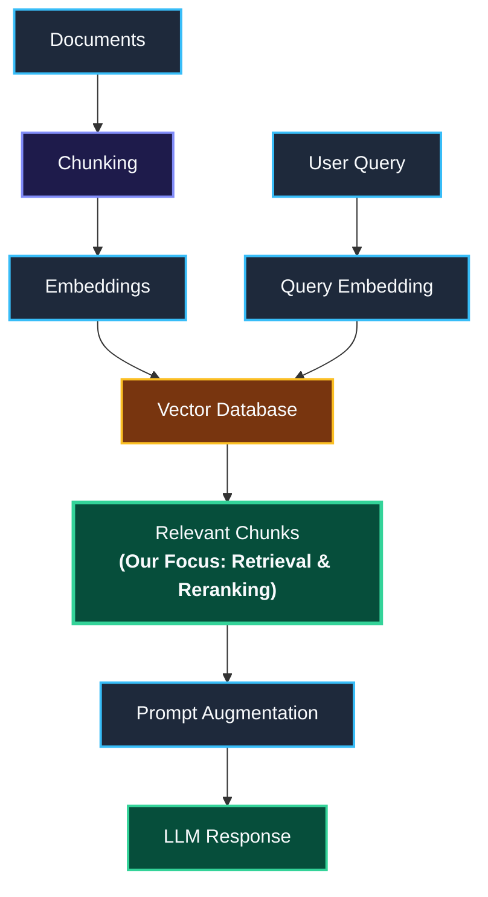
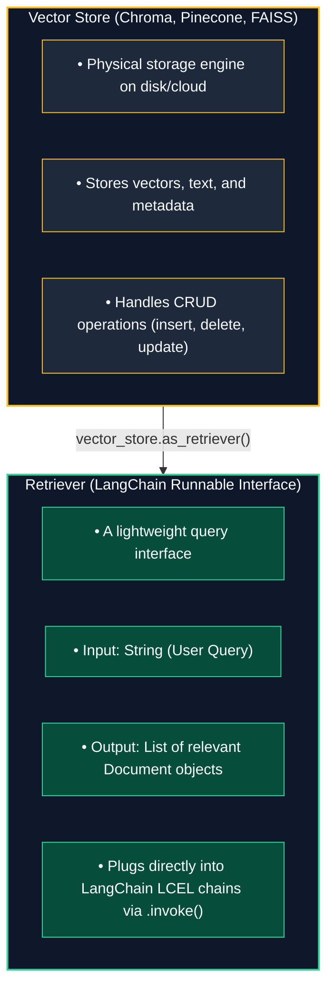
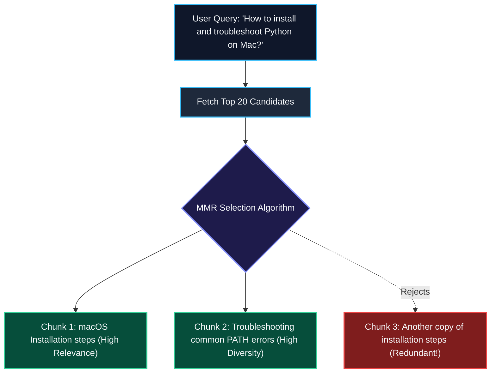
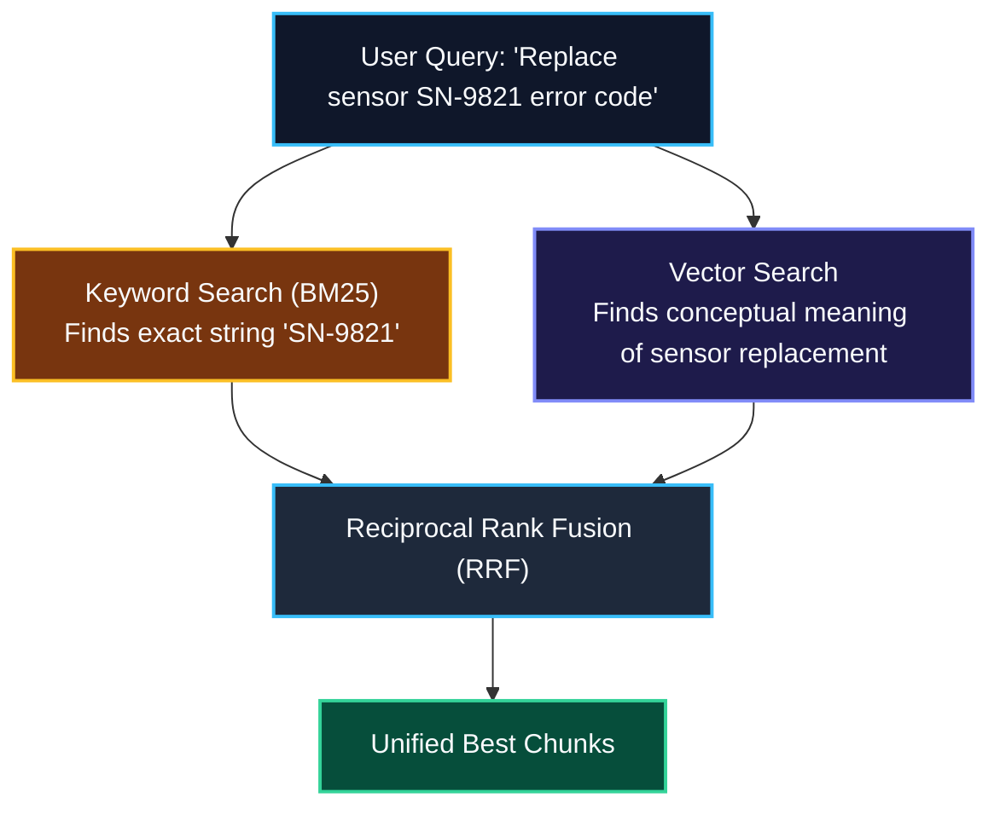
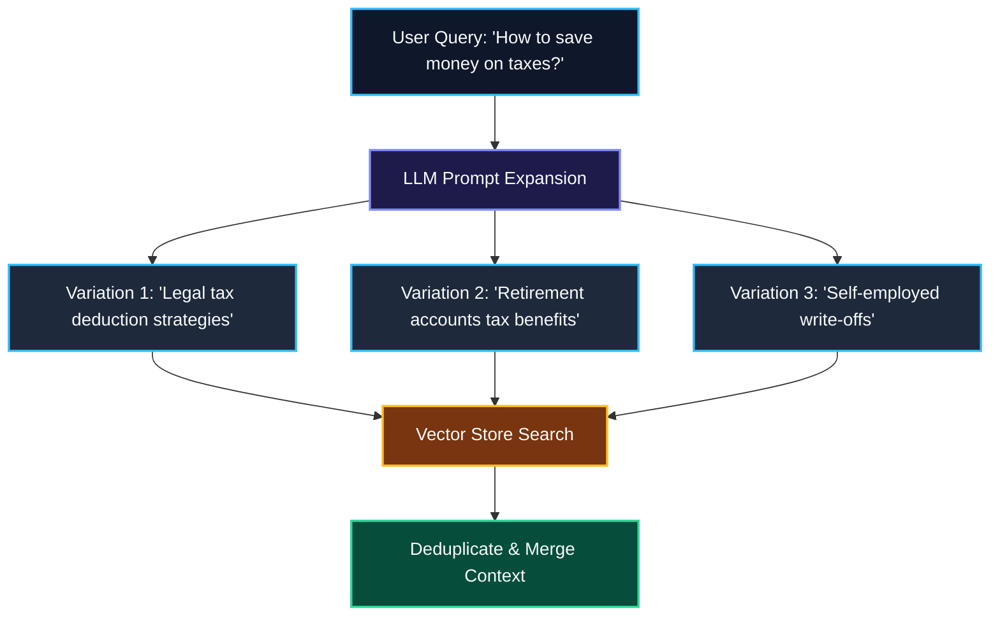

# Retrievers in RAG: Fetching the Right Context

In previous guides, we learned how to [load documents](/docs/ai/RAG/Document-loaders/), [split them into chunks](/docs/ai/RAG/Text-Splitters/), [generate embeddings](/docs/ai/RAG/Embeddings/), and [store vectors in a vector database](/docs/ai/RAG/Vector-Stores/).

Now comes the critical bridge between storage and answer generation: **Retrievers**.

A **Retriever** is responsible for taking a user's question, searching through thousands (or millions) of stored chunks, and returning the most accurate, relevant snippets to inject into the LLM's prompt.

---

## The Big Picture: Where Retrievers Fit

Notice how Retrievers sit at the extraction boundary—pulling relevant chunks out of the vector database to feed prompt augmentation:



---

## Vector Store vs. Retriever: What's the Difference?

A common point of confusion for beginners is distinguishing between a **Vector Store** and a **Retriever**:



{: .tip}
> **Simple Rule:** A **Vector Store** holds the data and provides basic mathematical distance calculations. A **Retriever** is an abstraction layer that knows *how to search*, filter, and re-order chunks smartly before passing them to the model.

---

## Core Retrieval Strategies

### 1. Standard Similarity Search
The default approach: convert the user query into a vector and return the top-$K$ chunks with the smallest distance.

* **Pros:** Fast and simple.
* **The Problem:** It often returns redundant, nearly duplicate passages (e.g., three chunks that say almost the exact same thing from different pages).

---

### 2. Maximal Marginal Relevance (MMR)
When answering complex questions, you want context that is both **relevant** to the prompt and **diverse** in content.

**Maximal Marginal Relevance (MMR)** balances two forces:
1. Finding chunks highly similar to the query.
2. Penalizing chunks that look too similar to already selected chunks.



{: .note}
> **When to use MMR:** Whenever your documents contain repeated boilerplate text or when questions require multi-faceted answers.

---

### 3. Similarity Score Threshold
Instead of returning a fixed number of chunks (e.g., always returning 4 chunks, even if 3 of them are irrelevant), this strategy only keeps chunks whose similarity score meets a minimum confidence bar.

```python
retriever = vector_store.as_retriever(
    search_type="similarity_score_threshold",
    search_kwargs={"score_threshold": 0.75, "k": 5}
)
```

---

## Advanced Retrieval Techniques

In real-world production systems, basic semantic search alone can sometimes fail. Here are three powerful techniques to improve search quality:

### A. Contextual Compression & Reranking
Embedding models are "bi-encoders"—they compress an entire chunk into a single vector, which can occasionally miss fine nuances.

A **Reranker** (using a Cross-Encoder) evaluates the query and document together at the token level, calculating an extremely precise relevance score:


* **Best of both worlds:** Vector search quickly narrows down 1,000,000 chunks to 25; the reranker then precisely picks the top 3.

---

### B. Hybrid Search: Keywords (BM25) + Semantic Vectors
Semantic search is great at understanding concepts, but poor at exact keyword matching (like part numbers, error codes `ERR-4048`, product SKUs, or specialized drug names).

**Hybrid Search** runs two parallel searches:
1. **BM25 Search**: Matches exact keywords and codes.
2. **Dense Vector Search**: Matches meaning and synonyms.

Both lists of results are merged using **Reciprocal Rank Fusion (RRF)**:



---

### C. Multi-Query Retrieval
Users rarely write optimal search queries on their first try. A **Multi-Query Retriever** uses an LLM to generate 3 to 4 variations of the user's question, searches for all variations, and pools the unique results:



---

## Hands-on Code: Using Retrievers in LangChain

Let's see how simple it is to turn a Chroma vector store into different types of retrievers:

```python
from langchain_chroma import Chroma
from langchain_openai import OpenAIEmbeddings
from langchain_core.documents import Document

# 1. Sample documents
docs = [
    Document(page_content="The Python return keyword exits a function and optionally passes back a value."),
    Document(page_content="Functions in Python can return multiple values as a tuple."),
    Document(page_content="To define a function in Python, use the def keyword followed by function name."),
    Document(page_content="List comprehensions provide a concise way to create lists in Python.")
]

# 2. Build Chroma vector store
embeddings = OpenAIEmbeddings(model="text-embedding-3-small")
vector_store = Chroma.from_documents(docs, embeddings)

# ----------------------------------------------------
# Strategy 1: Standard Top-K Similarity Retriever
# ----------------------------------------------------
print("--- 1. Standard Similarity Retriever ---")
basic_retriever = vector_store.as_retriever(
    search_type="similarity",
    search_kwargs={"k": 2}
)

results = basic_retriever.invoke("How do functions return data?")
for doc in results:
    print("->", doc.page_content)

# ----------------------------------------------------
# Strategy 2: Maximal Marginal Relevance (MMR)
# ----------------------------------------------------
print("\n--- 2. MMR Retriever (Diverse Results) ---")
mmr_retriever = vector_store.as_retriever(
    search_type="mmr",
    search_kwargs={"k": 2, "fetch_k": 4, "lambda_mult": 0.5}
)

mmr_results = mmr_retriever.invoke("How do functions return data?")
for doc in mmr_results:
    print("->", doc.page_content)
```

{: .tip}
> **Notice `.invoke()`:** Every LangChain retriever implements the Runnable interface. You simply pass a string query to `.invoke(query)`, and it returns a `List[Document]`.

---

## Summary & Next Step

| Retriever Strategy | When to Choose |
| :--- | :--- |
| **Similarity Search** | Fast, standard queries with non-redundant source documents |
| **MMR (Maximal Marginal Relevance)** | Complex queries where you want diverse perspectives without duplicate text |
| **Reranking / Cross-Encoder** | Mission-critical enterprise search where precision must be maximized |
| **Hybrid Search (BM25 + Dense)** | When documents contain exact IDs, SKUs, error codes, and technical jargon |

Now that we know how to fetch high-quality context, let's connect all the pieces together into a complete [End-to-End RAG Pipeline](/docs/ai/RAG/End-to-End-RAG/)!
