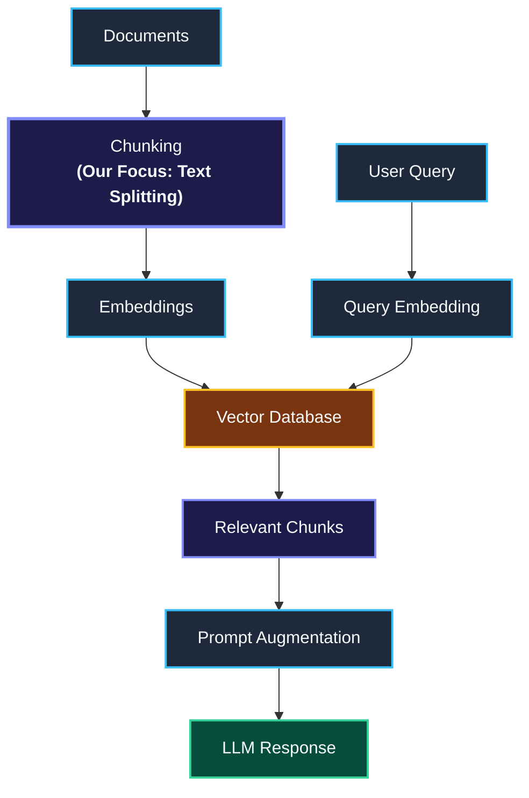
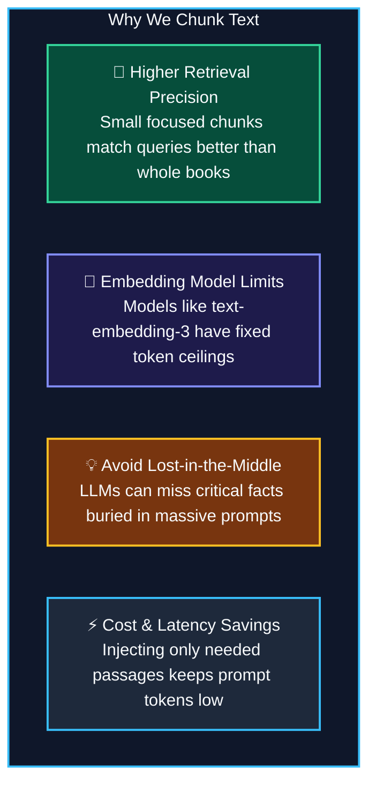
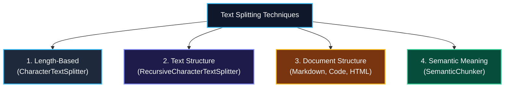
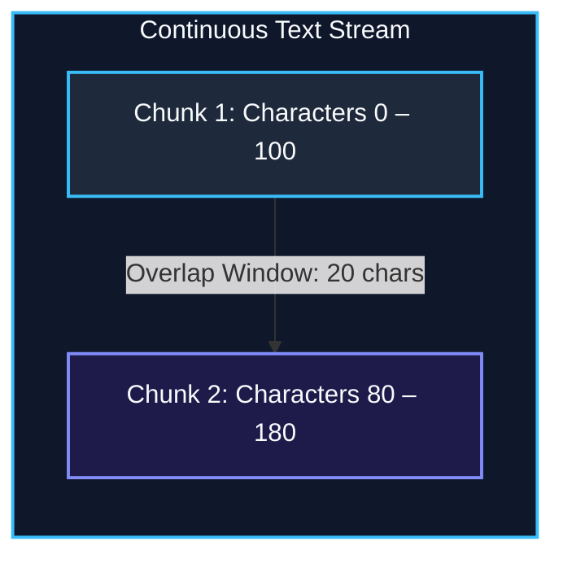
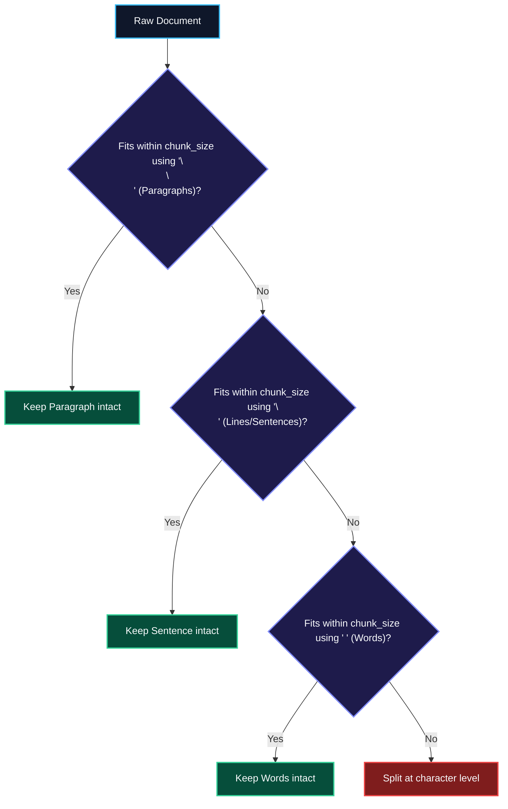
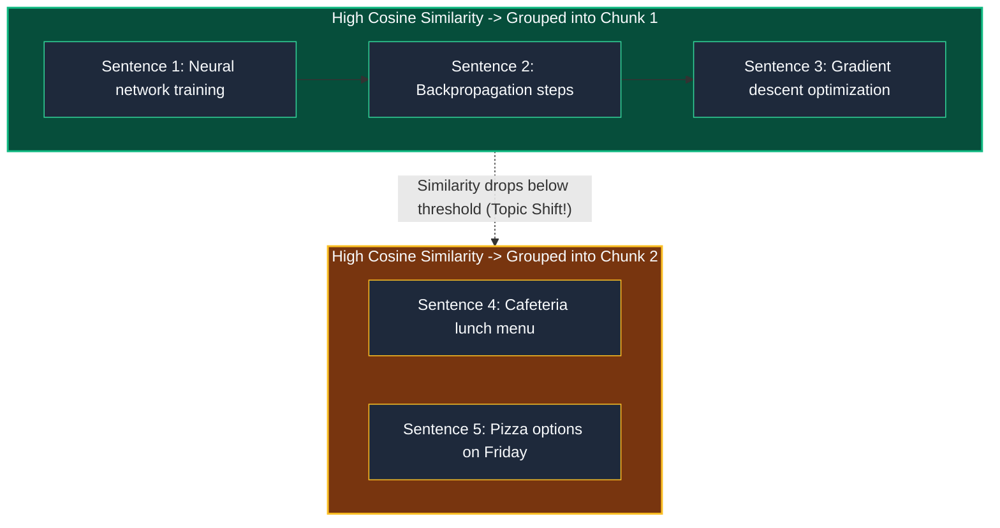

# Text Splitters in RAG: Chunking Data for LLMs

After loading raw documents into your pipeline, the next crucial step is breaking them down into smaller, semantically coherent segments. In RAG architectures, this process is known as **chunking**, and it is executed by **Text Splitters**.

In this guide, we will explore why chunking is essential, how chunk size and overlap work, and the primary splitting strategies available in LangChain.

---

## The Big Picture: RAG & Chunking



1. [**Document Loaders**](/docs/ai/RAG/Document-loaders/): Load data into `Document` objects.
2. **Text Splitters**: Divide large documents into digestible, focused chunks.
3. [**Text Embeddings**](/docs/ai/RAG/Embeddings/) & [**Vector Databases**](/docs/ai/RAG/Vector-Stores/): Convert chunks to vectors and store them.
4. [**Retrievers**](/docs/ai/RAG/Retrievers/): Fetch the most relevant chunks for user queries.

---

## What is a Text Splitter?

{: .important }
> **Definition:**  
> A **Text Splitter** breaks down large documents (such as books, manuals, or research papers) into smaller pieces called **chunks** while attempting to keep related semantic thoughts intact.

### Why is Chunking Essential?



1. **Precision in Semantic Search**: If an entire 50-page document is converted into a single embedding vector, its specific details are diluted. Searching over 300-word focused chunks returns exactly the paragraph answering the user's question.
2. **Embedding Model Constraints**: Most embedding models accept inputs between 512 and 8,192 tokens. Attempting to embed a 20,000-word PDF in one shot will trigger an error or silently truncate text.
3. **Preventing Attention Degradation**: LLMs suffer from the "lost-in-the-middle" effect—they pay high attention to the beginning and end of long prompts, but overlook details buried in between.

---

## Core Splitting Strategies

LangChain groups splitters into four main techniques:



---

### 1. Length-Based Splitting (`CharacterTextSplitter`)

Length-based splitting is the simplest approach: it divides text based on character count and a single fixed separator (like spaces `" "` or newlines `"\n"`).

```python
from langchain_text_splitters import CharacterTextSplitter

text = (
    "Generative AI is transforming modern software engineering. "
    "Retrieval-Augmented Generation connects LLMs to your private data. "
    "Chunking text properly ensures that vector search yields highly relevant context."
)

splitter = CharacterTextSplitter(
    separator=" ",
    chunk_size=75,
    chunk_overlap=15
)

chunks = splitter.split_text(text)
for idx, chunk in enumerate(chunks, 1):
    print(f"Chunk {idx} ({len(chunk)} chars): {chunk}")
```

#### Understanding Chunk Overlap

When text is split strictly at a length boundary, a sentence or thought can be sliced down the middle. **Chunk overlap** duplicates a small window of characters between consecutive chunks so context isn't lost.



{: .tip}
> **Rule of Thumb:** Setting `chunk_overlap` between **10% and 20%** of your `chunk_size` (e.g., `chunk_size=1000`, `chunk_overlap=150`) is a reliable starting point for most English text.

---

### 2. Text-Structure-Based Splitting (`RecursiveCharacterTextSplitter`)

Written prose has a natural hierarchical structure:
1. **Paragraphs** (`\n\n`)
2. **Sentences** (`\n` or `.` / `?` / `!`)
3. **Words** (`" "`)
4. **Individual Characters** (`""`)

The **`RecursiveCharacterTextSplitter`** is the recommended default splitter for general text. It attempts to split by paragraph first. If a piece is still too large, it steps down to sentences, then words, keeping natural blocks together as much as possible.



#### Implementation in LangChain
```python
from langchain_text_splitters import RecursiveCharacterTextSplitter

sample_text = """
Retrieval-Augmented Generation (RAG) is an architectural approach that can improve the efficacy of Large Language Model (LLM) applications by leveraging custom data.

This is done by retrieving relevant data/documents relevant to a question or task and providing them as context for the LLM. RAG has shown success in support chatbots and Q&A systems.
"""

splitter = RecursiveCharacterTextSplitter(
    chunk_size=150,
    chunk_overlap=25,
    separators=["\n\n", "\n", " ", ""]
)

chunks = splitter.split_text(sample_text)
for i, chunk in enumerate(chunks, 1):
    print(f"Chunk {i} ({len(chunk)} chars):\n{repr(chunk)}\n")
```

#### Splitting Loaded `Document` Objects
Instead of splitting raw strings, you usually split `Document` objects output by document loaders. Using `.split_documents()` automatically **preserves all metadata**:

```python
from langchain_community.document_loaders import PyPDFLoader
from langchain_text_splitters import RecursiveCharacterTextSplitter

loader = PyPDFLoader("sample.pdf")
pages = loader.load()

splitter = RecursiveCharacterTextSplitter(chunk_size=1000, chunk_overlap=100)
chunked_docs = splitter.split_documents(pages)

print(f"Original pages: {len(pages)} | Resulting chunks: {len(chunked_docs)}")
print("Chunk 1 metadata:", chunked_docs[0].metadata)
# Every chunk retains {'source': 'sample.pdf', 'page': 0}
```

---

### 3. Document-Structure-Based Splitting

Structured documents (like Markdown, HTML, and source code) contain syntax rules that standard sentence splitters might break.

#### A. Markdown: Preserving Headings (`MarkdownHeaderTextSplitter`)
When splitting documentation, knowing which `# Header` or `## Subheader` a paragraph belongs to is crucial for the LLM's understanding.

`MarkdownHeaderTextSplitter` splits along heading boundaries and **injects the heading names directly into document metadata**:

```python
from langchain_text_splitters import MarkdownHeaderTextSplitter

markdown_document = """
# RAG Architecture
RAG connects external databases to generative models.

## Document Ingestion
Ingestion loads raw files into standard formats.

### Supported Loaders
PDFs, text files, and web pages are all supported.
"""

headers_to_split_on = [
    ("#", "Header 1"),
    ("##", "Header 2"),
    ("###", "Header 3"),
]

markdown_splitter = MarkdownHeaderTextSplitter(headers_to_split_on=headers_to_split_on)
chunks = markdown_splitter.split_text(markdown_document)

for chunk in chunks:
    print(f"Metadata: {chunk.metadata}")
    print(f"Content: {chunk.page_content}\n")
```

#### B. Source Code Splitting (`from_language`)
Splitting source code requires respecting function and class definitions rather than sentences:

```python
from langchain_text_splitters import RecursiveCharacterTextSplitter, Language

python_code = """
class DataManager:
    def __init__(self, db_url: str):
        self.db_url = db_url

    def connect(self):
        print(f"Connecting to {self.db_url}")
        return True

def calculate_metrics(values):
    return sum(values) / len(values)
"""

python_splitter = RecursiveCharacterTextSplitter.from_language(
    language=Language.PYTHON,
    chunk_size=120,
    chunk_overlap=0
)

code_chunks = python_splitter.split_text(python_code)
for i, chunk in enumerate(code_chunks, 1):
    print(f"--- Chunk {i} ---")
    print(chunk)
```

---

### 4. Token-Based Splitting (`TokenTextSplitter`)

LLMs and embedding models measure input lengths in **tokens**, not characters. In English, 1,000 characters is roughly 250 tokens, but in code or other languages, the ratio can vary drastically.

If your embedding model has a hard limit of 512 tokens, using `TokenTextSplitter` guarantees your chunks stay within token boundaries:

```python
from langchain_text_splitters import TokenTextSplitter

# Uses the OpenAI tiktoken tokenizer behind the scenes
token_splitter = TokenTextSplitter(
    chunk_size=200,   # measured in tokens
    chunk_overlap=25  # measured in tokens
)

token_chunks = token_splitter.split_text("Long text...")
```

---

### 5. Semantic-Meaning-Based Splitting (`SemanticChunker`)

Length-based and structural splitters don't understand the underlying subject matter. If a single paragraph shifts from discussing *financial quarterly earnings* to *office catering options*, a structural splitter will lump them together.

**Semantic Chunking** uses an embedding model to evaluate the similarity between consecutive sentences. When cosine similarity drops significantly between sentence $N$ and $N+1$, the splitter detects a topic shift and creates a chunk boundary.



```python
# Note: Requires langchain-experimental
from langchain_experimental.text_splitter import SemanticChunker
from langchain_openai import OpenAIEmbeddings

# Embeddings model evaluates sentence transitions
embeddings = OpenAIEmbeddings(model="text-embedding-3-small")

semantic_splitter = SemanticChunker(
    embeddings,
    breakpoint_threshold_type="standard_deviation",
    breakpoint_threshold_amount=1.5
)

docs = semantic_splitter.create_documents([sample_text])
```

{: .note}
> **Performance Note:** Semantic chunking requires generating embeddings for every sentence during the ingestion stage, which is slower and incurs higher API usage than character or token splitting. It is best used for high-value knowledge bases where topics vary unpredictably within sections.

---

## Interactive Visualizer

To experiment with different chunk sizes, overlaps, and see visual breakdowns in real-time, check out [ChunkViz](https://chunkviz.up.railway.app/), a browser-based chunk visualization tool created by Greg Kamradt.

---

## Summary & Next Step

| Splitter Type | Best For | Main Advantage |
| :--- | :--- | :--- |
| **`RecursiveCharacterTextSplitter`** | General prose, articles, books | Keeps paragraphs and sentences intact |
| **`MarkdownHeaderTextSplitter`** | Technical docs, wikis, Markdown files | Attaches header hierarchy into metadata |
| **`TokenTextSplitter`** | Strict embedding model boundaries | Prevents token limit overflow errors |
| **`SemanticChunker`** | Multi-topic unstructured documents | Cuts chunks along natural topic transitions |

Now that your documents are split into clean chunks, the next step is converting them into vectors in [Text Embeddings](/docs/ai/RAG/Embeddings/) and storing them in [Vector Stores](/docs/ai/RAG/Vector-Stores/)!
