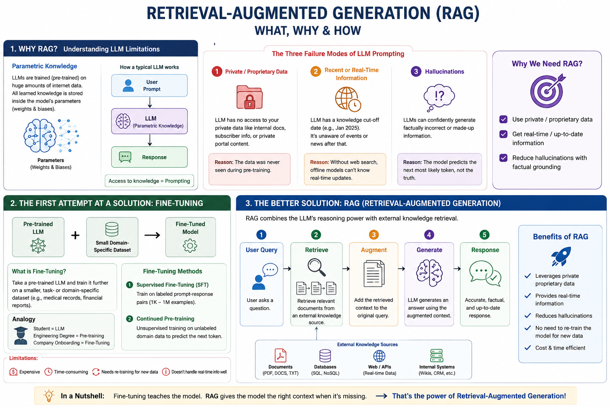
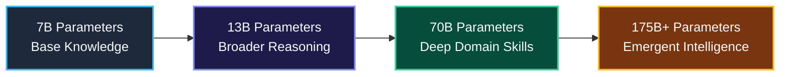
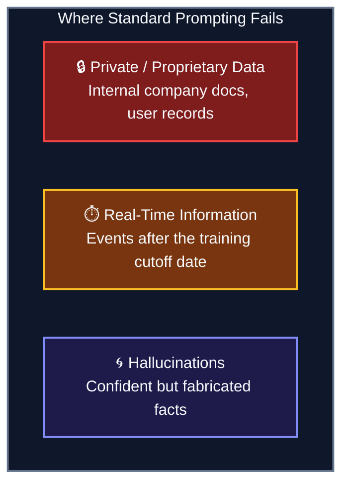
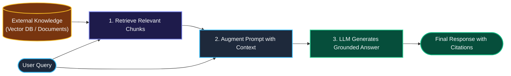
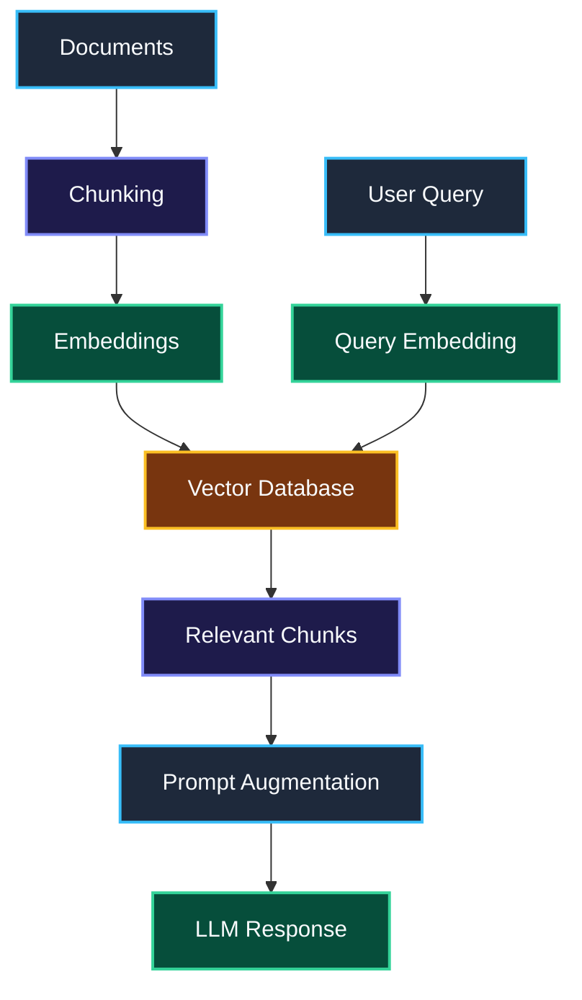

<p align="center">
  
</p>


# Retrieval-Augmented Generation (RAG): What, Why & How

In this guide, we will dive deep into one of the most important and widely used paradigms in Generative AI today: **Retrieval-Augmented Generation (RAG)**. 

Since the wave of Generative AI started, developers have built a multitude of applications. However, the most common, practical, and useful pattern among them is RAG.

---

## The Roadmap: Why, What, and How
To master RAG, we will follow a structured approach covering three core questions:
* **Why** do we need RAG? (Understanding the limitations of Large Language Models)
* **What** is RAG? (Defining the architecture and its core concept)
* **How** does RAG work? (Breaking down the technical steps and flow)

---

## Why RAG? Understanding LLM Limitations

To understand why we need RAG, let's first look at how Large Language Models (LLMs) learn and answer questions.

### Parametric Knowledge vs. External Knowledge
When an LLM (like GPT-4, Llama 3, or Gemini) is trained, it reads massive amounts of publicly available text from the internet. All the patterns and facts it learns are stored inside its **parameters** (weights and biases). This is called **Parametric Knowledge**.


Generally, the more parameters a model has, the larger its internal knowledge bank:



When you ask an LLM a question, it relies on this internal parametric memory to generate an answer token by token. For everyday knowledge (like *"What is photosynthesis?"*), this works well.

However, relying solely on parametric knowledge fails in three major scenarios:

### The Three Failure Modes of LLM Prompting



#### 1. Private / Proprietary Data
If you ask an LLM about your company's internal wiki, private codebase, customer invoices, or employee handbook, it cannot answer accurately.
* **Why**: The model was never trained on your private data.

#### 2. Recent or Real-Time Information
Every LLM has a fixed **knowledge cutoff date** (e.g., January 2025). It has no memory of events, product releases, or news that happened after training finished.
* **Why**: The weights are static and frozen unless retrained or augmented with live search.

#### 3. Hallucinations
LLMs are probabilistic prediction engines, not databases. They predict the next most likely word based on patterns. If a model doesn't know a fact, it may generate an answer that sounds completely convincing but is entirely fabricated.
* **Why**: Instead of saying "I don't know," models fill in gaps with plausible-sounding fiction.

---

## The First Attempt at a Solution: Fine-Tuning

When teams first encountered these problems, their instinctive solution was **Fine-Tuning**.


### What is Fine-Tuning?
Fine-tuning means continuing the training process on a smaller, domain-specific dataset (such as medical reports, customer support logs, or legal contracts).

{: .note }
> **The Engineering Student Analogy:**  
> Think of a pre-trained LLM as an engineering graduate who has finished university. They possess broad general knowledge (math, physics, basic programming). When they join a company, they spend 2–3 months in company onboarding to learn internal tools and domain language.
>
> * **Student** = Base LLM
> * **University Degree** = Pre-training
> * **Company Onboarding** = Fine-Tuning

### Fine-Tuning Methods
1. **Supervised Fine-Tuning (SFT)**: Training the model on curated prompt-response pairs to teach specific styles, tasks, or behaviors.
2. **Continued Pre-training**: Feeding large volumes of raw, unlabeled domain text (e.g., medical textbooks) to adapt vocabulary and domain patterns.
3. **RLHF (Reinforcement Learning from Human Feedback)**: Aligning outputs with human preferences and safety guidelines.
4. **PEFT (Parameter-Efficient Fine-Tuning)**: Methods like **LoRA** and **QLoRA** that freeze base weights and only train small adapter layers, cutting compute requirements.

### Why Fine-Tuning Doesn't Solve the Whole Problem
While fine-tuning is great for teaching a model **how to talk** (tone, format, specialized reasoning), it is painful for teaching a model **dynamic facts**:

* **High Cost & Complexity**: Training even small models requires specialized GPU clusters and machine learning engineering expertise.
* **The Dynamic Data Problem**: If your company publishes new documentation or product updates daily, you cannot afford to retrain your model every day.
* **Difficult Deletions**: If a policy document is deleted or modified, un-learning that specific piece of data from billions of neural network weights is difficult.

---

## The Breakthrough: In-Context Learning (ICL)

As models grew in scale, researchers uncovered an emergent property: **In-Context Learning (ICL)**.

### What is In-Context Learning?
In-Context Learning means the model can perform a new task or answer a question accurately simply by reading facts and examples **provided inside the prompt**, without updating any weights.

```text
Classify the sentiment of the following texts.

Text: "I love this phone! It's so smooth."
Sentiment: Positive

Text: "This app crashes a lot."
Sentiment: Negative

Text: "I hate the battery life."
Sentiment:
```
The model completes `Negative` simply by observing the prompt context.

{: .important }
> **Emergent Properties in LLMs**  
> An emergent capability is one that appears naturally when a system scales up in size. In-Context Learning emerged strongly in models with tens of billions of parameters, formalized in the landmark paper: *"Language Models are Few-Shot Learners"*.

### The Core Idea of RAG: Context Injection
If an LLM can reason over whatever context is inside its prompt, the solution is straightforward:
1. Don't try to cram all private data into the model's weights.
2. Keep the data in an external database.
3. When the user asks a question, search the database for the exact relevant paragraphs.
4. Inject those paragraphs directly into the prompt and instruct the LLM: *"Answer the user's question using only these passages."*

This is the foundation of **Retrieval-Augmented Generation (RAG)**.

---

## What is RAG?

**Retrieval-Augmented Generation (RAG)** is an architecture that augments an LLM with external knowledge: at query time, it retrieves relevant passages from your knowledge base and passes them as context into the prompt alongside the user's question.



### Sample RAG Prompt
```text
You are a helpful assistant. Answer the question using ONLY the provided context below.
If the context does not contain the answer, reply with "I do not know." Do not make up answers.

Context:
---------------------
[Retrieved Document Segment: Section 3.2 on Authentication Tokens]
---------------------

Question: How long does an auth token remain valid?
Answer:
```
Because the model has the exact source text directly in front of it, hallucinations are minimized and answers become verifiable.

---

## How RAG Works: Step-by-Step

Technically, RAG is a marriage of two fields:
1. **Information Retrieval (IR)**: A classic computer science field focused on finding relevant documents.
2. **Text Generation**: The modern capability of LLMs to generate coherent text.

Here is the complete end-to-end architecture connecting both the **offline ingestion** pipeline and the **online query** pipeline:



### Phase 1: Indexing (Building the Knowledge Base)
Indexing is the process of preparing your knowledge base so that it can be efficiently searched at query time.
(Indexing is an offline preparation phase where your documents are converted into a searchable index.)

1. **Document Ingestion**: Loading documents (PDFs, Markdown files, YouTube transcripts, Google Drive files, Github repos, scraped webpages, Internal wiki etc) using [**Document Loaders**](/docs/ai/RAG/Document-loaders/).

    {: .tip}
    > **Tools:** `PyPDFLoader`, `YoutubeLoader`, `WebBaseLoader`, `DirectoryLoader`, `CSVLoader` etc.

2. **Text Chunking**: Splitting large documents into smaller, semantically coherent segments using [**Text Splitters**](/docs/ai/RAG/Text-Splitters/). Chunking is required because:
   * **Semantic Precision**: A small chunk focused on a single topic generates a much more distinct and accurate embedding than a 50-page document.
   * **Embedding Constraints**: Most embedding models have maximum token limits (e.g., 512 to 8,192 tokens).
   * **Attention & Cost**: Supplying only the exact relevant excerpts avoids prompt clutter, prevents "lost-in-the-middle" attention degradation, and reduces LLM latency and costs.

    {: .tip}
    > **Tools:** `RecursiveCharacterTextSplitter`, `MarkdownHeaderTextSplitter`, `TokenTextSplitter`, `SemanticChunker` etc.

3. **Embedding Generation**: Converting each chunk into a dense vector (Embedding) that captures its semantic meaning using [**Text Embeddings**](/docs/ai/RAG/Embeddings/).

   **Why Embeddings?**
   * They allow fast mathematical similarity search.
   * Chunks with similar concepts land close to each other in vector space.
   * Chunks with completely different meanings land far apart.

    {: .tip}
    > **Tools:** `OpenAIEmbeddings`, `GoogleGenerativeAIEmbeddings`, `HuggingFaceEmbeddings`, `text-embedding-3-small` etc.

4. **Vector Storage**: Storing the embedding vectors alongside their corresponding raw text and metadata (such as source URLs, page numbers, or timestamps) in a [**Vector Store**](/docs/ai/RAG/Vector-Stores/).
   
    {: .tip }
    > **Tools:** Local/Embedded (`Chroma`, `FAISS`), Cloud/Managed (`Pinecone`, `Qdrant`, `Weaviate`, `Milvus`, `pgvector`).

### Phase 2: Retrieval (Finding Relevant Context)
When a user submits a query, RAG searches and retrieves relevant information from the vector store in real-time using [**Retrievers**](/docs/ai/RAG/Retrievers/).

1. **Query Embedding**: The user's query is converted into a vector using the **same embedding model** used during indexing.

2. **Semantic Search & Reranking**: The system calculates vector distance (e.g., Cosine Similarity or MMR) to find the closest matching chunks.

3. **Ranking & Filtering**: The top-performing text chunks (e.g., Top 3 or Top 5) are returned.

### Phase 3: Augmentation (Injecting Context)
The retrieved text chunks and the user's original query are formatted into a single prompt template (as shown in the [Sample RAG Prompt](#sample-rag-prompt) section).

### Phase 4: Generation (Producing the Grounded Output)
The augmented prompt is passed to the LLM. The LLM reads the context, processes the query, and produces a factual, grounded answer with citations (see [Building an End-to-End RAG Pipeline](/docs/ai/RAG/End-to-End-RAG/)).

---

## Comparing RAG and Fine-Tuning

{: .important}
>
| Metric / Feature | Fine-Tuning | RAG |
| :--- | :--- | :--- |
| **Model Customization** | Modifies internal weights (parametric knowledge) | Modifies prompt context (in-context knowledge) |
| **Cost** | High (expensive GPU compute for training) | Low (no model training, only vector DB storage) |
| **Data Update Frequency** | Slow (requires a retraining pipeline) | Instant (just add/remove vectors in database) |
| **Hallucination Control** | Moderate (hard to completely eliminate) | High (grounded via context instructions) |
| **Technical Expertise** | High (requires machine learning engineers) | Moderate (software/application engineers) |
| **Transparency & Auditability** | Low (black box model weights) | High (retrieved text chunks can be cited as sources) |

---

## Summary of RAG Benefits
1. **Solves Private Data Access**: Easily queries custom enterprise documents without sharing them for public base model training.
2. **Solves Knowledge Cut-off**: Constantly fetches live information or updated databases.
3. **Drastically Reduces Hallucinations**: Grounding answers in retrieved facts prevents the model from fabricating answers.
4. **Cost-Effective & Simple**: Avoids expensive model training, providing a lightweight, maintainable alternative to fine-tuning.
