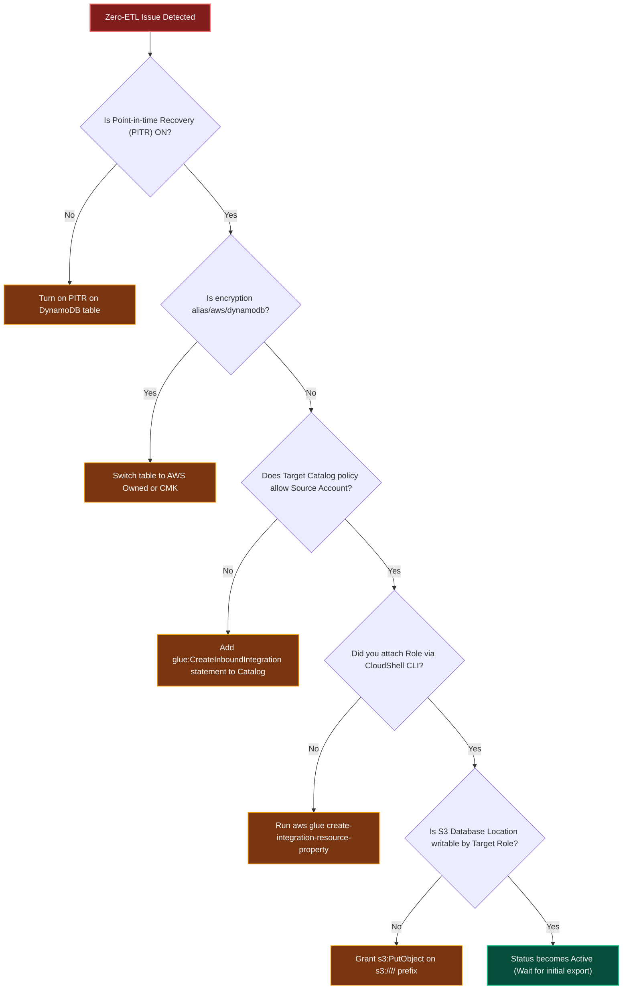

# Replicating a DynamoDB table into Athena with Glue zero-ETL

The DynamoDB table stays in the source account. The Iceberg files, the Glue database, and Athena live in the target account. Both are in the same Region. Glue zero-ETL has no cross-Region mode for this target.

{: .warning }
> **Same-Region Constraint:** Both the source DynamoDB table and the target S3 bucket / Glue Data Catalog must reside in the exact **same AWS Region (`<region>`)**. AWS Glue Zero-ETL does not support cross-Region replication for this target.

The copy keeps the DynamoDB item shape. Key attributes become columns. Everything else lands in one `value` column, still wrapped in the DynamoDB type markers (`S`, `N`, `BOOL`, `M`, `L`, and the set types). A later transform, such as dbt, is where you flatten, cast numbers, and split item types. One integration copies one table, the whole table. Create one integration per table.

{: .note }
> **Data Shape in Target Lake:** The replicated Apache Iceberg table preserves the native DynamoDB item structure. Primary key attributes become direct SQL columns, while all non-key attributes are encapsulated in a single nested `value` struct. Downstream SQL or dbt models handle schema flattening, casting strings to numbers, and unpackaging arrays.

Do the target account first, then the source account, and create the integration while you are signed in to the source account. The wizard in the target account cannot see the source table.

{: .important }
> **Setup Order Matters:** Always configure the **Target Account first**, then configure the **Source Account**, and initiate the integration from the **Source Account**. The console wizard in the target account cannot discover DynamoDB tables from another account.

---

## What you are building

### Cross-Account Architecture

```mermaid
flowchart LR
    subgraph SourceAccount["Source Account (<source-account-id>)"]
        direction TB
        DDB["Amazon DynamoDB Table<br/>• PITR: Enabled<br/>• Resource Policy: Allow Glue Export<br/>• Encryption: AWS Owned or CMK"]
        Integration["AWS Glue Zero-ETL Integration<br/>• Created & Owned in Source Account<br/>• Status: Active"]
        DDB -->|Export data stream| Integration
    end

    subgraph TargetAccount["Target Account (<target-account-id>)"]
        direction TB
        GlueRole["Target IAM Role (<role-name>)<br/>• Assumed by glue.amazonaws.com<br/>• S3 & Glue Catalog Permissions"]
        GlueDB["Glue Database (<database-name>)<br/>• Resource Property: RoleArn<br/>• Table Property: NO_UNNEST"]
        S3["Amazon S3 Bucket<br/>s3://<bucket-name>/<database-name>/<br/>(Stores Apache Iceberg Parquet files)"]
        Iceberg["Apache Iceberg Table<br/>(<iceberg-table-name>)<br/>Key columns + 'value' column"]
        Athena["Amazon Athena<br/>(SQL Query Engine)"]

        GlueRole -->|Registers Schema| GlueDB
        GlueRole -->|Writes Parquet & Commits| S3
        S3 --> Iceberg
        GlueDB --> Iceberg
        Iceberg --> Athena
    end

    Integration ==>|Assumes Role Across Accounts| GlueRole

    style SourceAccount fill:#1e293b,stroke:#38bdf8,stroke-width:2px,color:#f8fafc
    style TargetAccount fill:#0f172a,stroke:#a855f7,stroke-width:2px,color:#f8fafc
    style DDB fill:#172554,stroke:#3b82f6,stroke-width:1.5px,color:#f8fafc
    style Integration fill:#064e3b,stroke:#10b981,stroke-width:1.5px,color:#f8fafc
    style GlueRole fill:#4c1d95,stroke:#c084fc,stroke-width:1.5px,color:#f8fafc
    style GlueDB fill:#312e81,stroke:#818cf8,stroke-width:1.5px,color:#f8fafc
    style S3 fill:#78350f,stroke:#fbbf24,stroke-width:1.5px,color:#f8fafc
    style Iceberg fill:#065f46,stroke:#34d399,stroke-width:1.5px,color:#f8fafc
    style Athena fill:#1e1b4b,stroke:#a78bfa,stroke-width:1.5px,color:#f8fafc
```



### Account Responsibilities

| Where you are signed in | What you create there |
| :--- | :--- |
| **Target account** | S3 bucket, Glue database, target IAM role, catalog permission, role attached to the database, unnesting table property |
| **Source account** | Point-in-time recovery, table resource policy, the zero-ETL integration |

Use a new Glue database if the name you wanted is already used by another workload. The integration is bound to that database for its lifetime. A resource property or a permission on a different database has no effect on it.

### Setup Sequence & Execution Flow

```mermaid
sequenceDiagram
    autonumber
    actor Admin as Cloud / Data Engineer
    participant Target as Target Account (<target-account-id>)
    participant Source as Source Account (<source-account-id>)
    participant Engine as AWS Glue Zero-ETL Engine

    rect rgb(20, 25, 45)
    Note over Admin,Target: Phase 1: Configure Target Account
    Admin->>Target: 1. Create S3 Bucket & Glue Database (with S3 Location)
    Admin->>Target: 2. Create Target IAM Role with S3 & Glue permissions
    Admin->>Target: 3. Add Catalog Resource Policy (Allow Inbound Integration)
    Admin->>Target: 4. CloudShell CLI: Attach Role to Database (Resource Property)
    Admin->>Target: 5. CloudShell CLI: Pin NO_UNNEST Table Property
    end

    rect rgb(20, 40, 30)
    Note over Admin,Source: Phase 2: Configure Source Account
    Admin->>Source: 6. Enable Point-in-time recovery (PITR) on DynamoDB
    Admin->>Source: 7. Verify Encryption (No alias/aws/dynamodb)
    Admin->>Source: 8. Add DynamoDB Table Resource Policy
    Admin->>Source: 9. Create Zero-ETL Integration pointing to Target
    end

    rect rgb(45, 20, 40)
    Note over Engine,Target: Phase 3: Replication & Query
    Engine->>Source: Continuous incremental export via PITR
    Engine->>Target: Ingest & write Apache Iceberg tables to S3
    Admin->>Target: Query Iceberg tables in Amazon Athena
    end
```



### Placeholders used below:

| Placeholder | Meaning |
| :--- | :--- |
| `<region>` | Region of the DynamoDB table. The bucket and the Glue database use this same Region. |
| `<source-account-id>` | Account that owns the DynamoDB table. The integration is created here. |
| `<target-account-id>` | Account where S3, Glue, and Athena live. |
| `<database-name>` | Glue database you create in the target account. |
| `<table-name>` | DynamoDB table name. |
| `<bucket-name>` | General-purpose S3 bucket in the target account. |
| `<role-name>` | IAM role in the target account that Glue assumes to write Iceberg files. |
| `<iceberg-table-name>` | Target table name exposed in Glue Catalog and Athena. |

---

## Why you turn unnesting off

The default unnesting flattens every nested map into its own column and stores DynamoDB numbers as doubles. Tables with a loose item shape can also pass Iceberg's 1,000-column limit and the integration fails. On the Output settings step, choose the option that keeps the nested structure. In the console this is **No unnesting** or **Don't unnest**, depending on the console version. The API name of that choice is `NO_UNNEST`.

{: .warning }
> **The 1,000-Column Limit Trap:** Default unnesting flattens every nested attribute into a separate column. Schemaless or semi-structured tables with varying JSON schemas can easily breach **Apache Iceberg's hard limit of 1,000 columns**, causing the integration to fail irrecoverably. Choosing `NO_UNNEST` keeps non-key attributes safely wrapped in the `value` column.

For a target in the same account, that choice on the wizard is enough. For a target in another account, the wizard does not save output settings onto the remote database. Set them in the target account before you open the wizard. That setting has no page of its own. The CloudShell command is in [the two settings the console does not show](#two-settings-the-console-does-not-show).

{: .important }
> **Cross-Account UI Limitation:** In a single-account setup, the wizard writes this setting automatically. For cross-account targets, the wizard cannot reach into the remote database to register output properties. You **must** pre-configure `NO_UNNEST` via the AWS CLI in the target account before creating the integration.

---

## Target account

Sign in to the target account. Set the console Region to `<region>`.

### Bucket and database

Create a general-purpose S3 bucket in `<region>`, or choose one you already use for the lake. Remember the prefix, for example `s3://<bucket-name>/<database-name>/`.

In the AWS Glue console:

1. Open **Data Catalog**, then **Databases**.
2. Choose **Add database**.
3. Enter `<database-name>`.
4. Set **Location** to that S3 URI. The integration will not run without a location.
5. Choose **Create database**.

{: .tip }
> **Database Location is Mandatory:** If the database already exists, open it and confirm the location is set to an S3 URI ending with a trailing slash (`s3://<bucket-name>/<database-name>/`). Glue Zero-ETL will fail to initialize without an explicit storage location.

---

### Target role

In the IAM console, create a role named `<role-name>`.

Trusted entity is an AWS account you will replace with this custom trust policy. The service that assumes the role is Glue:

```json
{
  "Version": "2012-10-17",
  "Statement": [
    {
      "Effect": "Allow",
      "Principal": { "Service": "glue.amazonaws.com" },
      "Action": "sts:AssumeRole"
    }
  ]
}
```

#### Required IAM Permissions Matrix

Attach a permissions policy that grants the required S3, Glue, CloudWatch, and Lake Formation actions:

| Service | Actions Allowed | Target Resource Scope | Operational Purpose |
| :--- | :--- | :--- | :--- |
| **Amazon S3** | `s3:GetBucketLocation`<br/>`s3:ListBucket` | `arn:aws:s3:::<bucket-name>` | Discovers bucket existence, region, and lake prefix location |
| **Amazon S3** | `s3:GetObject`<br/>`s3:PutObject`<br/>`s3:DeleteObject`<br/>`s3:AbortMultipartUpload` | `arn:aws:s3:::<bucket-name>/<database-name>/*` | Writes Apache Iceberg Parquet files, updates metadata, and cleans up aborted uploads |
| **AWS Glue** | `glue:GetDatabase`<br/>`glue:GetDatabases` | `arn:aws:glue:<region>:<target-account-id>:catalog`<br/>`arn:aws:glue:<region>:<target-account-id>:database/<database-name>` | Verifies target database configuration, location, and integration properties |
| **AWS Glue** | `glue:CreateTable`<br/>`glue:UpdateTable`<br/>`glue:DeleteTable`<br/>`glue:GetTable`<br/>`glue:GetTables`<br/>`glue:GetTableVersion`<br/>`glue:GetTableVersions`<br/>`glue:GetResourcePolicy` | `arn:aws:glue:<region>:<target-account-id>:catalog`<br/>`arn:aws:glue:<region>:<target-account-id>:database/<database-name>`<br/>`arn:aws:glue:<region>:<target-account-id>:table/<database-name>/*` | Creates, alters, and manages versioned Iceberg table definitions in the Data Catalog |
| **Amazon CloudWatch** | `cloudwatch:PutMetricData` | `*`<br/>*(Condition: `namespace = AWS/Glue/ZeroETL`)* | Emits integration operational health and replication latency metrics |
| **CloudWatch Logs** | `logs:CreateLogGroup`<br/>`logs:CreateLogStream`<br/>`logs:PutLogEvents` | `*` | Emits ingestion and error logs for auditability |
| **AWS Lake Formation** | `lakeformation:GetDataAccess` | `*` | Grants underlying data access if Lake Formation manages the target catalog |
| **AWS KMS** *(Optional)* | `kms:Decrypt`<br/>`kms:Encrypt`<br/>`kms:GenerateDataKey`<br/>`kms:DescribeKey` | `<kms-key-arn>` | Required only if the target S3 bucket uses a Customer Managed Key (CMK) |

{: .warning }
> **Principle of Least Privilege:** Give this role **no write access** to downstream transform databases or analytics folders where tools like dbt will land processed data. It should only write to the raw zero-ETL prefix (`<database-name>/*`).

{: .tip }
> **Example Target Account Role Policy Document:**
>
```json
{
    "Version": "2012-10-17",
    "Statement": [
        {
            "Effect": "Allow",
            "Action": [
                "s3:GetBucketLocation",
                "s3:ListBucket"
            ],
            "Resource": "arn:aws:s3:::<bucket-name>"
        },
        {
            "Effect": "Allow",
            "Action": [
                "s3:GetObject",
                "s3:PutObject",
                "s3:DeleteObject"
            ],
            "Resource": "arn:aws:s3:::<bucket-name>/<database-name>/*"
        },
        {
            "Effect": "Allow",
            "Action": [
                "glue:GetDatabase"
            ],
            "Resource": [
                "arn:aws:glue:<region>:<target-account-id>:catalog",
                "arn:aws:glue:<region>:<target-account-id>:database/<database-name>"
            ]
        },
        {
            "Effect": "Allow",
            "Action": [
                "glue:CreateTable",
                "glue:GetTable",
                "glue:GetTables",
                "glue:UpdateTable",
                "glue:DeleteTable",
                "glue:GetTableVersion",
                "glue:GetTableVersions",
                "glue:GetResourcePolicy"
            ],
            "Resource": [
                "arn:aws:glue:<region>:<target-account-id>:catalog",
                "arn:aws:glue:<region>:<target-account-id>:database/<database-name>",
                "arn:aws:glue:<region>:<target-account-id>:table/<database-name>/*"
            ]
        },
        {
            "Effect": "Allow",
            "Action": [
                "cloudwatch:PutMetricData"
            ],
            "Resource": "*",
            "Condition": {
                "StringEquals": {
                    "cloudwatch:namespace": "AWS/Glue/ZeroETL"
                }
            }
        },
        {
            "Effect": "Allow",
            "Action": [
                "logs:CreateLogGroup",
                "logs:CreateLogStream",
                "logs:PutLogEvents"
            ],
            "Resource": "*"
        },
        {
            "Effect": "Allow",
            "Action": [
                "lakeformation:GetDataAccess"
            ],
            "Resource": "*"
        }
    ]
}
```

---

### Catalog permission

The Data Catalog has one resource policy. In the Glue console open **Data Catalog**, then **Catalog settings**, then the **Permissions** editor. Add the two statements below to the existing `Statement` array.

{: .warning }
> **Do Not Overwrite Existing Statements:** The Data Catalog has a single global resource policy. **Append** the two statements below into the existing `Statement` array. Saving a document that contains only these statements removes every other existing permission on the catalog!

`<source-account-id>` in the first statement is the account where you will click **Create zero-ETL integration**. `aws:SourceArn` lists each DynamoDB table that will replicate into this database. Add one ARN per table.

```json
{
  "Effect": "Allow",
  "Principal": {
    "AWS": "arn:aws:iam::<source-account-id>:root"
  },
  "Action": "glue:CreateInboundIntegration",
  "Resource": [
    "arn:aws:glue:<region>:<target-account-id>:catalog",
    "arn:aws:glue:<region>:<target-account-id>:database/<database-name>"
  ],
  "Condition": {
    "StringEquals": {
      "aws:SourceArn": [
        "arn:aws:dynamodb:<region>:<source-account-id>:table/<table-name>"
      ]
    }
  }
}
```

```json
{
  "Effect": "Allow",
  "Principal": { "Service": "glue.amazonaws.com" },
  "Action": "glue:AuthorizeInboundIntegration",
  "Resource": [
    "arn:aws:glue:<region>:<target-account-id>:catalog",
    "arn:aws:glue:<region>:<target-account-id>:database/<database-name>"
  ],
  "Condition": {
    "StringEquals": {
      "aws:SourceArn": [
        "arn:aws:dynamodb:<region>:<source-account-id>:table/<table-name>"
      ]
    }
  }
}
```

Choose **Save**.

{: .note }
> **Lake Formation Environments:** If this Data Catalog is enforced by AWS Lake Formation, also grant `<role-name>` database and table permissions on `<database-name>`, and data-location access on the S3 prefix. Otherwise the integration will be created and immediately stall in **Needs attention**.

---

## Source account

Sign in to the source account. Set the console Region to `<region>`.

### Point-in-time recovery

1. Open the DynamoDB console, then **Tables**, then `<table-name>`.
2. Open the **Backups** tab.
3. Under **Point-in-time recovery**, choose **Edit** and turn recovery on.
4. Save.

{: .important }
> **Keep PITR Enabled Permanently:** Turning off Point-in-time recovery at any point after setup stops active replication immediately. Repeat this configuration for every source DynamoDB table you plan to integrate.

---

### Encryption

On the same table, open the encryption setting. An AWS owned key or a customer managed key is fine.

{: .warning }
> **Unsupported Key Warning:** Stop if the table uses the AWS managed key `alias/aws/dynamodb`. Zero-ETL rejects that key. Switch the table to an **AWS owned key** or a **Customer Managed Key (CMK)** before continuing.

---

### Table resource policy

Still on the table, open **Resource-based policy for table** and edit it. If a policy is already there, add this statement to the existing `Statement` array. `aws:SourceAccount` is the source account, because that is the account that will own the integration.

```json
{
  "Effect": "Allow",
  "Principal": { "Service": "glue.amazonaws.com" },
  "Action": [
    "dynamodb:ExportTableToPointInTime",
    "dynamodb:DescribeTable",
    "dynamodb:DescribeExport"
  ],
  "Resource": "*",
  "Condition": {
    "StringEquals": {
      "aws:SourceAccount": "<source-account-id>"
    },
    "ArnLike": {
      "aws:SourceArn": "arn:aws:glue:<region>:<source-account-id>:integration:*"
    }
  }
}
```

Save.

{: .tip }
> After the integration is active, you can tighten `aws:SourceArn` from `integration:*` to the exact integration ARN (`arn:aws:glue:<region>:<source-account-id>:integration/<integration-id>`).

---

## Two settings the console does not show

**Fix it for me** on the create wizard attaches the target role and fills in a catalog permission, and the Output settings step writes the unnesting choice. Both of those buttons apply only when the target database is in the same account as the wizard. With a cross-account target they are missing, and creating the integration then fails with:

```text
ValidationException: Resource property does not exist for the target resource
with ResourceArn: arn:aws:glue:<region>:<target-account-id>:database/<database-name>
```

{: .important }
> **Execute in Target Account CloudShell:** Run these two CLI calls in the **target account** before opening the create integration wizard in the source account.

The CloudShell CLI is often too old to know these commands. If you see `Invalid choice`, install the current CLI into your home directory and use that binary:

```bash
cd "$HOME"
curl -sS "https://awscli.amazonaws.com/awscli-exe-linux-x86_64.zip" -o awscliv2.zip
unzip -q awscliv2.zip
./aws/install -i "$HOME/aws-cli" -b "$HOME/bin"
export PATH="$HOME/bin:$PATH"
hash -r
aws --version
```

### 1. Attach the role to the database:

```bash
aws glue create-integration-resource-property \
  --region "<region>" \
  --resource-arn "arn:aws:glue:<region>:<target-account-id>:database/<database-name>" \
  --target-processing-properties "RoleArn=arn:aws:iam::<target-account-id>:role/<role-name>"
```

{: .tip }
> If the bucket is encrypted with a customer managed key, add `KmsArn=<key-arn>` to `--target-processing-properties`. If the property already exists, leave it when the role is the one you intend.

### 2. Pin no-unnesting for this source table:

`--table-name` is the DynamoDB name. `TargetTableName` is the Iceberg table Athena will show. Changing either value after data is flowing rebuilds the table and runs the full export again.

```bash
aws glue create-integration-table-properties \
  --region "<region>" \
  --resource-arn "arn:aws:glue:<region>:<target-account-id>:database/<database-name>" \
  --table-name "<table-name>" \
  --target-table-config '{"UnnestSpec":"NO_UNNEST","TargetTableName":"<iceberg-table-name>"}'
```

Repeat that second command once per source table.

---

## Create the integration

Stay in the source account.

1. Open the AWS Glue console and choose **Zero-ETL integrations**.
2. Choose **Create zero-ETL integration**.
3. Select **Amazon DynamoDB** and choose **Next**.
4. Under source details, select `<table-name>`. The list contains only DynamoDB tables in the account you are signed in to. You cannot paste a table ARN from another account into that box.
5. Under target details, choose a different account. Enter `<target-account-id>` and `<database-name>`.
6. If the wizard asks for a target IAM role and `<role-name>` is not listed, do not pick a role from the source account. The role attached to the database in the previous section is the one Glue uses.
7. On **Output settings**, choose no unnesting if the control is shown. For a cross-account target, the table property you already saved is the setting that counts.
8. Open the replication settings and set the refresh interval before you create the integration. The allowed range is 15 to 8640 minutes. The default is 15. An interval of 1440 minutes or more is processed as one daily batch, because a DynamoDB incremental export cannot span more than 24 hours. An idle table on a 15-minute schedule can still be billed the 10 MB export minimum on every cycle.
9. Under security, leave the default encryption for the replication channel. The Iceberg files stay encrypted by the target bucket. A customer managed key on the channel would also need a grant from the source account.
10. Name the integration, review, and choose **Create and launch integration**.

{: .note }
> The integration then belongs to the source account. The Zero-ETL list in the target account does not show it.

On the integration page, wait until **Status** is **Active**. The Iceberg table appears in the target account after the initial export, which takes longer than the refresh interval and grows with the table size.

Then, in the Athena console in the target account, with a workgroup whose results bucket the query role can write:

```sql
DESCRIBE "<database-name>"."<iceberg-table-name>";
```

Key attributes are ordinary columns. The rest of the item is `value`. Read a field through its type marker. Trust the casing `DESCRIBE` prints. A number is still a string until you cast it:

```sql
SELECT
  value.status.s AS status,
  CAST(value.amount.n AS decimal(38, 10)) AS amount
FROM "<database-name>"."<iceberg-table-name>"
LIMIT 20;
```

Repeat the wizard for the next table. Two integrations cannot write the same DynamoDB table into the same Glue database.

---

## Troubleshooting



### The source list is empty

The wizard was open in the target account. That dropdown lists DynamoDB tables in the signed-in account, and it does not accept a pasted ARN.

{: .tip }
> **Fix:** Sign out of the target account, sign in to the source account, and start the wizard there. On the target step, choose a different account and enter the target account id and the database name.

### Resource property does not exist for the target resource

The database exists, and Glue has no role attached to it. **Fix it for me** is not offered for a cross-account target, so the wizard cannot repair this.

{: .warning }
> **Fix:** Run `create-integration-resource-property` in the target account against the same database ARN you selected in the wizard. A property on a database you tried earlier does not satisfy an integration aimed at a different database.

### CloudShell says the Glue operation is an invalid choice

The CLI installed in CloudShell predates these Glue operations. The error is `Invalid choice`, with a list of older operations.

{: .tip }
> **Fix:** Install the current AWS CLI into `$HOME` as shown above, put `$HOME/bin` first on `PATH`, and run the command again in the target account. A new CloudShell session needs the `PATH` export again.

### The refresh interval will not save

```text
Validation error for source table "<table-name>"
Resource ARN arn:aws:glue:<region>:<target-account-id>:database/<database-name>
does not belong to the user's account.
```

The integration page in the source account rechecks the target database when you edit replication settings. That database belongs to the target account, so the console rejects the save. Opening the same integration from the target account does not help, because the integration object is not in that account.

{: .important }
> **Fix:** Set the interval on the create screen. If you need to change it later, do it from the source account with only the interval in the request. Use the current CLI, and take `INTEGRATION_ARN` from the integration details page:
>
```bash
aws glue modify-integration \
  --region "<region>" \
  --integration-identifier "<INTEGRATION_ARN>" \
  --integration-config '{"RefreshInterval":"60"}'
```
> The value is minutes, from 15 to 8640. If this returns the same validation error, delete the integration in the source account and create it again with the interval set before you launch it. Keep the same unnesting choice and the same Iceberg table name. Creation runs the full export again.

### Status stays on Needs attention

Check these in order:

- [ ] **Point-in-time recovery** is on for that table.
- [ ] The **table resource policy** allows `ExportTableToPointInTime`, `DescribeTable`, and `DescribeExport`, and `aws:SourceAccount` is the source account.
- [ ] The **catalog policy** in the target account allows `glue:CreateInboundIntegration` for the source account and `glue:AuthorizeInboundIntegration` for `glue.amazonaws.com`, and `aws:SourceArn` includes this table.
- [ ] The **integration resource property** on this database points at `<role-name>`.
- [ ] The **database location** is an S3 prefix that `<role-name>` can write.
- [ ] The table is **not** encrypted with `alias/aws/dynamodb`.
- [ ] **Lake Formation**, if it enforces this catalog, grants the target role.

The integration detail page is the status view. The summary page does not show the useful metrics. Metrics that do exist are in CloudWatch under `AWS/Glue/ZeroETL`, in the source account.

### A first attempt left a second database behind

Permissions, the resource property, and the unnesting property are all per database. If the first create targeted one database and the next attempt targets another, configure the database you select in the wizard. Settings on the unused database do nothing for the integration.

---

## Limits & Operational Boundaries

| Constraint / Limit | Operational Behavior & Cost Impact |
| :--- | :--- |
| **Max Source Table Size** | Up to **100 TB**. Replacing an integration repeats the full export, which is billed per GB. |
| **Pricing Model** | There is **no separate zero-ETL hourly fee**. You pay for Point-in-time recovery, the initial export, incremental exports, S3 storage, KMS calls, and Athena query scans. |
| **DynamoDB Workload Impact** | Replication **does not consume read or write capacity units (RCU/WCU)** and does not use DynamoDB Streams. |
| **Iceberg Schema Limit** | Apache Iceberg allows at most **1,000 columns**. Keeping items nested via `NO_UNNEST` prevents schemaless tables from breaching this limit. |
| **Attribute Naming Constraint** | A source attribute whose name contains a colon (`:`) can cause the integration to fail, as Athena cannot parse that identifier. |
| **Target Immutability** | The target Glue database **cannot be changed** after the integration is created. |
| **Replication Latency (Lag)** | Lag equals the configured refresh interval plus incremental export and commit duration. The initial copy takes longer. |
| **Global Tables** | A global table replicates strictly from the **single Region** you select. |
