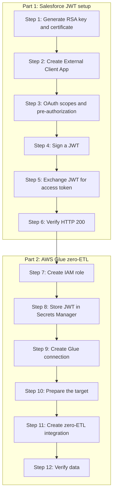
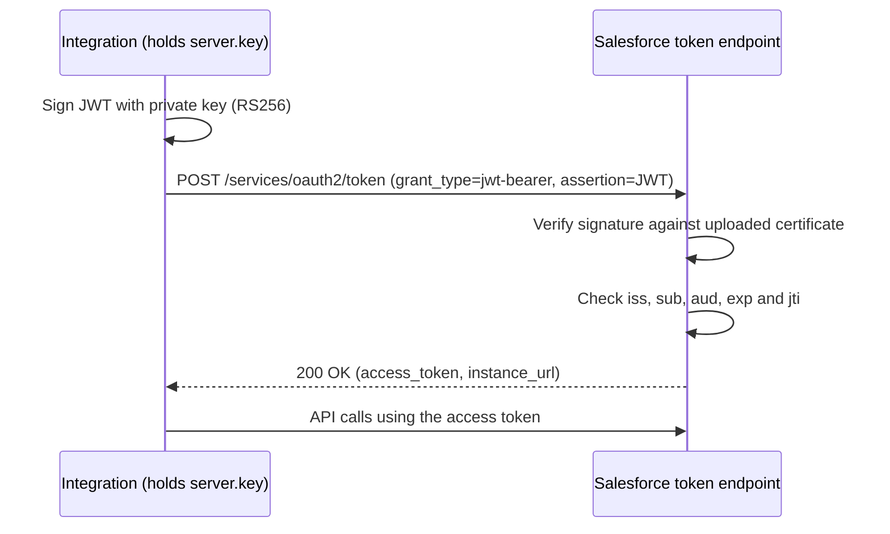
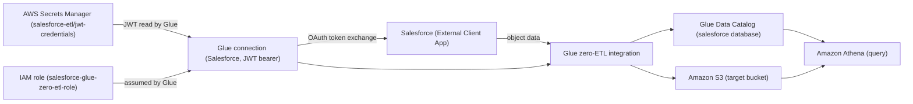
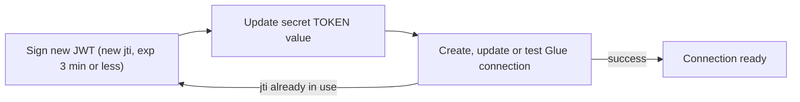
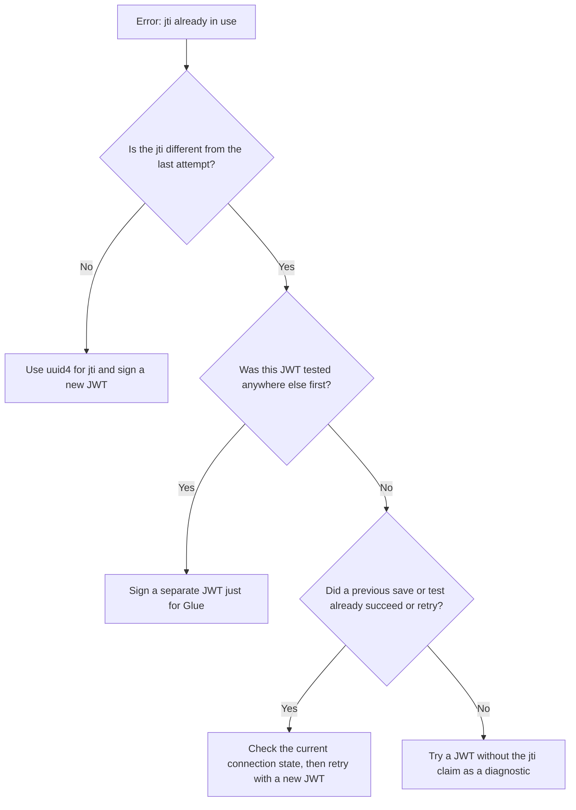
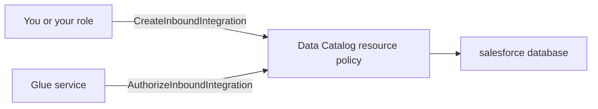
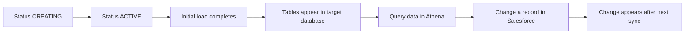

# Setting up AWS Glue Zero-ETL integration with Salesforce

Server-to-server integrations shouldn't need a human to click "Allow" in a browser. The OAuth 2.0 JWT Bearer Flow lets a backend process prove its identity to Salesforce with a signed token, with no interactive login and no password stored in your pipeline.

This guide has two parts:

1. **Part 1:** Set up Salesforce for JWT bearer authentication and verify it with a local Python test.
2. **Part 2:** Use that setup to build an AWS Glue zero-ETL integration that replicates Salesforce data into AWS.

## The big picture



---

# Part 1: Salesforce JWT Bearer Flow

## How it works

You create an RSA key pair. Salesforce holds the public certificate, and your integration holds the private key. To authenticate, your code signs a short-lived JWT with the private key and sends it to Salesforce's token endpoint. Salesforce verifies the signature against the certificate and returns an access token.



## Step 1: Generate an RSA private key and certificate

Install OpenSSL on your Windows machine (for example via the Git for Windows bundle, or a standalone build), then run:

```bash
openssl genrsa -out server.key 2048
openssl req -new -x509 -key server.key -out server.crt -days 730 -subj "/CN=salesforce-jwt-integration"
```

- `server.key` is the private key. Keep it secret and never commit it to source control.
- `server.crt` is the X.509 public certificate you'll upload to Salesforce.
- The certificate validity (`-days 730`) is a rotation deadline, so set a reminder before it expires.

## Step 2: Configure the Salesforce External Client App

In Salesforce Setup, create (or open) your External Client App and go to **OAuth Settings**:

1. Enable OAuth.
2. Enable the **JWT Bearer Flow**.
3. Upload `server.crt` as the certificate.
4. Disable **OAuth Device Flow**. This integration is server-to-server, so the device flow isn't needed and leaving it off reduces your attack surface.

Copy the app's **Consumer Key** (Client ID). You'll need it as the JWT issuer.

## Step 3: Configure OAuth scopes and app authorization

1. Add the scope **Perform requests at any time (refresh_token, offline_access)**.
2. Under **OAuth Policies**, set **Permitted Users** to **Admin approved users are pre-authorized**, then assign the integration user's profile or a permission set to the app.

Pre-authorization is what makes the flow non-interactive. If the user isn't pre-approved, Salesforce rejects the JWT with an `invalid_grant` error saying the user hasn't approved the consumer.

## Step 4: Generate and sign the JWT

Install the dependencies:

```bash
pip install pyjwt cryptography requests
```

The JWT has these claims:

| Claim | Value |
|---|---|
| `iss` | The External Client App's Consumer Key (Client ID) |
| `sub` | The Salesforce integration username |
| `aud` | `https://login.salesforce.com` (use `https://test.salesforce.com` for sandboxes, or your My Domain URL) |
| `iat` | Current time |
| `exp` | Current time plus a short window (3 minutes or less) |
| `jti` | A unique ID for each token |

It's signed with RSA SHA-256 (`RS256`) using your private key. Two notes:

- `exp` only limits how long this one assertion can be exchanged for a token. It has nothing to do with how long your integration keeps working.
- A unique `jti` per token protects against replay. Reusing the same signed JWT, including through automatic retries, can fail with `jti already in use`.

## Step 5: Exchange the JWT for an access token

The script below signs a fresh JWT, posts it to the token endpoint, and checks the result without ever printing the access token.

```python
import os
import time
import uuid

import jwt
import requests

CLIENT_ID = os.environ["SF_CLIENT_ID"]      # Consumer Key
SF_USERNAME = os.environ["SF_USERNAME"]     # Integration user
LOGIN_URL = "https://login.salesforce.com"  # test.salesforce.com for sandbox

with open("server.key", "r") as f:
    private_key = f.read()

now = int(time.time())
claims = {
    "iss": CLIENT_ID,
    "sub": SF_USERNAME,
    "aud": LOGIN_URL,
    "iat": now,
    "exp": now + 180,          # short-lived assertion
    "jti": str(uuid.uuid4()),  # unique per token
}

assertion = jwt.encode(claims, private_key, algorithm="RS256")

response = requests.post(
    f"{LOGIN_URL}/services/oauth2/token",
    data={
        "grant_type": "urn:ietf:params:oauth:grant-type:jwt-bearer",
        "assertion": assertion,
    },
    timeout=30,
)

print("HTTP status:", response.status_code)

if response.ok:
    body = response.json()
    print("Authentication: Successful")
    print("Salesforce instance URL:", body.get("instance_url"))
    print("Access token received:", bool(body.get("access_token")))
else:
    print("Authentication: Failed")
    print("Error:", response.json())
```

On Windows, set the environment variables before running:

```powershell
$env:SF_CLIENT_ID = "<consumer key>"
$env:SF_USERNAME = "<integration username>"
python test_jwt.py
```

## Step 6: Verify the result

A successful run prints:

```
HTTP status: 200
Authentication: Successful
Salesforce instance URL: <your Salesforce instance URL>
Access token received: True
```

That confirms Salesforce accepted the JWT, validated the signature against your certificate, and issued an access token.

> **Note:** This test consumes the JWT's `jti`. Never reuse the same signed JWT in Glue. Sign a separate one for it.

---

# Part 2: AWS Glue zero-ETL integration

Once the JWT test returns a 200, you can wire the same External Client App into Glue. The flow is: create an IAM role, store the JWT in Secrets Manager, create the Glue connection, set up the target, then create the integration.

## Architecture



## Using this with AWS Glue: ground rules

- **Sign a new JWT every time** you create, update, or test the connection. Pasting a previously used token causes `jti already in use`.
- **Don't test the same JWT elsewhere first.** The Python test above consumes that token's `jti`, so generate a separate one for Glue.
- **Plan for long-running connections.** The JWT is exchanged for an access token at connection time, and the access token expires per your connected app's session settings. See [Operating it long-term](#operating-it-long-term).

## Step 7: Create the IAM role

Create a role named `salesforce-glue-zero-etl-role` that Glue can assume.

**Trust policy**

```json
{
  "Version": "2012-10-17",
  "Statement": [
    {
      "Effect": "Allow",
      "Principal": { "Service": "glue.amazonaws.com" },
      "Action": "sts:AssumeRole"
    }
  ]
}
```

**Permissions policy**

Replace `<s3_bucket_name>`, `<region>`, and `<account_id>` with your values.

```json
{
    "Version": "2012-10-17",
    "Statement": [
        {
            "Action": [
                "s3:GetBucketLocation",
                "s3:ListBucket",
                "s3:ListAllMyBuckets",
                "s3:GetBucketAcl",
                "ec2:DescribeVpcEndpoints",
                "ec2:DescribeRouteTables",
                "ec2:CreateNetworkInterface",
                "ec2:DeleteNetworkInterface",
                "ec2:DescribeNetworkInterfaces",
                "ec2:DescribeSecurityGroups",
                "ec2:DescribeSubnets",
                "ec2:DescribeVpcAttribute",
                "iam:ListRolePolicies",
                "iam:GetRole",
                "iam:GetRolePolicy",
                "cloudwatch:PutMetricData"
            ],
            "Effect": "Allow",
            "Resource": ["*"]
        },
        {
            "Action": ["s3:Get*", "s3:PutObject"],
            "Effect": "Allow",
            "Resource": [
                "arn:aws:s3:::<s3_bucket_name>",
                "arn:aws:s3:::<s3_bucket_name>/*"
            ]
        },
        {
            "Action": [
                "logs:CreateLogGroup",
                "logs:CreateLogStream",
                "logs:PutLogEvents",
                "logs:AssociateKmsKey"
            ],
            "Effect": "Allow",
            "Resource": ["*"]
        },
        {
            "Action": ["ec2:CreateTags", "ec2:DeleteTags"],
            "Condition": {
                "ForAllValues:StringEquals": {
                    "aws:TagKeys": ["aws-glue-service-resource"]
                }
            },
            "Effect": "Allow",
            "Resource": [
                "arn:aws:ec2:*:*:network-interface/*",
                "arn:aws:ec2:*:*:security-group/*",
                "arn:aws:ec2:*:*:instance/*"
            ]
        },
        {
            "Sid": "SecretsManager",
            "Action": [
                "secretsmanager:GetSecretValue",
                "secretsmanager:DescribeSecret",
                "secretsmanager:PutSecretValue"
            ],
            "Effect": "Allow",
            "Resource": [
                "arn:aws:secretsmanager:<region>:<account_id>:secret:salesforce-etl/credentials-*",
                "arn:aws:secretsmanager:<region>:<account_id>:secret:salesforce-etl/jwt-credentials-*"
            ]
        },
        {
            "Action": [
                "glue:CreateTable",
                "glue:GetTable",
                "glue:GetTables",
                "glue:DeleteTable",
                "glue:UpdateTable",
                "glue:GetTableVersion",
                "glue:GetTableVersions",
                "glue:GetResourcePolicy"
            ],
            "Resource": [
                "arn:aws:glue:<region>:<account_id>:catalog",
                "arn:aws:glue:<region>:<account_id>:database/salesforce",
                "arn:aws:glue:<region>:<account_id>:table/salesforce/*"
            ],
            "Effect": "Allow"
        },
        {
            "Action": ["glue:GetDatabase"],
            "Resource": [
                "arn:aws:glue:<region>:<account_id>:catalog",
                "arn:aws:glue:<region>:<account_id>:database/salesforce"
            ],
            "Effect": "Allow"
        },
        {
            "Action": ["cloudwatch:PutMetricData"],
            "Resource": "*",
            "Condition": {
                "StringEquals": {
                    "cloudwatch:namespace": "AWS/Glue/ZeroETL"
                }
            },
            "Effect": "Allow"
        },
        {
            "Sid": "GlueConnections",
            "Effect": "Allow",
            "Action": ["glue:GetConnections", "glue:GetConnection"],
            "Resource": [
                "arn:aws:glue:*:<account_id>:catalog",
                "arn:aws:glue:<region>:<account_id>:connection/*"
            ]
        },
        {
            "Sid": "GlueActionBasedPermissions",
            "Effect": "Allow",
            "Action": ["glue:ListEntities", "glue:RefreshOAuth2Tokens"],
            "Resource": "*"
        }
    ]
}
```

**What each part does**

| Area | What it allows | Scoped to |
|---|---|---|
| S3 | Read and write the integration's staging and target data | `arn:aws:s3:::<s3_bucket_name>` and `/*` |
| Secrets Manager | `GetSecretValue`, `DescribeSecret`, `PutSecretValue` so Glue can read credentials and write back refreshed tokens | `salesforce-etl/credentials-*` and `salesforce-etl/jwt-credentials-*` |
| Glue Data Catalog | Create, read, update, and delete tables, and read the database | The `salesforce` database and its tables |
| Glue connections | `GetConnection`, `GetConnections` | Connections in your account and region |
| Glue OAuth | `ListEntities`, `RefreshOAuth2Tokens` | `*` |
| CloudWatch | `PutMetricData`, limited to the `AWS/Glue/ZeroETL` namespace | `*` |
| CloudWatch Logs | Create log groups and streams, write events | `*` |
| EC2 networking | Describe VPC resources and manage Glue's network interfaces (tag changes limited to the `aws-glue-service-resource` key) | `*` and EC2 resource ARNs |
| IAM (read-only) | `GetRole`, `GetRolePolicy`, `ListRolePolicies` | `*` |

**Hardening ideas**

- Scope the CloudWatch Logs statement to `/aws-glue/*` log groups instead of `*`.
- The unconditioned `cloudwatch:PutMetricData` in the first statement makes the namespace-restricted statement redundant, so remove it from the first statement.
- If the secret or S3 bucket uses a customer-managed KMS key, add `kms:Decrypt` and `kms:GenerateDataKey` for that key: `<kms_key_arn>`.

## Step 8: Store the credentials in Secrets Manager

Create a secret named `salesforce-etl/jwt-credentials` in `ap-southeast-1` (or your region). The role's policy matches secret names that start with `salesforce-etl/jwt-credentials`, so keep the secret name and the policy ARN in sync.

The secret holds the signed JWT under the key `TOKEN`:

```json
{
  "TOKEN": "<freshly signed JWT>"
}
```

Reference it only by name or ARN:

```
arn:aws:secretsmanager:<region>:<account_id>:secret:salesforce-etl/jwt-credentials-<suffix>
```

Because each JWT is single-use, the safe routine is: sign a new JWT, update the secret, and then create, update, or test the connection straight away.



To update the secret from the CLI without leaving the JWT in your shell history, write it to a temporary file first:

```bash
aws secretsmanager put-secret-value \
  --region ap-southeast-1 \
  --secret-id salesforce-etl/jwt-credentials \
  --secret-string file://secret.json
```

Delete `secret.json` afterwards. Never paste a real JWT, the private key, or an access token into a blog post, ticket, or chat.

## Step 9: Create the Glue connection

In the Glue console, go to **Data connections → Create connection** and choose **Salesforce**.

1. Enter the Salesforce instance URL, in the form `https://<your-domain>.my.salesforce.com`.
2. Set the authentication type to **OAuth2** with the **JWT bearer** grant, and use the Consumer Key from your External Client App.
3. Select the IAM role from Step 7 and the secret from Step 8.
4. Test the connection.

If the test fails with `jti already in use`, the JWT being submitted was already used. Sign a fresh one with a new `jti`, or remove the `jti` claim from the JWT. Don't test the same token anywhere else first.



**Common errors**

| Error | Likely cause | Fix |
|---|---|---|
| `jti already in use` | The same signed JWT reached Salesforce more than once | Sign a new JWT per attempt; don't reuse it in tests or retries |
| `invalid_grant` (user hasn't approved this consumer) | The integration user isn't pre-authorized | Assign the user's profile or a permission set to the app (Step 3) |
| Access denied reading the secret | Secret name doesn't match the policy ARN | Keep the secret name and the policy ARN in sync |
| Signature or audience errors | Wrong certificate, or `aud` doesn't match the login URL | Re-upload `server.crt`, and use the correct login or My Domain URL |

## Step 10: Prepare the target

Zero-ETL needs a destination, such as a Glue Data Catalog database backed by S3 (or a Redshift or lakehouse target). This post uses a Glue Data Catalog database named `salesforce`.

- **Target database:** `salesforce`
- **Target S3 location:** `s3://<s3_bucket_name>/<prefix>/`
- **Target KMS key (if encrypted):** `<kms_key_arn>`

### Add the Data Catalog resource policy

The Data Catalog needs a resource policy that lets the integration be created against the target database and lets Glue authorize it. Without it, creating the integration fails with an authorization error.

In the Glue console, go to **Data Catalog settings → Permissions**, add the statements below, and save. Replace `<region>` and `<account_id>` with your values.

```json
{
  "Version": "2012-10-17",
  "Statement": [
    {
      "Effect": "Allow",
      "Principal": {
        "AWS": "arn:aws:iam::<account_id>:root"
      },
      "Action": "glue:CreateInboundIntegration",
      "Resource": [
        "arn:aws:glue:<region>:<account_id>:catalog",
        "arn:aws:glue:<region>:<account_id>:database/salesforce"
      ]
    },
    {
      "Effect": "Allow",
      "Principal": {
        "Service": "glue.amazonaws.com"
      },
      "Action": "glue:AuthorizeInboundIntegration",
      "Resource": [
        "arn:aws:glue:<region>:<account_id>:catalog",
        "arn:aws:glue:<region>:<account_id>:database/salesforce"
      ]
    }
  ]
}
```

| Statement | Principal | Action | Purpose |
|---|---|---|---|
| 1 | Your AWS account | `glue:CreateInboundIntegration` | Allows an integration to be created with the `salesforce` database as its target |
| 2 | The Glue service | `glue:AuthorizeInboundIntegration` | Allows Glue to authorize that integration to write into the catalog and database |

**Apply it from the CLI instead**

```bash
aws glue put-resource-policy \
  --region ap-southeast-1 \
  --policy-in-json file://catalog-policy.json
```

`put-resource-policy` replaces the whole catalog resource policy. If your account already has one (check with `aws glue get-resource-policy`), merge these statements into it, or you will overwrite the existing permissions.



## Step 11: Prepare the target

Zero-ETL needs a destination, such as a Glue Data Catalog database backed by S3 (or a Redshift or lakehouse target).

- **Target database / S3 location:** `<target details>`
- **Target resource policy** allowing the integration to write: `<policy details>`
- **Target KMS key:** `<key details>`

## Step 12: Create the zero-ETL integration

In the Glue console, open **Zero-ETL integrations → Create integration**:

1. Choose **Salesforce** as the source and select the connection from Step 9.
2. Select the Salesforce objects to replicate (for example Account, Contact, Opportunity).
3. Choose the target and the IAM role.
4. Set the replication frequency and review the settings.
5. Create the integration.

Or from the CLI:

```bash
aws glue create-integration \
  --region ap-southeast-1 \
  --integration-name <integration-name> \
  --source-arn <glue-connection-arn> \
  --target-arn <target-database-arn>
```

## Step 13: Verify



- The integration status moves from `CREATING` to `ACTIVE`.
- The initial load completes, and tables appear in the target database.
- Data shows up in the target (for example via Athena).
- Changes made in Salesforce show up after the next sync.

## Operating it long-term

The JWT is exchanged for an access token when the connection is created. For an integration that runs for months or years, check how Glue handles renewal, because a JWT bearer connection may need its credentials refreshed periodically. If renewal is a problem, the authorization code flow with a refresh token set to "valid until revoked" is the more hands-off option.

Either way:

- Set an alert on integration status so a failure doesn't go unnoticed.
- Rotate the certificate before it expires.
- Keep the integration user active and its permissions stable.

## Security checklist

- Store `server.key` in a secrets manager, not in your repo.
- Rotate the certificate before it expires.
- Use a dedicated integration user with least-privilege permissions.
- Never log or publish the JWT, the private key, or the access token.
- Keep account IDs and secret ARN suffixes out of public posts.
