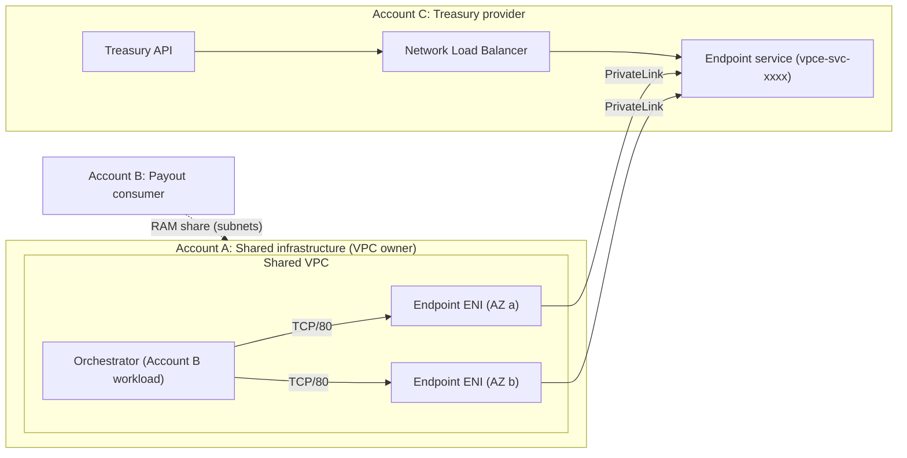
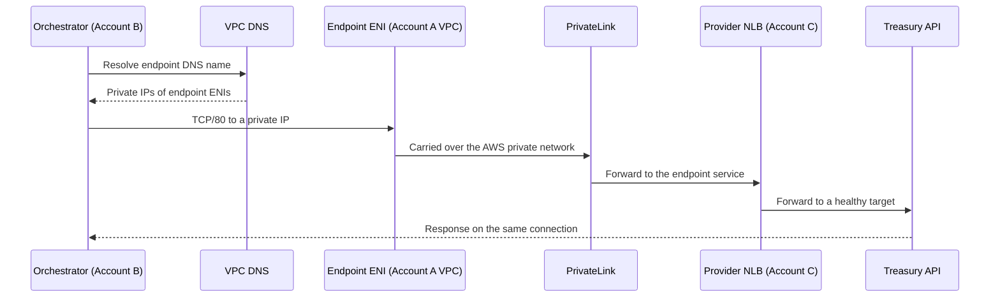
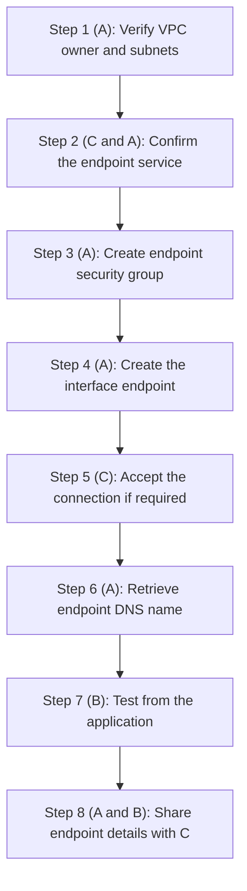
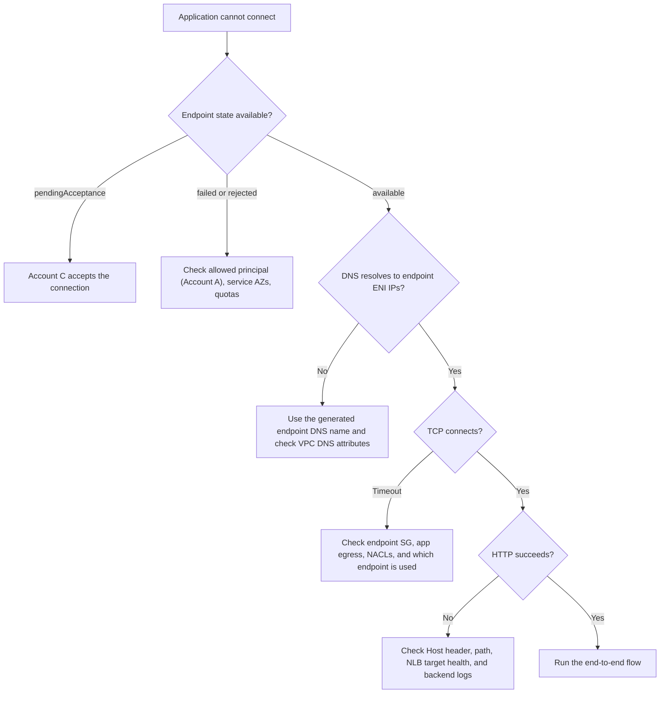

# AWS PrivateLink End-to-End: Cross-Account Private Connectivity with a RAM-Shared VPC

**A practical guide to interface VPC endpoints, endpoint services, AWS Resource Access Manager (RAM), security groups, DNS, and troubleshooting**

## 1. Introduction

In a multi-account AWS environment, applications often need to call services hosted in another account: payment gateways, treasury services, central authentication, internal APIs, and shared platform services.

The challenge is enabling that communication without exposing the service to the public internet, adding unnecessary routes, or connecting every VPC through a Transit Gateway.

AWS PrivateLink solves this. The service provider publishes an **endpoint service**, and the consumer creates an **interface VPC endpoint** that gives its VPC a private entrance to that service.

It gets more interesting when the consumer workload runs in a VPC owned by a separate shared-infrastructure account and shared through AWS RAM. This post walks through that setup using a payment-to-treasury integration as the example.

By the end you will understand:

- How PrivateLink works, and the difference between an endpoint and an endpoint service.
- How RAM VPC sharing affects who can create and manage the endpoint.
- How to configure the endpoint security group, DNS, service permissions, and connection acceptance.
- How to test the connection and troubleshoot common failures.
- When to choose PrivateLink instead of VPC peering or Transit Gateway.

---

## 2. The business problem

A payment platform has a settlement orchestrator that hands payouts to a Treasury API.

- The orchestrator runs in private subnets of a VPC that is owned by a shared-infrastructure account and shared with the application account through RAM.
- Treasury owns and operates the API in a separate account and exposes it through a PrivateLink endpoint service.
- The application currently resolves the Treasury hostname through an interface endpoint that lives in a **different VPC**.
- DNS returns private IPs, but the application's VPC has no route to them, so connections time out.

The root cause is not necessarily a security group. It is a mismatch between the network path the application uses and the VPC where that path exists.

**Goal:** the orchestrator must reach the Treasury API privately over TCP/80, with no public entry point and no unnecessary Transit Gateway route.

**Preferred fix:** create a new interface endpoint in the VPC the orchestrator actually runs in.

---

## 3. Architecture

### 3.1 The three-account model

| Account | Role | Responsibility |
|---|---|---|
| **Account A** | Shared infrastructure | Owns the shared VPC and subnets, manages the RAM share, and creates and manages the interface endpoint. |
| **Account B** | Payout consumer | Runs the settlement orchestrator, owns the application security group, and requests the change. |
| **Account C** | Treasury provider | Hosts the Treasury API, publishes the endpoint service, controls allowed principals and connection acceptance. |

Placeholders used in this post: `<ACCOUNT_A_ID>`, `<ACCOUNT_B_ID>`, `<ACCOUNT_C_ID>`.

The account that owns a VPC is not necessarily the account that owns the application running in it.

### 3.2 Architecture diagram



The diagram shows logical relationships. The interface endpoint lives in the shared VPC, so Account A creates and owns it.

### 3.3 Two separate mechanisms

1. **AWS RAM** shares subnets so Account B can run workloads in Account A's VPC. It does not route traffic to Treasury.
2. **AWS PrivateLink** creates the private connection to Treasury's service. It does not grant Account B rights over the shared VPC.

Both must be configured correctly.

---

## 4. What is AWS PrivateLink?

PrivateLink lets a consumer reach a service privately through endpoint network interfaces. The consumer needs no public IP, no public load balancer, and no route to the provider's CIDR range. It is well suited to cases where teams or organizations manage their own VPCs and should not have unrestricted connectivity to each other.

Reference: [AWS PrivateLink concepts](https://docs.aws.amazon.com/vpc/latest/privatelink/concepts.html)

### 4.1 The two components

| Component | Side | What it is |
|---|---|---|
| **Endpoint service** | Provider (Account C) | A service published behind a load balancer, named like `com.amazonaws.vpce.<region>.vpce-svc-xxxxxxxx`. The provider controls which principals may connect and whether requests need manual acceptance. |
| **Interface VPC endpoint** | Consumer side (created by Account A here) | AWS creates requester-managed ENIs with private IPs in the selected subnets. You configure its security groups and use its DNS names to connect. |

Think of the endpoint service as the provider's published entrance, and the interface endpoint as the consumer's private entrance to it.

### 4.2 Traffic flow



Traffic stays on the AWS private network. PrivateLink does not add authentication, authorization, or encryption. Those remain separate concerns.

---

## 5. What is an interface VPC endpoint?

An interface endpoint places an ENI with a private IP in each selected subnet:

```text
Shared VPC
  Subnet (AZ a):  application resources + Endpoint ENI A -> private IP
  Subnet (AZ b):  application resources + Endpoint ENI B -> private IP
```

### 5.1 Why two subnets?

Using two Availability Zones is the common high-availability design. It reduces dependence on one AZ, but it does not guarantee end-to-end availability. The provider's load balancer, targets, and application must also be resilient.

### 5.2 Do interface endpoints need route-table entries?

Normally no. The application reaches the endpoint ENIs through normal VPC routing, and security groups and NACLs decide what is allowed. This differs from Gateway Load Balancer endpoints and from peering or Transit Gateway designs, where route changes are central.

Adding a route to the provider's private CIDR is not the preferred fix here. A new endpoint inside the application's own VPC gives a local private destination instead.

Reference: [Create an interface VPC endpoint](https://docs.aws.amazon.com/vpc/latest/privatelink/create-interface-endpoint.html)

---

## 6. What is AWS Resource Access Manager (RAM)?

RAM lets an account share supported resources with other accounts or an organization. A networking team commonly owns a VPC and shares subnets with application accounts, so each application team deploys into shared subnets without owning the VPC.

```text
AWS Organization
|
+-- Account A (Shared infrastructure)
|     Owns VPC and subnets, manages the RAM resource share
|
+-- Account B (Payout consumer)
|     Receives shared subnets, deploys the settlement workload
|
+-- Account C (Treasury provider)
      Owns the Treasury API, publishes the endpoint service
```

### 6.1 How VPC sharing works

Account A creates a RAM resource share containing the subnets and names the accounts allowed to use them. Once the share is active, Account B can launch supported resources into those subnets. VPC ownership is not transferred, and participants do not get unrestricted control of the VPC.

### 6.2 The shared-subnet limitation that matters for PrivateLink

Per AWS documentation, a participant account **cannot create, describe, modify, or delete VPC endpoints in subnets shared with it** (service-managed endpoints are an exception). Check the current VPC sharing documentation, as restrictions can change.

So in this design:

- **Account A (VPC owner) creates and manages the interface endpoint** in the shared subnets.
- Account B cannot create it, even though it can see and use the subnets.

This is separate from Treasury owning the endpoint service. The provider and consumer roles stay distinct even when Account A performs the consumer-side networking.

Reference: [VPC sharing considerations](https://docs.aws.amazon.com/vpc/latest/userguide/vpc-sharing.html)

---

## 7. How the three accounts interact

### Account A: Shared infrastructure
- Owns the VPC and shared subnets, and manages the RAM share.
- Creates the interface endpoint and its security group.
- Ensures the endpoint is in the intended Availability Zones.
- **Is the principal Treasury must allow**, because Account A creates the endpoint.

### Account B: Payout consumer
- Runs the settlement orchestrator and owns the application security group.
- Requests the network change from Account A.
- Tests connectivity from the real application runtime.
- Ensures application-level authentication and authorization work.

### Account C: Treasury provider
- Hosts the Treasury API and the provider-side load balancer.
- Publishes the endpoint service.
- Adds Account A to the service's allowed principals.
- Accepts the connection request if manual acceptance is enabled.
- Ensures its own network, security groups, and application allow the traffic.

Confirm the actual owner of each security group and endpoint during implementation instead of inferring it from the workload's account.

---

## 8. Implementation walkthrough



### Step 1: Collect and verify the network details

Placeholders for the example environment:

| Property | Value |
|---|---|
| Region | `<region>` |
| Account A (VPC owner) | `<ACCOUNT_A_ID>` |
| Account B (consumer) | `<ACCOUNT_B_ID>` |
| Account C (provider) | `<ACCOUNT_C_ID>` |
| Shared VPC | `<vpc_id>` |
| Subnet A / Subnet B | `<subnet_a_id>` / `<subnet_b_id>` |
| Application SG (Account B) | `<app_sg_id>` |
| Endpoint service name | `com.amazonaws.vpce.<region>.<vpce-svc-id>` |
| Endpoint name tag | `app-dev-treasury-vpce` |
| Protocol | HTTP over TCP/80 |
| Private DNS | Disabled |

Set shell variables once so the commands below stay readable:

```bash
REGION="<region>"
VPC_ID="<vpc_id>"
SUBNET_A="<subnet_a_id>"
SUBNET_B="<subnet_b_id>"
APP_SG_ID="<app_sg_id>"
SERVICE_NAME="com.amazonaws.vpce.<region>.<vpce-svc-id>"
```

**Run as Account A.** Verify the caller and the VPC owner:

```bash
aws sts get-caller-identity

aws ec2 describe-vpcs \
  --region "$REGION" \
  --vpc-ids "$VPC_ID" \
  --query 'Vpcs[0].{VpcId:VpcId,OwnerId:OwnerId,Cidr:CidrBlock}' \
  --output json
```

Confirm `OwnerId` is `<ACCOUNT_A_ID>`, then verify both subnets belong to the VPC:

```bash
aws ec2 describe-subnets \
  --region "$REGION" \
  --subnet-ids "$SUBNET_A" "$SUBNET_B" \
  --query 'Subnets[*].{SubnetId:SubnetId,VpcId:VpcId,OwnerId:OwnerId,AZ:AvailabilityZone,CIDR:CidrBlock}' \
  --output table
```

Resolve any ownership, sharing, or authorization issue before continuing.

### Step 2: Confirm the Treasury endpoint service

Account C supplies the exact service name and confirms it exists in your Region. **Run as Account A** to inspect it:

```bash
aws ec2 describe-vpc-endpoint-services \
  --region "$REGION" \
  --service-names "$SERVICE_NAME" \
  --query 'ServiceDetails[*].{ServiceName:ServiceName,Owner:Owner,AZs:AvailabilityZones,AcceptanceRequired:AcceptanceRequired}' \
  --output json
```

Verify:

- The service exists in the expected Region and supports your endpoint's Availability Zones.
- **Account C has added Account A (`arn:aws:iam::<ACCOUNT_A_ID>:root`, or a specific role) to the service's allowed principals.** Allowing Account B does not help, because Account A creates the endpoint.
- You know whether manual acceptance is enabled.

Allowed principals and connection acceptance are separate checks. An account can be allowed to request a connection while the request still waits for acceptance.

### Step 3: Create a dedicated endpoint security group

**Run as Account A.** Use a dedicated security group instead of reusing a broad application one:

```bash
ENDPOINT_SG_ID=$(aws ec2 create-security-group \
  --region "$REGION" \
  --group-name treasury-privatelink-endpoint-sg \
  --description "Inbound access to the Treasury PrivateLink endpoint" \
  --vpc-id "$VPC_ID" \
  --query 'GroupId' \
  --output text)
```

Allow inbound TCP/80 from the orchestrator's security group:

```bash
aws ec2 authorize-security-group-ingress \
  --region "$REGION" \
  --group-id "$ENDPOINT_SG_ID" \
  --ip-permissions "[
    {
      \"IpProtocol\": \"tcp\",
      \"FromPort\": 80,
      \"ToPort\": 80,
      \"UserIdGroupPairs\": [
        {
          \"GroupId\": \"$APP_SG_ID\",
          \"UserId\": \"<ACCOUNT_B_ID>\",
          \"Description\": \"Orchestrator access\"
        }
      ]
    }
  ]"
```

Verify:

```bash
aws ec2 describe-security-groups \
  --region "$REGION" \
  --group-ids "$ENDPOINT_SG_ID" \
  --query 'SecurityGroups[0].IpPermissions' \
  --output json
```

The rule should show TCP/80 with the application SG as the source. If it already exists, AWS returns a duplicate-permission error, so inspect the rules instead of re-adding.

**Note on SG references:** referencing a security group owned by another account works within the same shared VPC, but it has ownership and topology constraints. If the reference is rejected, fall back to the orchestrator subnets' CIDR ranges for this rule.

Security groups are stateful, so return traffic is allowed automatically. Provider-side security groups and NACLs must still permit the traffic.

### Step 4: Create the interface endpoint

**Run as Account A**, which is permitted to manage endpoints in the shared subnets:

```bash
aws ec2 create-vpc-endpoint \
  --region "$REGION" \
  --vpc-id "$VPC_ID" \
  --vpc-endpoint-type Interface \
  --service-name "$SERVICE_NAME" \
  --subnet-ids "$SUBNET_A" "$SUBNET_B" \
  --security-group-ids "$ENDPOINT_SG_ID" \
  --no-private-dns-enabled \
  --tag-specifications 'ResourceType=vpc-endpoint,Tags=[
    {Key=Name,Value=app-dev-treasury-vpce},
    {Key=Environment,Value=dev},
    {Key=Service,Value=treasury-handoff},
    {Key=ManagedBy,Value=shared-infrastructure}
  ]'
```

Private DNS is off here, so the endpoint uses its generated DNS names. (Private DNS on a third-party endpoint service also requires the provider to have verified domain ownership.)

Before running, verify:

- You are running as Account A (`aws sts get-caller-identity`).
- The subnets are valid and eligible, and the endpoint SG is in the same VPC.
- Account C has allowed Account A.
- An endpoint for this service does not already exist.
- You have the permissions and quota needed.

Do not run this from Account B just because it can see the shared VPC. The shared-subnet restriction applies.

### Step 5: Wait for acceptance and availability

Account A creates the request. Account C's service setting decides whether it is accepted automatically or manually. Check the state:

```bash
aws ec2 describe-vpc-endpoints \
  --region "$REGION" \
  --filters "Name=vpc-id,Values=$VPC_ID" "Name=service-name,Values=$SERVICE_NAME" \
  --query 'VpcEndpoints[*].{EndpointId:VpcEndpointId,State:State,Owner:OwnerId,Subnets:SubnetIds}' \
  --output json
```

The target state is `available`. `pendingAcceptance` means Account C still has to accept the connection. If several endpoints match, compare IDs and creation times rather than taking the first result.

### Step 6: Retrieve the endpoint DNS name

```bash
aws ec2 describe-vpc-endpoints \
  --region "$REGION" \
  --vpc-endpoint-ids <endpoint_id> \
  --query 'VpcEndpoints[0].{EndpointId:VpcEndpointId,State:State,DNS:DnsEntries[*].DnsName,ENIs:NetworkInterfaceIds}' \
  --output json
```

Copy the DNS name from the API response instead of constructing it by hand. If the service expects a specific `Host` header or hostname, follow Treasury's instructions.

### Step 7: Test from the application

**Run as Account B**, from the same runtime as the orchestrator where possible.

```bash
# 1. DNS resolution
getent hosts <endpoint_dns_name>

# 2. TCP connectivity
nc -vz -w 5 <endpoint_dns_name> 80

# 3. Application endpoint (use the real health or hand-off path)
curl -v --connect-timeout 5 http://<endpoint_dns_name>/
```

A TCP handshake proves basic connectivity. A valid HTTP response is stronger evidence, but the real payout flow still needs an end-to-end test.

### Step 8: Share endpoint details with Treasury

Send Account C the endpoint ID and DNS name from AWS so it can verify the connection and confirm its load balancer and API are ready:

```text
Environment:   dev
Endpoint name: app-dev-treasury-vpce
Endpoint ID:   <endpoint_id>
Endpoint DNS:  <endpoint_dns_name>
Service name:  com.amazonaws.vpce.<region>.<vpce-svc-id>
Protocol/Port: TCP / 80
Region:        <region>
```

---

## 9. Security groups and traffic direction

```text
Orchestrator (Account B SG)
  |  TCP/80
  v
Endpoint ENI (endpoint SG, Account A)
  |  PrivateLink
  v
Treasury endpoint service -> provider NLB -> Treasury API (Account C)
```

### 9.1 Endpoint security group (consumer side)

Controls inbound traffic to the endpoint ENIs.

| Direction | Protocol | Port | Source |
|---|---|---:|---|
| Inbound | TCP | 80 | Orchestrator security group |

### 9.2 Application security group

Must allow outbound TCP/80 to the endpoint. Egress is typically open already. If it is later restricted, add a rule for the endpoint destination and port.

### 9.3 Provider-side controls (Account C)

Account C separately validates:

- The service's allowed principals and connection acceptance.
- Load balancer and backend target security groups, where applicable.
- Network ACLs and application access controls.

With a Network Load Balancer, the source addresses seen by targets depend on the load balancer and PrivateLink configuration. The provider should follow AWS guidance for its exact topology and avoid blanket allow rules.

Reference: [Security groups and network ACLs for interface endpoints](https://repost.aws/knowledge-center/security-network-acl-vpc-endpoint)

### 9.4 Is a route to the provider's CIDR needed?

No. The application talks to the endpoint ENIs, and PrivateLink carries traffic onward. Provider-side routing is part of Account C's implementation.

---

## 10. DNS and private DNS

DNS is often the missing piece. Each interface endpoint gets generated DNS names that resolve to its private ENIs. With private DNS disabled, the application must use that generated name or a deliberate internal alias (for example, a Route 53 private hosted zone record that points `treasury.internal.example.com` at the endpoint).

Private DNS is not required for every deployment. Enable it only when the service configuration and your DNS design support it.

### Why a successful DNS lookup proves little

In the original problem, the old endpoint's DNS name resolved to private IPs such as `10.x.x.x`. Those IPs belonged to ENIs in a different VPC, so the lookup succeeded but nothing could reach them.

Connectivity has separate layers:

1. DNS decides the destination IP.
2. Routing decides the next hop.
3. Security groups and NACLs allow or deny the traffic.
4. The endpoint and provider service must be operational.
5. The application protocol and API must succeed.

So start troubleshooting by identifying exactly which endpoint DNS name the application is using.

---

## 11. Why not just add a route or use Transit Gateway?

The application VPC has local routes and a default route to NAT, and no route to the old endpoint's IPs.

| | Option A: endpoint in the application VPC | Option B: Transit Gateway or routed connection |
|---|---|---|
| Route to provider CIDR | Not needed | Needed, plus return routes |
| Network boundary | Provider and consumer stay separate | Broader connectivity between VPCs |
| Extra moving parts | Endpoint SG, acceptance | TGW attachments, route tables, SG and NACL changes, CIDR overlap checks |
| Cost | Hourly endpoint plus data processing | TGW attachment plus data processing |
| Best for | One application reaching one service | Broad many-to-many routed connectivity |

For a single application-to-service integration, a dedicated interface endpoint is usually the cleaner choice. A route alone does not help if the endpoint ENIs sit in a VPC the traffic cannot reach.

---

## 12. Troubleshooting



| Symptom | Likely cause | What to check |
|---|---|---|
| Endpoint creation fails | Wrong account, permissions, subnet restrictions, invalid service, quota | Caller identity (must be Account A), subnet ownership, service name, service AZs |
| Pending acceptance | Provider requires manual approval | Account C's endpoint connection list |
| Rejected or failed | Account A not an allowed principal | Account C's allowed principals |
| DNS does not resolve | Wrong hostname or DNS settings | Real endpoint DNS entry, resolver, VPC DNS attributes |
| DNS resolves, TCP times out | SG, NACL, routing, or wrong endpoint | Endpoint SG, app egress, NACLs, endpoint state |
| TCP connects, HTTP fails | Application or API problem | Host header, path, listener rules, backend health |
| 403 or authorization error | Application or API authorization | Credentials, provider policy |
| Works from one AZ only | AZ-specific endpoint or provider issue | ENIs, subnet placement, service AZ support, NLB targets |
| Old IPs still appear | App uses the old endpoint DNS or a stale cache | Runtime config, resolver cache, endpoint ID |

### 12.1 Useful diagnostic commands

```bash
# Endpoint state
aws ec2 describe-vpc-endpoints --region "$REGION" --vpc-endpoint-ids <endpoint_id> --output json

# Endpoint ENIs
aws ec2 describe-network-interfaces \
  --region "$REGION" \
  --network-interface-ids <eni_id_1> <eni_id_2> \
  --query 'NetworkInterfaces[*].{ENI:NetworkInterfaceId,PrivateIPs:PrivateIpAddresses[*].PrivateIpAddress,Subnet:SubnetId,VPC:VpcId,Status:Status}' \
  --output json

# TCP and HTTP
nc -vz -w 5 <endpoint_dns_name> 80
curl -v --connect-timeout 5 http://<endpoint_dns_name>/<expected_path>
```

Ping is not a useful test, because interface endpoints do not answer ICMP echo. Use TCP and application-level tests.

---

## 13. Production considerations

### High availability
- Use at least two supported Availability Zones.
- Verify endpoint ENIs and provider load balancer health.
- Test application retry and timeout behavior.
- Confirm the provider handles failover and traffic spikes.

### Security
- Keep a dedicated endpoint security group with narrow inbound rules.
- Prefer security-group references over broad CIDR rules where supported.
- Confirm allowed principals and acceptance settings with Account C.
- Keep application authentication and authorization in place.
- **Use TLS where possible.** TCP/80 usually means unencrypted HTTP, and private networking is not a substitute for encryption. Confirm whether the provider supports HTTPS.

### Monitoring and logging
- Endpoint state and connection failures.
- Application timeouts, plus provider response codes and latency.
- Provider load balancer metrics.
- VPC Flow Logs where appropriate.
- Correlation IDs across consumer and provider logs, agreed with Account C.

### Cost
Interface endpoints incur hourly charges per AZ plus data-processing charges, depending on Region and traffic. Weigh that against the security and operational benefits of dedicated connectivity.

Reference: [AWS PrivateLink pricing](https://aws.amazon.com/privatelink/pricing/)

---

## 14. Applying the same design to other environments

Repeat the pattern for each environment (for example preprod) with that environment's own values:

| Property | Value |
|---|---|
| VPC | `<vpc_id>` |
| Subnet A / Subnet B | `<subnet_a_id>` / `<subnet_b_id>` |
| Application SG | `<app_sg_id>` |
| Endpoint service | The provider's service for **that** environment |
| Endpoint name | `app-preprod-treasury-vpce` |
| Private DNS | Disabled |

- Never reuse another environment's endpoint service name unless the provider explicitly confirms it is correct.
- Before replacing or deleting any existing endpoint, confirm which service it targets and get the owner's approval.
- Repeat service validation, security group setup, endpoint creation, acceptance, DNS retrieval, and testing in each environment.

---

## 15. Operational checklist

- [ ] Identify the workload account (B) and the VPC owner account (A).
- [ ] Confirm the VPC is shared through RAM and identify the shared subnets.
- [ ] Confirm the endpoint service name and Region with Account C.
- [ ] Confirm the service's supported Availability Zones.
- [ ] Confirm Account C allows **Account A**, the account that creates the endpoint.
- [ ] Confirm whether manual acceptance is required.
- [ ] Create a dedicated endpoint security group (Account A).
- [ ] Allow inbound TCP/80 from the approved application SG.
- [ ] Verify application egress and subnet NACLs.
- [ ] Create the interface endpoint in the intended subnets (Account A).
- [ ] Apply a descriptive `Name` tag and ownership tags.
- [ ] Wait for state `available`.
- [ ] Retrieve the endpoint ID and DNS entries.
- [ ] Test DNS, TCP, and HTTP from the workload runtime (Account B).
- [ ] Complete an end-to-end payout hand-off test.
- [ ] Share the endpoint ID and DNS name with Account C.
- [ ] Document monitoring, troubleshooting, ownership, and teardown.

---

## 16. Key takeaways

- PrivateLink gives private access to a service without general routed connectivity to the provider's VPC.
- RAM shares subnets, but it does not remove ownership restrictions. In a shared VPC, **the VPC owner (Account A) creates and manages the interface endpoint**.
- Keep responsibilities distinct: Account A owns the network, Account B owns the application, Account C owns the service.
- The provider must allow **the account that creates the endpoint**, not just the account that runs the workload.
- A dedicated interface endpoint is the preferred design for private application-to-service communication.

**Before calling a PrivateLink timeout a routing problem, verify the VPC owner, the shared-subnet restrictions, the allowed principal, the endpoint security group, and the actual DNS destination.**

### Official AWS references

1. [AWS PrivateLink concepts](https://docs.aws.amazon.com/vpc/latest/privatelink/concepts.html)
2. [Create an interface VPC endpoint](https://docs.aws.amazon.com/vpc/latest/privatelink/create-interface-endpoint.html)
3. [Share your VPC with other accounts](https://docs.aws.amazon.com/vpc/latest/userguide/vpc-sharing.html)
4. [AWS RAM user guide](https://docs.aws.amazon.com/ram/latest/userguide/what-is.html)
5. [Troubleshoot interface VPC endpoints](https://repost.aws/knowledge-center/vpc-troubleshoot-interface-endpoint)
6. [Security groups and network ACLs for interface endpoints](https://repost.aws/knowledge-center/security-network-acl-vpc-endpoint)
7. [AWS PrivateLink pricing](https://aws.amazon.com/privatelink/pricing/)