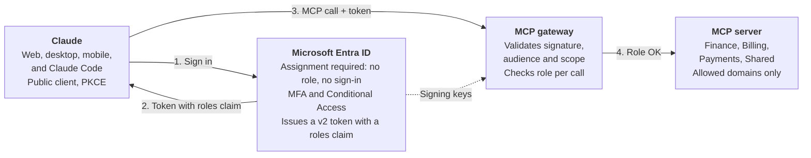

# Company SSO for an Internal MCP Server: Entra ID App Roles, Security Groups and Claude Connectors

## The problem

You can put an internal MCP server behind company SSO with one Entra ID app registration, a handful of app roles and "assignment required". You don't need an identity broker or a custom login page.

Our case: engineers and AI agents use an internal MCP server (a code and document index) from Claude. Two requirements came from security:

- **Company SSO.** People sign in with their Microsoft work account, with MFA and Conditional Access, like every other internal app.
- **Access follows security groups.** Someone in the Finance group can reach the finance index and nothing else. Someone in no group can't sign in at all.

For the user, it should be one URL added as a connector in Claude, followed by a Microsoft sign-in.

The example uses generic names throughout: the tenant is *Contoso*, the server lives at `https://mcp.dev.contoso.com/mcp`, and the data domains are Finance, Billing, Payments and Shared.

## How it fits together

Entra ID is the authorization server, so the MCP server itself never handles a password or a login page.



Claude signs the user in against Entra and receives a token carrying their app roles. The gateway checks that token on every MCP call and forwards only calls whose role covers the requested domain.

> Token refresh runs from Anthropic's servers, so location-based Conditional Access must allow their ranges.

## Five design choices

| Choice | What we picked | Why |
| --- | --- | --- |
| Client type | Public client, "Mobile and desktop applications" platform, auth code + PKCE | Claude doesn't need a client secret. No secret means nothing to rotate, leak or paste into a dialog. |
| Authorization model | App roles, delivered in the `roles` claim | Microsoft recommends app roles for app-level authorization. The `groups` claim carries object IDs, not names, and is capped at 200 groups. |
| Who can sign in | "Assignment required = Yes" on the enterprise app | Entra refuses anyone without a role at sign-in (AADSTS50105), before a token reaches the server. |
| Token format | `requestedAccessTokenVersion = 2` | v2 tokens have a predictable issuer and audience, which keeps gateway validation simple. |
| Audience | Default `api://<client-id>` plus the server's own URL as a second Application ID URI | The MCP client asks for a token for the server URL. Entra must recognise that URL as this API. |

There are two layers of defence. Entra blocks anyone with no role at sign-in, and the gateway checks the role on every call. Each one covers the other's blind spot. For example, Global Administrators bypass "assignment required", but the gateway still refuses them if they have no role.

## Setting it up in Entra, step by step

All of this happens in the Entra admin center (entra.microsoft.com). Before you start, check two things:

- **Verified domain.** `contoso.com` must show as verified under Identity > Settings > Domain names. Entra won't accept an `https://` Application ID URI on a domain the tenant hasn't verified.
- **Licence.** Assigning *groups* to app roles needs Entra ID P1 or P2. Without it, you can only assign individual users.

### 1. Register the app

Go to Identity > Applications > App registrations > New registration. Name it `Engineering MCP (Dev)`, choose **Single tenant**, and leave the redirect URI empty. From the Overview page, copy the **Application (client) ID** and the **Directory (tenant) ID**.

### 2. Add the redirect URIs to the public-client platform

Go to Authentication > Add a platform > **Mobile and desktop applications** and add:

- `https://claude.ai/api/mcp/auth_callback` (claude.ai, Claude Desktop, mobile)
- `http://localhost/callback` (Claude Code; Entra ignores the port on localhost)

The portal refuses `127.0.0.1`, so add it in the Manifest instead:

```json
"publicClient": {
  "redirectUris": [
    "https://claude.ai/api/mcp/auth_callback",
    "http://localhost/callback",
    "http://127.0.0.1/callback"
  ]
}
```

Leave "Allow public client flows" set to **No**. That setting is for device-code and password flows, not for PKCE. If tenant policy refuses an `https` URI on this platform, fall back to the Web platform with a client secret. Hand that secret only to the person who configures the connector.

### 3. Expose an API

Accept the default Application ID URI `api://<client-id>`. Then, in the Manifest, add the server URL as a second URI, with no trailing slash, and request v2 tokens:

```json
"identifierUris": ["api://<client-id>", "https://mcp.dev.contoso.com/mcp"],
"api": { "requestedAccessTokenVersion": 2 }
```

Add one scope, `mcp.access`, with "Who can consent" set to **Admins only**.

### 4. Create the app roles

Under App roles, create five roles, each with member type **Users/Groups**:

| Display name | Value |
| --- | --- |
| MCP Finance Read | `mcp.finance.read` |
| MCP Billing Read | `mcp.billing.read` |
| MCP Payments Read | `mcp.payments.read` |
| MCP Shared Read | `mcp.shared.read` |
| MCP Admin | `mcp.admin` |

The **Value** is what the gateway reads, so it must match the server's configuration exactly.

### 5. Require assignment

Go to Enterprise applications > Engineering MCP (Dev) > Properties and set **Assignment required** to Yes. Optionally set "Visible to users" to No, since people reach the app through Claude, not My Apps.

### 6. Create the groups and assign them

Create five security groups with assigned membership, one per role: `SG-MCP-Finance`, `SG-MCP-Billing`, `SG-MCP-Payments`, `SG-MCP-Shared` and `SG-MCP-Admin`. Add people as **direct** members. Then go to the enterprise app's Users and groups page and assign each group to its matching role.

### 7. Keep the token lean

Under Token configuration, add **no** groups claim, and leave `groupMembershipClaims` empty in the manifest. Assigned roles appear in `roles` automatically.

### 8. Grant admin consent

Under API permissions, add your own `mcp.access` scope plus the Microsoft Graph delegated permissions `openid`, `profile`, `email` and `offline_access`. Then click **Grant admin consent**. With assignment required and an admins-only scope, users can't consent for themselves.

### 9. Conditional Access

- Make sure your standard MFA policy covers the app.
- Claude refreshes tokens from Anthropic's servers, not from the user's laptop. If a policy filters by named location, add Anthropic's published egress ranges as a named location for this app, or refreshes will fail. At the time of writing these were `160.79.104.0/21` and `153.61.208.0/20`; check Anthropic's docs for the current list.
- Keep the default token lifetimes. Add a sign-in frequency control only if you want a forced daily sign-in.

### 10. Hand back

The server team needs only the tenant ID, the client ID, the role values and the group names. No secret is involved.

## Connecting from Claude

Once Entra is ready, an organization admin adds the server as a connector once, and everyone else just signs in.

1. **Add the connector.** In Organization settings > Connectors > Add custom connector, enter the name and `https://mcp.dev.contoso.com/mcp`. If the server doesn't handle client registration itself, choose "Use your own OAuth client", enter the Entra client ID and leave the secret blank.
2. **Start clean.** A connector's authentication settings can't be changed after it's added. If an older entry points at a previous URL, remove it and add the connector again.
3. **Restrict it (Enterprise plans).** Set the connector to Always allow, Needs approval or Blocked for each role.
4. **Users connect.** Under Settings > Connectors > Engineering MCP (Dev) > Connect, users sign in with Microsoft. The connector then works in Claude on the web, desktop and mobile.

For Claude Code on a laptop without the org connector:

```bash
claude mcp add --transport http engineering-mcp https://mcp.dev.contoso.com/mcp
```

Then run `/mcp` inside Claude Code to sign in. The browser comes back to the `localhost` or `127.0.0.1` redirect from step 2.

## Testing, and what tripped us up

Run three tests before anyone else uses it:

- **A user in a group** connects from Claude Desktop and calls one tool. It should succeed.
- **A user in no group** tries to connect. Entra should refuse at sign-in with AADSTS50105.
- **Token check.** Paste an access token into jwt.ms and confirm: `ver` is `2.0`, the audience is this API, `scp` contains `mcp.access`, `roles` holds the expected value, and there's no `groups` claim.

What caught us:

- **Global Administrators bypass "assignment required".** Run the refusal test with a non-admin account, or it will look broken. The gateway's role check is what still stops an admin who has no role.
- **The `https` Application ID URI fails on an unverified domain.** Verify the parent domain first; its subdomains are then covered.
- **`127.0.0.1` only goes in through the manifest.** The portal's form refuses it.
- **Location-based Conditional Access breaks refresh, not sign-in.** The first sign-in comes from the user's browser and works. The refresh an hour later comes from Anthropic's servers and fails unless their ranges are allowed.

## The request that looks reasonable: "nest the admin group in the others"

A week in, we got this request: "Add me to `SG-MCP-Admin`, and add that group as a member of the Finance, Billing, Payments and Shared groups so admins can see everything." Don't do the nesting part.

**It doesn't work.** Entra doesn't pass app role assignments through nested groups. Only direct members of an assigned group get its role. Admins nested inside `SG-MCP-Finance` still get no `mcp.finance.read` in their token.

**It would be a bad idea even if it worked:**

- **Least privilege.** "Administers the MCP service" and "can read finance data" are different permissions. Nesting quietly gives every future admin read access to every domain.
- **Audits get harder.** A reviewer opening the Finance group sees another group, not a list of people. That's the group where you most want a plain list.
- **It's hard to undo.** You can't remove one domain from admins later without unpicking the nesting.

**What to do instead,** if the data owner agrees admins should read every domain:

| Option | How | Trade-off |
| --- | --- | --- |
| Assign the admin group to several roles (recommended) | On the enterprise app, assign `SG-MCP-Admin` to each of the four read roles as well as `mcp.admin` | Every grant shows on the app's assignment list, and you can remove one domain without touching the others |
| Let the role imply the others | The gateway treats `mcp.admin` as including every read role | No Entra change, but the rule lives in server config, not in the directory |
| Add people directly | Add the person to each domain group they need | Most explicit, with more memberships to maintain |

Adding the person to `SG-MCP-Admin` as a direct member is fine, once the service owner approves it.

## Checklist

- [ ] Domain verified, P1/P2 licence confirmed
- [ ] Single-tenant app with public-client redirect URIs (claude.ai, localhost, 127.0.0.1 through the manifest)
- [ ] Server URL added as a second Application ID URI, v2 tokens, `mcp.access` scope (admins only)
- [ ] One app role per data domain plus an admin role
- [ ] Assignment required on the enterprise app
- [ ] One security group per role, direct members, no nesting
- [ ] No groups claim, admin consent granted
- [ ] MFA applies, Anthropic's refresh ranges allowed in location policies
- [ ] Tested with an in-group user, an out-of-group non-admin user, and a decoded token

Once it's in place, giving someone access is a group membership change. Revoking it is the same change in reverse, and both show up in the directory's audit log.
