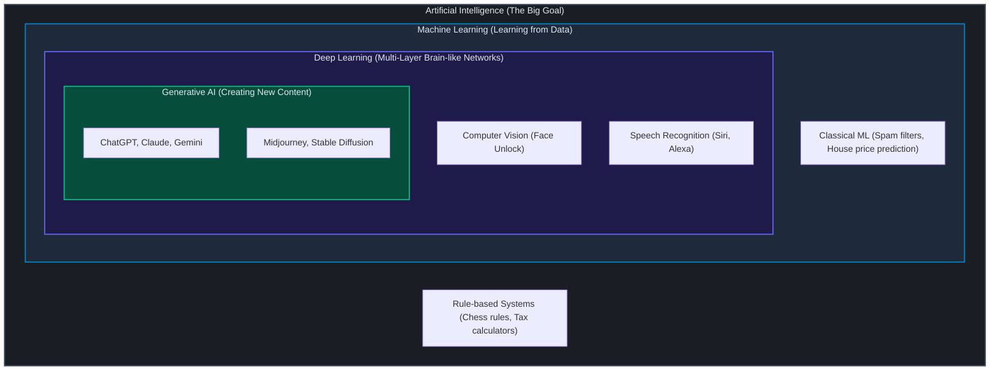
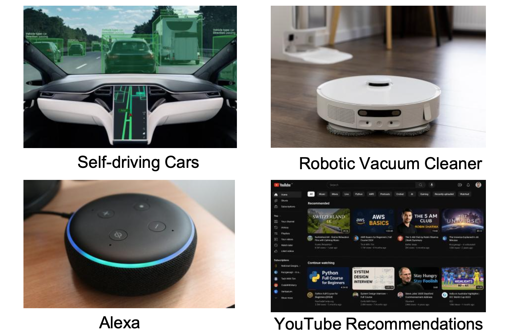
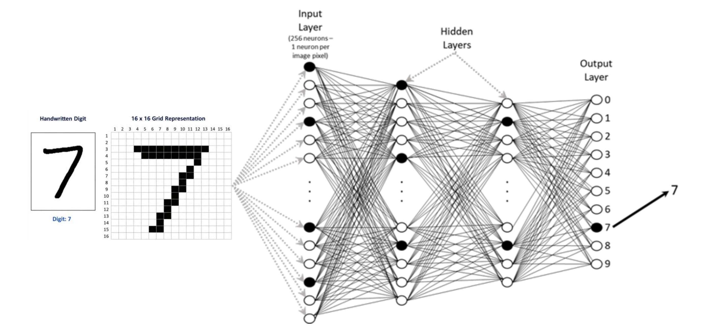
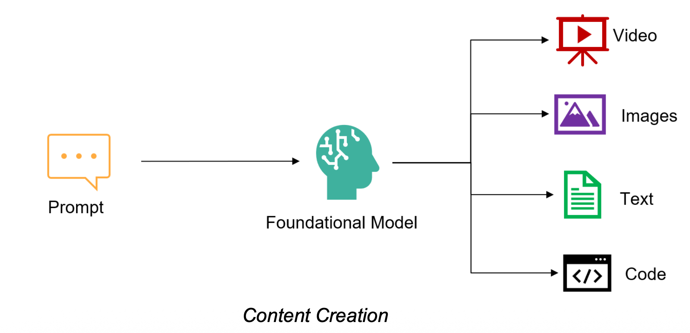

# AI, ML, Deep Learning & Generative AI: Explained Simply

If you browse tech news today, you will see terms like **AI**, **Machine Learning**, **Deep Learning**, and **Generative AI** everywhere. People often mix them up as if they all mean the exact same thing.

They are closely related, but they are **not** the same thing. 

The easiest way to understand them is to think of Russian nesting dolls: each one sits inside the bigger one.



Here is the quick 10-second summary:
- **AI** is the big goal: making machines behave smartly like humans.
- **Machine Learning (ML)** is the method: letting computers learn patterns from data instead of programming every single rule.
- **Deep Learning (DL)** is a specialized technique: using deep neural networks (inspired by human brains) to understand complex things like pictures and voice.
- **Generative AI (GenAI)** is the modern creative twist: instead of just analyzing data, it creates brand-new content like text, code, images, and audio.

---

## 1. Artificial Intelligence (AI): The Umbrella

**Artificial Intelligence** is the broad term for any technology that enables a machine to mimic human-like intelligence.

When humans solve problems, we reason, recognize objects, understand language, and make decisions. AI is simply the goal of getting computers to do those same things.

{: .note }
> **In Simple Words:**  
> AI = Any computer system designed to do a task that normally requires human intelligence.

<p align="center">
  
</p>

### Two Ways to Build AI:
1. **Rule-Based AI (Old School):**
   - Humans write down hundreds of `if/else` rules.
   - *Example:* A chess game in the 1990s. Programmers wrote rules like: *"If the king is threatened and you can move a pawn, move the pawn."*
   - *Problem:* It breaks easily when something unexpected happens. You cannot write enough rules to cover real-life messiness.
2. **Learning-Based AI (Modern School):**
   - Instead of writing rules, you show the computer millions of examples, and it figures out the rules itself. This is **Machine Learning**.

---

## 2. Machine Learning (ML): Learning from Data

**Machine Learning** is a branch of AI where computers learn from data and make predictions or decisions without someone programming every specific rule.

{: .tip }
> **The Key Difference:**
> - **Traditional Programming:** You give the computer **Data + Rules** $\longrightarrow$ it gives you **Answers**.
> - **Machine Learning:** You give the computer **Data + Answers** $\longrightarrow$ it figures out the **Rules**.

### A Real-Life Example: Email Spam Filter
Imagine you want to build a spam filter:

- **Traditional Way:** You sit down and write rules:
  ```python
  if "free money" in email or "click here now" in email:
      mark_as_spam()
  ```
  Spammers quickly change their text to *"fr33 m0ney"* or *"click below"*, and your rules fail. You have to keep updating rules forever.

- **Machine Learning Way:** You give the computer 500,000 past emails that humans already marked as `spam` or `not spam`.
  The ML algorithm looks at words, senders, links, and timing. It notices thousands of subtle patterns on its own. When a new email arrives, it calculates the probability: *"There is a 98% chance this is spam."*

### Popular Classical ML Use Cases:
- Predicting house prices based on size, location, and bedrooms.
- Predicting whether a bank customer might default on a loan.
- Predicting which employees might leave a company in the next 3 months.
- Recommending products on Amazon or movies on Netflix.

---

## 3. Deep Learning (DL): Deep Neural Networks

**Deep Learning** is a powerful subfield of Machine Learning inspired by how neurons in the human brain work. It uses **Artificial Neural Networks** with many layers (that is why it is called *"Deep"*).

<p align="center">
  
</p>

### Why Do We Need Deep Learning?
Classical ML works wonders with numbers and clean tables (like Excel sheets with columns for age, salary, and tenure).

But what if your data is an image of a dog? An image is just a grid of millions of colored numbers (pixels). Classical ML struggles here because nobody can write a simple mathematical formula for *"what makes a dog look like a dog"*.

Deep Learning solves this by learning in layers:

```
[Raw Pixels] ──> [Layer 1: Detects edges and lines]
             ──> [Layer 2: Combines edges into shapes (ears, noses)]
             ──> [Layer 3: Combines shapes into faces]
             ──> [Output: "Golden Retriever - 99% Confidence"]
```

### What Deep Learning Powers Today:
- **Computer Vision (CV)** - Face unlock in smartphones, self-driving cars identifying pedestrians and stop signs, medical imaging analysis (X-rays, CT scans) to detect tumors.
- **Automatic Speech Recognition (ASR)** - Voice assistants like Siri, Alexa, and Google Assistant converting spoken language into text for processing.
- **Natural Language Processing (NLP)** - Chatbots, sentiment analysis, language translation, text summarization, and virtual assistants.

---

## 4. Generative AI (GenAI): The Creative Machine

**Generative AI** is a type of Deep Learning that does not just analyze or classify existing data—it **creates brand-new, original content**.

### Understanding the Difference: Classifier vs. Creator

| Traditional AI / ML (Discriminative) | Generative AI (GenAI) |
| :--- | :--- |
| **Analyzes and labels existing things** | **Creates brand-new things** |
| *"Is this photo a cat or a dog?"* | *"Draw me a picture of an astronaut cat riding a skateboard on Mars."* |
| *"Is this customer review positive or negative?"* | *"Write a polite 3-paragraph reply apologizing for the delay."* |
| *"Will it rain tomorrow? (Yes/No)"* | *"Write a Python script to fetch tomorrow's weather from an API."* |

### Common Generative AI Tools:
- **Text & Code Generators:** ChatGPT, Claude, Gemini, GitHub Copilot (powered by Large Language Models / Transformers).
- **Image Generators:** Midjourney, DALL-E, Stable Diffusion (powered by Diffusion Models).
- **Audio & Video Generators:** Suno (music), Runway, Sora (video).


<p align="center">
  
</p>


---

## Quick Comparison at a Glance

{: .important }
> Here is a simple reference table to remember how they differ:

| Concept | What is it? (Simple Definition) | What does it take in? | What does it give you? | Example |
| :--- | :--- | :--- | :--- | :--- |
| **AI** | The broad dream of smart machines | Any problem or data | Intelligent actions or answers | A chess bot, GPS navigation |
| **Machine Learning** | Learning patterns from data without hand-written rules | Structured data, numbers, history | Predictions, categories, scores | Spam detection, churn prediction |
| **Deep Learning** | Multi-layer neural networks for messy, perceptual data | Images, audio, video, raw text | High-level recognition and understanding | Self-driving vision, Face ID |
| **Generative AI** | Deep learning models that synthesize new content | A text prompt or instruction | New text, images, code, voice | ChatGPT writing essays, Midjourney images |

---

## When Should You Use Which?

When you have a problem to solve at work, do not jump straight to the most complex tool:

1. **If a simple rule or formula works $\longrightarrow$ Use Standard Code.**  
   *Example:* Calculating employee overtime pay. Do not use AI; just use basic math (`hours * rate * 1.5`).
2. **If you have structured table data and need a prediction $\longrightarrow$ Use Classical Machine Learning.**  
   *Example:* Predicting loan defaults or churn. Tools like XGBoost or Random Forests are fast, cheap, and highly accurate.
3. **If your inputs are images, video, or audio $\longrightarrow$ Use Deep Learning.**  
   *Example:* Inspecting factory parts on a conveyor belt for scratches using a camera.
4. **If you need language understanding, writing, reasoning, or content generation $\longrightarrow$ Use Generative AI.**  
   *Example:* Summarizing long customer contracts, drafting emails, or answering employee questions from internal documentation.

---

## Summary

- **AI** is the umbrella concept: building machines that act intelligently.
- **ML** is the core engine: computers learning from past examples.
- **Deep Learning** is the brain-inspired technique: solving vision, speech, and complex data with layers.
- **Generative AI** is the creative breakthrough: generating new text, images, and code on demand.

Now that the definitions are clear, how does a machine actually "learn"? In the next article, we look at the simple mechanics behind it: **[How Machines Learn: The Core Mechanics](/docs/ml/basics/how-machines-learn/)**.
