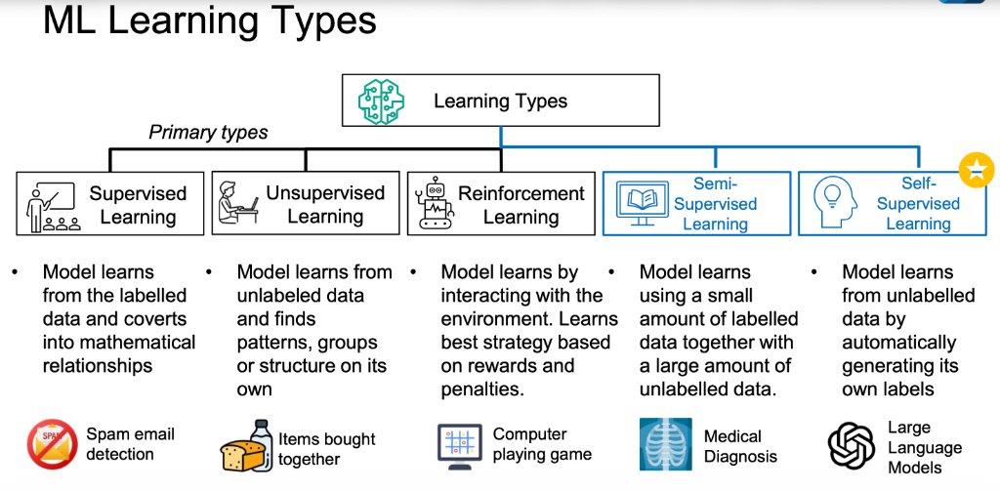
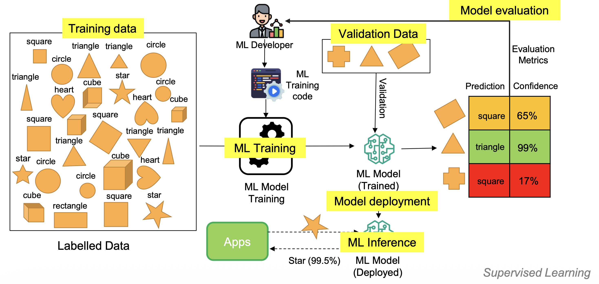
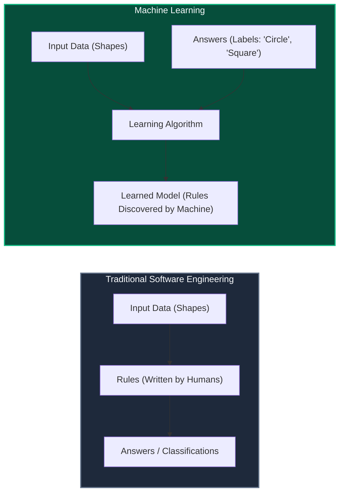
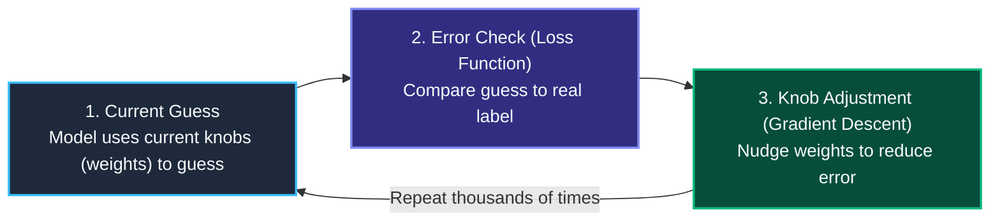

# How Machines Learn: The Core Mechanics

When people say a computer is *"learning"*, it sounds like science fiction—as if the computer has a brain, consciousness, and intuition. 

In reality, inside a machine, there is no conscious thought.

So what does "learning" actually mean?

In plain English: **Learning is a process of trial, error, and adjustment.**

Think of learning how to shoot a basketball into a hoop:
1. You take your first shot. You miss by 2 feet to the left.
2. Your eyes and brain note the error: *"Too far left, thrown too hard."*
3. You adjust your angle, stance, and strength, and throw again.
4. After 50 practice shots, your throws get closer and closer until you consistently swish the ball through the net.

A machine learning algorithm does the exact same thing—except instead of muscles, it adjusts mathematical numbers called **weights**.

---

## The 5 Ways Machines Learn

Before diving into the inner math of how a model tunes its weights, let's step back and look at the big picture. How do computers learn from data?

Depending on the type of data available and how the machine receives feedback, machine learning is organized into five core learning paradigms:

<p align="center">
  
</p>

### 1. Supervised Learning (Learning with an Answer Key)
- **How it works:** The model learns from **labelled data** (input examples paired with their known correct answers) and converts them into mathematical rules.
- **Example:** **Spam email detection.** You show the computer 100,000 past emails marked as *"Spam"* or *"Not Spam"*, and it learns to predict future emails.

### 2. Unsupervised Learning (Finding Hidden Patterns)
- **How it works:** The model is fed **unlabelled data** with no answers. It explores the data on its own to discover hidden clusters, groups, and structures.
- **Example:** **"Items bought together" (Market Basket Analysis).** Finding out that customers who buy bread also buy milk and butter, grouping them automatically without any human guidance.

### 3. Reinforcement Learning (Learning by Trial and Reward)
- **How it works:** An AI agent interacts with a dynamic environment, learning winning strategies based on **rewards (+1)** for good actions and **penalties (-1)** for mistakes.
- **Example:** **Computers playing games.** Chess engines and AlphaGo playing millions of matches against themselves to learn optimal gameplay.

### 4. Semi-Supervised Learning (The Hybrid Approach)
- **How it works:** Hand-labeling data is slow and expensive. The model trains using a **small amount of labelled data** alongside a **massive pool of unlabelled data**.
- **Example:** **Medical Diagnosis.** Training on 500 expert-labeled X-ray scans combined with 50,000 raw unlabelled scans.

### 5. Self-Supervised Learning (The Foundation of Modern AI)
- **How it works:** The model automatically creates its own labels by masking parts of the input data and learning to predict the missing pieces.
- **Example:** **Large Language Models (LLMs like ChatGPT, Claude, Gemini).** Reading raw text from the web and continuously training itself to predict the hidden next word in every sentence.

---

## The Supervised Learning Blueprint: How a Model Learns

Because **Supervised Learning** powers over 85% of practical enterprise applications, let's zoom in on how a supervised model actually learns using the workflow below:

<p align="center">
  
</p>

This diagram captures the complete **Supervised Learning** lifecycle. Let's break down each stage in the picture step-by-step:

1. **Labelled Training Data:** Teaching the computer using past examples paired with their correct answers.
2. **ML Training & Code:** The algorithm iteratively adjusting its knobs to find patterns.
3. **Validation Data & Confidence Scores:** Testing the model on new, unseen examples to see how confident its guesses are.
4. **Evaluation Feedback Loop:** Measuring errors and sending feedback back to the developer to improve the model.
5. **Model Deployment & Inference:** Serving the finalized model in production so real apps can send new queries and get instant answers.

Let's dive into each part of this process.

---

## 1. Traditional Programming vs. Machine Learning

Before we look at the training box, let's contrast how we used to solve problems with how machine learning solves them:



### The Traditional Way (Rule-Based)
Imagine writing code to identify whether a shape is a square, triangle, or star:
```python
def classify_shape(corners, sides, is_round):
    if is_round:
        return "circle"
    elif corners == 3 and sides == 3:
        return "triangle"
    elif corners == 4 and sides == 4:
        return "square"
    # What if the square is tilted? What if the line is slightly curved?
    # You have to write hundreds of fragile edge cases!
```
If someone feeds a rotated square or a hand-drawn circle with bumpy edges, rule-based code breaks down. Humans cannot write enough `if/else` conditions to cover the real world.

### The Machine Learning Way (Data-Driven)
Instead of hardcoding rules, we collect thousands of examples of shapes and their names (the **Labelled Data** in the diagram). 

We feed those examples into an ML training algorithm. The algorithm inspects the pixels, angles, and lines, measures its mistakes, and discovers its own mathematical rules.

---

## 2. Stage 1: Labelled Data (The Study Material)

Look at the left box of our diagram:

```
┌────────────────────────────────────────────────────────┐
│                   Training Data                        │
│                                                        │
│   square [■]      triangle [▲]      circle [●]         │
│   heart [♥]       cube [🧊]         star [★]           │
│   rectangle [▬]   triangle [▲]      circle [●]         │
│                                                        │
│                    Labelled Data                       │
└────────────────────────────────────────────────────────┘
```

This is **Supervised Learning**. It is called "supervised" because the data comes with an answer key:
- **Features ($X$):** The raw input (e.g., the image pixels or dimensions of the shape).
- **Labels ($y$):** The true answer associated with each shape (`"square"`, `"triangle"`, `"circle"`).

The computer cannot learn without these pairs. The more diverse and clean this dataset is, the better the model will be.

{: .tip }
> You can think of features as columns.

---

## 3. Stage 2: ML Model Training (The Engine)

In the middle of the diagram, the **ML Developer** writes the **ML Training Code** and triggers the **ML Training** process.



What actually happens inside the "ML Training" box? It comes down to three mathematical concepts:

### A. The Knobs: Weights and Biases
Inside the model, every input feature is multiplied by an adjustable number called a **Weight** ($w$), and shifted by a baseline number called a **Bias** ($b$):

$$\text{Prediction} = (w_1 \cdot \text{Feature}_1) + (w_2 \cdot \text{Feature}_2) + b$$

- When training begins, all weights and biases are **random numbers**. 
- The model's initial guesses are wild shots in the dark.

### B. Measuring Mistakes: The Loss Function
After each guess, the algorithm checks the true label. The **Loss Function** computes a penalty score measuring how wrong the guess was:
$$\text{Loss} = (\text{Actual Label} - \text{Predicted Probability})^2$$
If the shape was a Triangle and the model guessed Square with 80% confidence, the Loss is huge. If it guessed Triangle with 95% confidence, the Loss is near zero.

### C. Turning the Knobs: Gradient Descent
How does the computer adjust its weights so that the Loss goes down? It uses **Gradient Descent**.

{: .note }
> **The Foggy Mountain Analogy:**  
> Imagine you are blindfolded on a foggy mountain and want to find the lowest valley (zero error):  
> 1. You feel the slope under your feet.  
> 2. You take a small step downward.  
> 3. You feel the slope again and take another step downward.  
> 4. You repeat this until the ground is flat—you have found the bottom of the valley!

In machine learning, the slope is called the **Gradient**. The algorithm takes small steps (governed by the **Learning Rate**) in the direction that makes the Loss smaller.

---

## 4. Stage 3: Validation Data & Confidence Scores

Once training finishes, we have a candidate **ML Model (Trained)**. 

Now look at the upper-right section of our diagram:

```
            Validation Data: [ ✛ ]   [ ▲ ]   [ ◆ ]
                                   │
                                   ▼
                         [ Trained ML Model ]
                                   │
                                   ▼
┌───────────────────────┬────────────┬────────────────────────┐
│ Unseen Test Shape     │ Prediction │ Confidence Score       │
├───────────────────────┼────────────┼────────────────────────┤
│ Tilted Square [ ◆ ]   │ square     │ 65%  (Moderate / Amber)│
│ Triangle      [ ▲ ]   │ triangle   │ 99%  (High / Green)    │
│ Plus Sign     [ ✛ ]   │ square     │ 17%  (Low / Red)       │
└───────────────────────┴────────────┴────────────────────────┘
```

Notice what is happening here:
1. **Validation Data is Separate:** These shapes were **never** shown to the model during training. This simulates the real world.
2. **Every Prediction Has a Confidence Score:** The model does not just output a label; it outputs a probability (from 0% to 100%).

### Analyzing the Three Diagram Examples:

#### 1. The Triangle [ ▲ ] $\longrightarrow$ Prediction: `triangle` (99% Confidence - Green)
- **Why?** The triangle in validation matches the triangles in the training set closely. The model recognized 3 straight lines and 3 sharp angles with almost total certainty.

#### 2. The Tilted Square [ ◆ ] $\longrightarrow$ Prediction: `square` (65% Confidence - Amber)
- **Why?** In the training data, squares were mostly upright. When shown a tilted square (diamond), the model still sees 4 equal straight sides and 4 right angles, but the rotation confuses it slightly. It correctly predicts `"square"`, but with lower confidence (65%).

#### 3. The Plus Sign [ ✛ ] $\longrightarrow$ Prediction: `square` (17% Confidence - Red)
- **Why?** Look closely at the training dataset on the left: **there was never a plus sign in the training data!**
- Because the model *must* pick from the classes it knows, it looks for the closest rough match (4 symmetrical arms resembles 4 corners) and weakly guesses `"square"` with a dismal **17% confidence**.
- This is a critical lesson in machine learning: **A model only knows what you teach it.** When exposed to completely new concepts, it will make low-confidence guesses.

---

## 5. Stage 4: Model Evaluation & The Developer Loop

In the diagram, notice the arrow leading from the evaluation table back to the **ML Developer**:

$$\text{Validation Results} \longrightarrow \text{Evaluation Metrics} \longrightarrow \text{ML Developer}$$

Evaluation is not just a pass/fail grade—it is a diagnostic tool:
- If the model gets **99% on Triangles** but **fails on Tilted Squares**, the developer learns: *"We need to add rotated shapes to our training data."*
- If the model gets confused by **Plus Signs**, the developer learns: *"We need to add a new category for Crosses, or set a confidence threshold where anything below 40% is flagged as 'Unknown'."*

The developer updates the training dataset, adjusts the training code, and trains again until the evaluation metrics meet the production standard.

---

## 6. Stage 5: Model Deployment & Live ML Inference

Once the model passes validation with high scores, it is ready for the real world:

```mermaid
flowchart LR
    NewShape["New Unseen Input<br/>Star [ ★ ]"] --> Deployed["Deployed ML Model<br/>(Hosted on Server)"]
    Deployed --> Pred["ML Inference<br/>Output: 'Star (99.5%)'"]
    Pred --> App["Client Applications<br/>(Web / Mobile / Enterprise App)"]

    style NewShape fill:#1e293b,stroke:#38bdf8,stroke-width:2px,color:#f8fafc
    Deployed fill:#064e3b,stroke:#10b981,stroke-width:2px,color:#f8fafc
    Pred fill:#78350f,stroke:#fbbf24,stroke-width:2px,color:#f8fafc
    App fill:#1e1b4b,stroke:#818cf8,stroke-width:2px,color:#f8fafc
```

Notice the key difference between **Training** and **Inference**:
- **Training (Offline):** The slow, computationally heavy process of learning weights from thousands of historical examples.
- **Inference (Online / Live):** The instant, lightweight process of running a single new input through the frozen model.
  - In our diagram, a user uploads a new shape: a **Star ($\bigstar$)**.
  - The deployed model computes the prediction in milliseconds: `"Star (99.5%)"`.
  - The answer is sent back to the **App** to display to the user.

---

## 7. The Learning Mechanics in 30 Lines of Python

To see how training, loss, and weight adjustment work in code without black-box libraries, here is a complete Python training loop. It learns the linear relationship **$y = 2x + 1$** through trial and error:

```python
import random

# 1. Labelled Training Data: (Input Feature x, True Answer y)
# The true relationship is: y = 2x + 1
training_data = [(1, 3), (2, 5), (3, 7), (4, 9), (5, 11)]

# 2. Initialize knobs (Weight and Bias) randomly
weight = random.uniform(0.0, 1.0)
bias = random.uniform(0.0, 1.0)
learning_rate = 0.05
epochs = 100

print(f"Initial Random Knobs -> Weight: {weight:.2f}, Bias: {bias:.2f}\n")

# 3. The Training Loop (Trial, Error, Adjustment)
for epoch in range(epochs):
    total_loss = 0.0
    
    for x, true_y in training_data:
        # Step A: Make a guess (Forward Pass)
        prediction = (weight * x) + bias
        error = prediction - true_y
        total_loss += error ** 2
        
        # Step B & C: Calculate Gradient and Nudge Knobs (Gradient Descent)
        weight -= learning_rate * (2 * error * x) / len(training_data)
        bias   -= learning_rate * (2 * error) / len(training_data)
        
    if (epoch + 1) % 25 == 0:
        print(f"Round {epoch+1:3d} | Total Loss: {total_loss:.4f} | Weight: {weight:.2f}, Bias: {bias:.2f}")

# 4. Final Learned Model
print(f"\nFinal Learned Formula: y = {weight:.2f}x + {bias:.2f}")

# 5. Live Inference on a brand-new unseen input (x = 10)
unseen_x = 10
predicted_y = (weight * unseen_x) + bias
print(f"Inference on unseen x={unseen_x}: Predicted y = {predicted_y:.2f} (Expected: 21.00)")
```

### What Happens When You Run This:
1. **Round 1:** The model's guesses are wild errors because the knobs started randomly.
2. **Round 25–75:** On every pass, the loss function measures the error, and gradient descent nudges the weight and bias closer to the truth.
3. **Round 100:** The model converges on **Weight = 2.00** and **Bias = 1.00** all by itself!
4. **Inference:** When fed $x = 10$ (which it never saw during training), it instantly calculates $2(10) + 1 = 21.00$.

---

## Summary: The Mental Model

| Stage in Diagram | What Happens | Real-World Meaning |
| :--- | :--- | :--- |
| **Labelled Data** | Images paired with text tags | The textbook and study material with answer keys. |
| **ML Training** | Adjusting weights via Gradient Descent | The student practicing over and over, learning from mistakes. |
| **Validation Data** | Unseen shapes tested on the model | The mock exam to test if the student truly understands or just memorized. |
| **Confidence Scores** | Probabilities (e.g., 99% vs 17%) | How sure the model is about its decision. |
| **Developer Feedback** | Metrics routed back to engineer | Finding gaps in the curriculum (e.g., adding rotated shapes). |
| **ML Inference** | Deployed model answering live queries | Graduation day: answering real questions for client apps in milliseconds. |

Now that you understand the mechanics of how algorithms learn from data, how do teams take this from an experiment to a full production lifecycle? 

In the next article, we explore **[The Machine Learning Lifecycle: An End-to-End Overview](/docs/ml/basics/machine-learning-lifecycle/)**.
