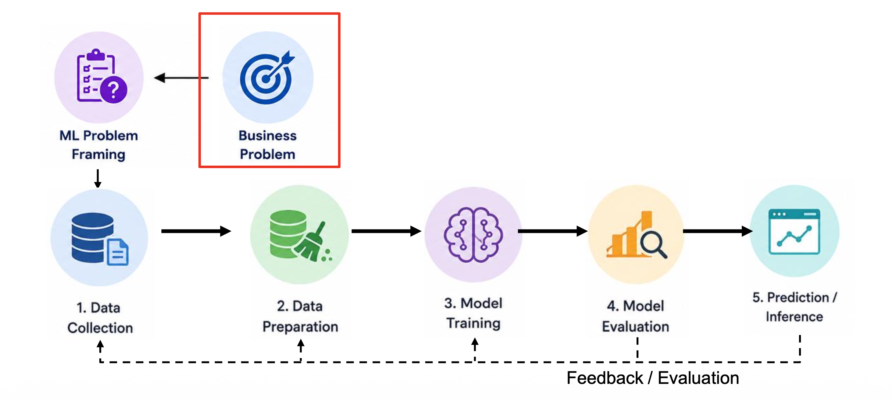
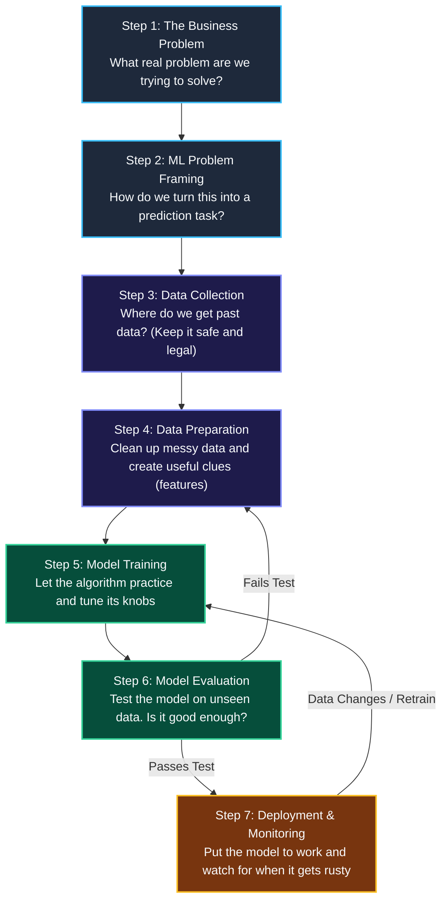

# The Machine Learning Lifecycle: Explained Simply

Building a machine learning project is very different from building a standard website or mobile app.

In traditional software, you write code, test it, deploy it, and you are mostly done. As long as nobody changes the server, your code will keep working the exact same way for years.

Machine learning is not like that. An ML system is made of three things:
$$\text{Code} + \text{Data} + \text{The Changing World}$$

Because human behavior and real-world data are constantly changing, an ML system is never really "finished". It is a continuous loop.

In this guide, we walk through the **7 core steps** of building any real-world machine learning system.

---

## The 30,000-Foot View: The 7 Steps

Here is the step-by-step journey of an ML project from start to finish:

<p align="center">
  
</p>



Let's break down what happens in each step using a real-world example: **Predicting Employee Attrition** (figuring out which employees might quit so managers can help retain them).

{: .important}
> You may heard the terms **$Prediction$**, **$Inference$**, and **$Serving$**.
> - **$Inference$** is the technical term for when the trained model makes a prediction on new data.
> - **$Serving$** refers to the infrastructure pattern used to deliver those predictions (e.g., a web API).
> So, "Deployment" is the overall process, and "Inference/Serving" is what happens inside it.

> You may notice that "Deployment" and "Monitoring" are not just the end of the line, but a loop that feeds back into training the model. This is the core idea of MLOps.

---

### Step 1: The Business Problem

* Clearly define the business objective or challenge to be solved.
* Determine whether AI/ML is the right solution for the problem.

{: .important}
> Never start a project by saying: *"Hey, let's use AI!"*
>
> Always start with: *"What business headache are we trying to fix?"*

- **Example:** A company with 500,000 employees loses 15,000 valuable workers every year. Replacing an employee costs \$50,000 in recruiting and lost work.

- **Goal:** Spot at-risk employees a few months early so HR and managers can check in, resolve issues, and offer better growth opportunities.

{: .important}
> ### When NOT to use Machine Learning?
> 1. Simple rule-based logic: If a problem can be solved with straightforward 'if-then' statements or standard programming, machine learning adds unnecessary complexity. e.g. Tax computation
> 2. Lack of data: If there is not enough high-quality, relevant data to train a model accurately.
> 3. When explainability and deterministic outcomes are critical : In highly regulated industries (e.g., healthcare or law), black-box models are risky because you cannot explain how a specific decision was made.

```bash
### Predict Exam Result
Rule: If Marks < 35 → Fail, 35–60: Grade B, 61–80: Grade A, 81+ : Grade A+
 * Rules are already clearly defined
 * Output is deterministic
 * No pattern learning is needed
```

```bash
### Predict house prices
Dataset: Pricing details available for 10 houses only.
 * Model cannot learn meaningful patterns
 * Predictions become inaccurate
```

---

### Step 2: ML Problem Framing

Translate the business problem into a machine learning problem.
 * Identify the required input data, ML learning type, ML task type and ML model type
 * Define model output, Model evaluation metrics and Success criteria for the model.

Translate that human goal into a mathematical task:
- Instead of *"keep people happy"*, we frame it as:  
  *"Predict the probability (between 0% and 100%) that an employee will leave the company in the next 90 days."*
- Because we have past records of who stayed and who left, this is a **Supervised Classification** problem.

---

### Step 3: Data Collection
A machine cannot learn without past examples. Where does the data live?
- **Sources:** HR databases, payroll records, training course logs, performance reviews.
- **Important:** We must remove personal sensitive details (names, personal phone numbers, emails) so employee privacy is protected under laws like GDPR.

---

### Step 4: Data Preparation (Cleaning & Feature Prep)
Raw enterprise data is always messy.
- **Fixing holes:** Fill in missing values (e.g., an employee who didn't take an optional survey).
- **Removing errors:** An employee whose age is listed as `210 years` is clearly a typo.
- **Creating clues (Features):** Machines need useful signals. For example, instead of just raw salary, we create a helpful clue:
  $$\text{Salary Ratio} = \frac{\text{Employee Salary}}{\text{Department Average Salary}}$$
  (If someone makes 30% below their peers, they are more likely to look for another job).

---

### Step 5: Model Training
Now we feed our prepared data into a machine learning algorithm (like Random Forest or XGBoost).
- The algorithm looks through thousands of past employees.
- It tests different weights and adjustments.
- It gradually learns which patterns signal that someone is thinking of quitting (e.g., long commute + no promotion in 4 years + below-average pay).

---

### Step 6: Model Evaluation (Testing)
Never trust a model on the data it just practiced on! That is like giving a student the exact exam questions the night before.

- We test the model on a **separate set of test data** it has never seen before.
- We check:
  - How many at-risk employees did it catch? (Recall)
  - When it flags someone, how often is it right? (Precision)
- If the model's score is bad, we do **not** launch it. We go back to Step 4 to clean more data or engineer better features.

---

### Step 7: Deployment, Inference & Monitoring
Once the model passes testing, we deploy it into production.

- **Inference (Making Predictions):** Once a month, the model reads the latest employee data and outputs a risk score for managers.
- **Monitoring (Watching for Drift):** What happens if the economy changes, or everyone starts working remotely? The old patterns might stop working. We continuously monitor the model. If its accuracy drops, we trigger an automated retraining loop with fresh data.

---

## Why Is the ML Lifecycle a Loop?

Traditional software is a straight line: write code $\rightarrow$ ship code.

Machine learning is an **interactive feedback loop**:

```
[Deploy Model] ──> [Monitor Live Results] ──> [Data Shifts] ──> [Retrain with New Data]
```

{: .important }
> **Why Models Get "Rusty":**  
> Unlike regular software that stays the same, ML models naturally decay over time because human habits, seasons, and market conditions shift. A model trained on 2023 data will make mistakes in 2026 unless it is refreshed.

---

## Who Works on This? (The Team Roles)

Building an enterprise ML project takes a small team of specialists:

| Role | What They Do (In Simple Terms) | Tools They Use |
| :--- | :--- | :--- |
| **Product Manager** | Defines the business goal, sets the budget, and makes sure the team solves the right problem. | Jira, Dashboards |
| **Data Engineer** | Builds the data pipelines that pull raw data safely from databases and cleans out private info. | SQL, Airflow, Spark, Kafka |
| **Data Scientist** | Explores the data, engineers useful features, and trains the machine learning algorithms. | Python, Pandas, Scikit-Learn, XGBoost |
| **MLOps / DevOps Engineer** | Packages the model, deploys it to servers (Kubernetes), scales it, and sets up alerts when the model gets rusty. | Docker, Kubernetes, Prometheus, Triton |

---

## Summary

- The **ML Lifecycle** is the complete journey of turning a business idea into an intelligent, working software tool.
- It consists of **7 steps**: Business Problem $\rightarrow$ Framing $\rightarrow$ Data Collection $\rightarrow$ Data Prep $\rightarrow$ Training $\rightarrow$ Evaluation $\rightarrow$ Deployment & Monitoring.
- It is a **loop, not a straight line**: real-world data changes, so models need ongoing monitoring and retraining.

Now, let's zoom in on the first two critical steps: **[Business Problem Definition & ML Problem Framing](/docs/ml/basics/business-problem-and-ml-framing/)**.
