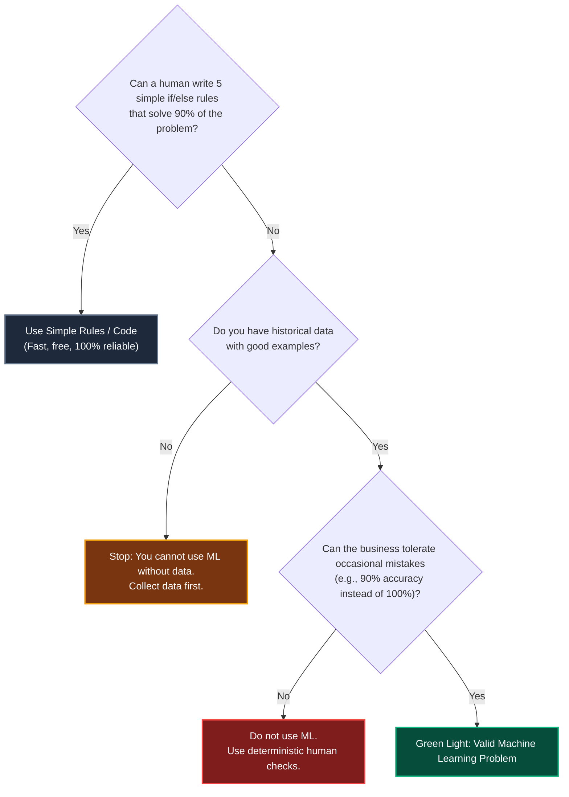
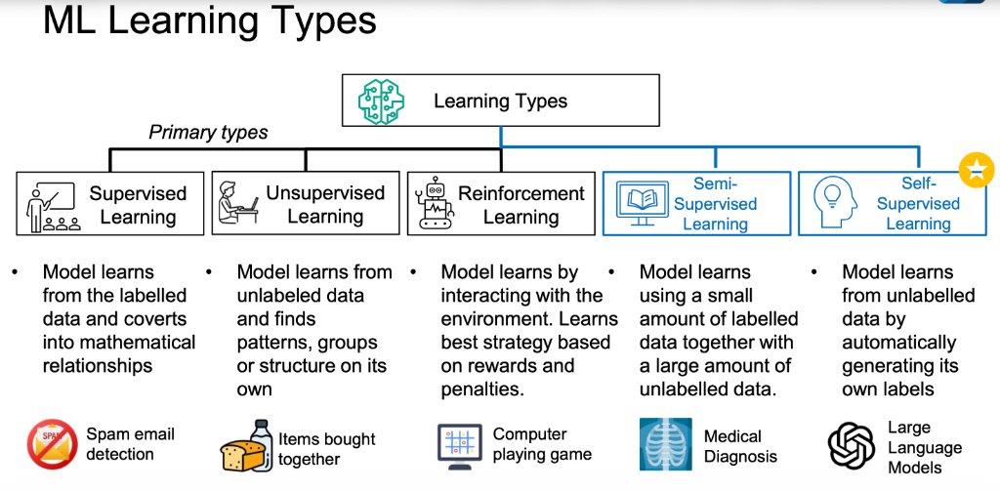

# Business Problem & ML Problem Framing: Explained Simply

The number one reason machine learning projects fail has nothing to do with bad code or slow computers. 

They fail because the team **built the wrong thing**.

Engineers often get excited about shiny new algorithms and start coding before asking: *"What exact problem are we trying to solve, and will this model actually help a human make a better decision?"*

In this guide, we look at how to take a messy business problem and turn it into a clear, solvable machine learning task.

---

## 1. Step 1: The Business Problem

Every ML project must begin with an actual business headache. 

```
❌ Bad Starting Point:  "Let's use an AI neural network to analyze our employee database!"
✅ Good Starting Point: "We are losing 15% of our top engineers every year, and it costs us $30M to replace them. Can we spot who is unhappy 3 months earlier so managers can help?"
```

### The Three Golden Questions:
Before writing a single line of code, ask:
1. **What is the painful problem?** (e.g., *"Customers are canceling their subscriptions after month 2."*)
2. **What will a human do with the prediction?** (e.g., *"If we know who is likely to cancel, customer support can call them with an offer or help them onboard."*)
3. **What is the economic value?** (e.g., *"Saving even 5% of these customers keeps $1M in revenue."*)

{: .important }
> **The Golden Rule:** If nobody can take action on the prediction, **do not build the model**. A prediction that sits in a spreadsheet and changes nobody's behavior has zero value.

---

## 2. The Litmus Test: Do You Actually Need ML?

Machine learning is expensive to build and maintain. Before building an ML model, make sure you cannot solve the problem with a simple rule.



{: .tip}
> ### When NOT to use Machine Learning?
> 1. Simple rule-based logic: If a problem can be solved with straightforward 'if-then' statements or standard programming, machine learning adds unnecessary complexity. e.g. Tax computation
> 2. Lack of data: If there is not enough high-quality, relevant data to train a model accurately.
> 3. When explainability and deterministic outcomes are critical : In highly regulated industries (e.g., healthcare or law), black-box models are risky because you cannot explain how a specific decision was made.
> 4. You have no past data: If you launched a brand new website yesterday, you have no data to learn from. Build simple rules first.
> 5. A simple SQL filter solves it: If simply filtering `WHERE days_inactive > 30` catches 80% of lost users, start with that! Keep it simple until you truly need ML.

---

## 3. Step 2: ML Problem Framing

Once you know you need ML, you must translate the fuzzy business goal into a mathematical task.

```
Fuzzy Business Goal:  "Help our company retain more employees."
                               ↓
Clear ML Framing:    "Predict the probability (0% to 100%) that an active employee
                      will quit in the next 90 days."
```

### Which Type of Machine Learning Is It?

Once you have decided to use machine learning, the next step is choosing which **learning paradigm** matches your problem and data.

<p align="center">
  
</p>

Machine learning algorithms learn in different ways depending on how data and feedback are structured:

### 1. Supervised Learning (Learning with an Answer Key)
- **How it works:** The model learns from **labelled data** (inputs paired with known past answers) and converts them into mathematical relationships.
- **Real-World Example:** **Spam email detection.** You show the model 100,000 emails already labeled as *"Spam"* or *"Not Spam"*.
- **Subtypes:**
  - **Classification (Categories):** Predicting discrete buckets (e.g., Will an employee leave? $\rightarrow$ `Yes` or `No`; Customer support ticket routing $\rightarrow$ `Billing`, `Tech`, or `Sales`).
  - **Regression (Continuous Numbers):** Predicting a numerical value (e.g., What will this house sell for? $\rightarrow$ `\$425,000`; Delivery arrival time $\rightarrow$ `23 minutes`).

### 2. Unsupervised Learning (Finding Hidden Structure)
- **How it works:** The model is given **unlabelled data** without any answer key. It explores the data on its own to uncover hidden patterns, natural groupings, or unusual anomalies.
- **Real-World Example:** **"Items bought together" (Market Basket Analysis).** Recommending items on Amazon or grocery stores by grouping items that frequently appear in the same shopping cart (like bread and milk).
- **Subtypes:**
  - **Clustering:** Grouping 1 million customers into distinct personas based on shopping habits.
  - **Anomaly Detection:** Flagging a credit card charge that deviates drastically from a user's normal location and spending patterns.
  - **Dimensionality Reduction:** Compressing high-dimensional features while retaining key structure (e.g., PCA) to reduce storage, speed up training, and enable 2D/3D visualization.

### 3. Reinforcement Learning (Learning by Trial and Reward)
- **How it works:** An AI "agent" interacts with a dynamic environment. It learns the best strategy over time based on **rewards (+1)** for good actions and **penalties (-1)** for mistakes.
- **Real-World Example:** **Computers playing games (Chess, AlphaGo, video games)** or autonomous drone navigation and robotics.

<p align="center">
  
</p>

### 4. Semi-Supervised Learning (The Best of Both Worlds)
- **How it works:** Hand-labeling data is slow and expensive. The model trains using a **small amount of carefully labelled data** alongside a **massive pool of unlabelled data**.
- **Real-World Example:** **Medical Diagnosis.** A hospital has 500 X-ray scans meticulously annotated by senior radiologists, but 50,000 raw unannotated scans. Semi-supervised learning leverages both to build a high-accuracy classifier.

### 5. Self-Supervised Learning (The Powerhouse of Modern AI)
- **How it works:** The model learns from massive unlabelled data by **automatically creating its own labels** (e.g., masking words in a sentence and training itself to predict the missing words).
- **Real-World Example:** **Large Language Models (LLMs like ChatGPT, Claude, Gemini).** Pre-trained on billions of web pages and books to understand language without needing humans to manually label every single sentence.

---

## 4. Defining the Target Variable ($y$)

In Supervised Learning, the target variable $y$ is the exact answer you want the model to predict.

You have to be very precise:

| Vague Target (Bad) | Precise Target (Good) |
| :--- | :--- |
| *"Predict if someone is unhappy at work."* | **$y = 1$ if the employee voluntarily resigns within the next 90 days; $y = 0$ if they remain employed.** |
| *"Predict customer churn."* | **$y = 1$ if customer cancels their paid plan within 30 days of trial ending; $y = 0$ otherwise.** |
| *"Predict if a transaction is fraud."* | **$y = 1$ if a chargeback is filed within 60 days of the purchase; $y = 0$ otherwise.** |

---

## 5. False Alarms vs. Missed Fires (The Cost Matrix)

Every machine learning model makes mistakes. But not all mistakes cost the same!

Think of a smoke alarm in your home:
- **False Alarm (False Positive):** Burnt toast sets off the alarm. You wave a towel for 30 seconds. Inconvenient, but harmless.
- **Missed Fire (False Negative):** There is a real fire, but the alarm stays silent. Catastrophic.

In our **Employee Attrition** example:

| Prediction vs Reality | Reality: Employee Leaves ($y=1$) | Reality: Employee Stays ($y=0$) |
| :--- | :--- | :--- |
| **Model Guesses: "At Risk"** | **True Positive (Success!)**<br/>Manager has a helpful conversation. Employee stays.<br/>**Net Saved: +$49,000** | **False Positive (False Alarm)**<br/>Manager has a nice chat with a happy employee.<br/>**Cost: 30 minutes of time ($50)** |
| **Model Guesses: "Safe"** | **False Negative (Missed Fire!)**<br/>Employee quits unexpectedly.<br/>**Net Loss: -$50,000 replacement cost** | **True Negative (Success!)**<br/>Everything runs smoothly.<br/>**Cost: $0** |

{: .tip }
> **Key Insight:** Missing an at-risk employee costs \$50,000, while a false alarm only costs a 30-minute chat. Therefore, we want a model with high **Recall**—one that catches almost every at-risk employee, even if it sets off a few harmless false alarms.

---

## Summary

- Start with the **business pain point**, not the algorithm.
- If a simple rule or SQL query solves 80% of the problem, **do not build ML**.
- Frame the problem clearly: choose between **Classification** (categories) and **Regression** (numbers).
- Define your exact target variable $y$ and the time window (e.g., next 90 days).
- Know which mistake hurts more: a **false alarm** or a **missed fire**.

Now that our problem is framed, what exact task type and model architecture should you choose? In the next article, we explore **[ML Tasks, Model Types & Evaluation Metrics](/docs/ml/basics/ml-tasks-and-model-types/)**.
