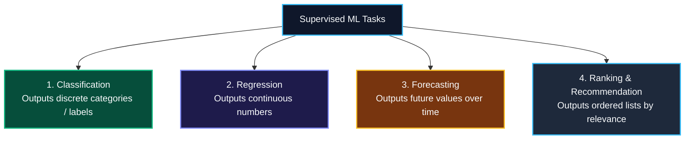
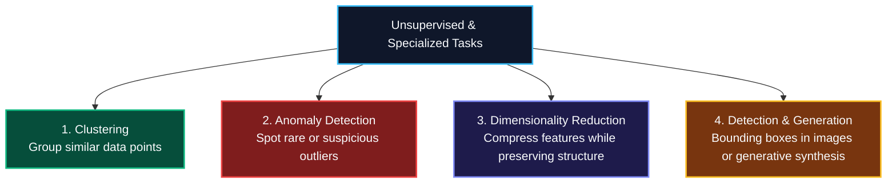
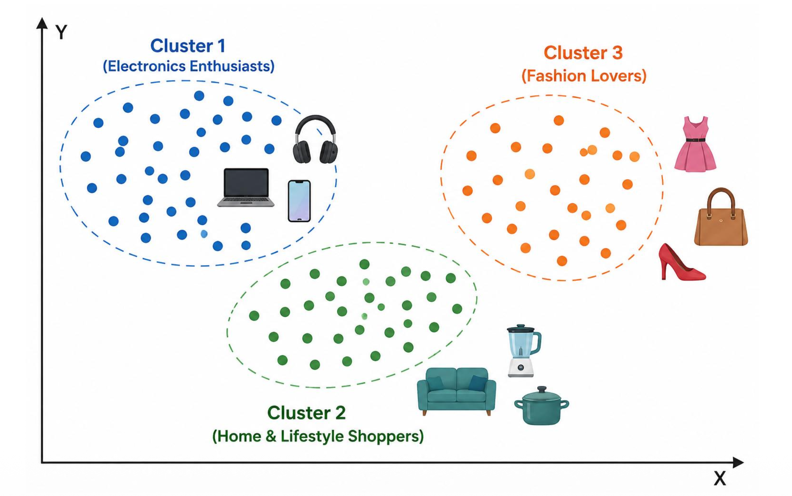
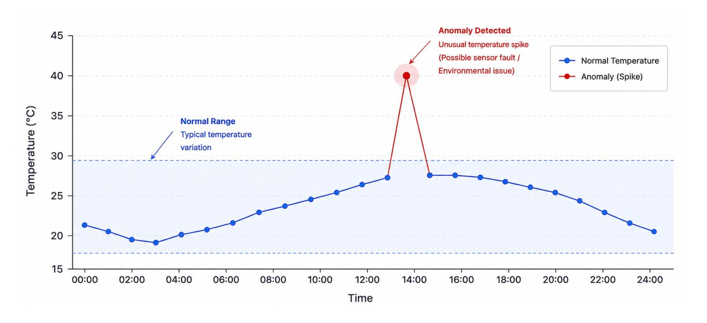
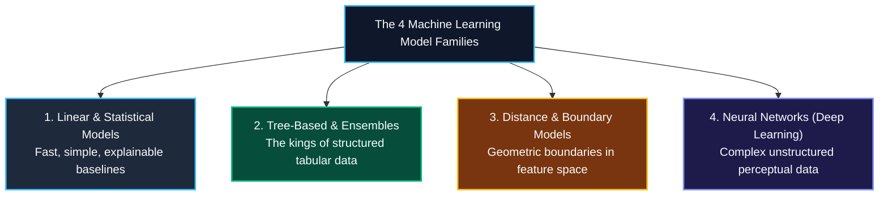
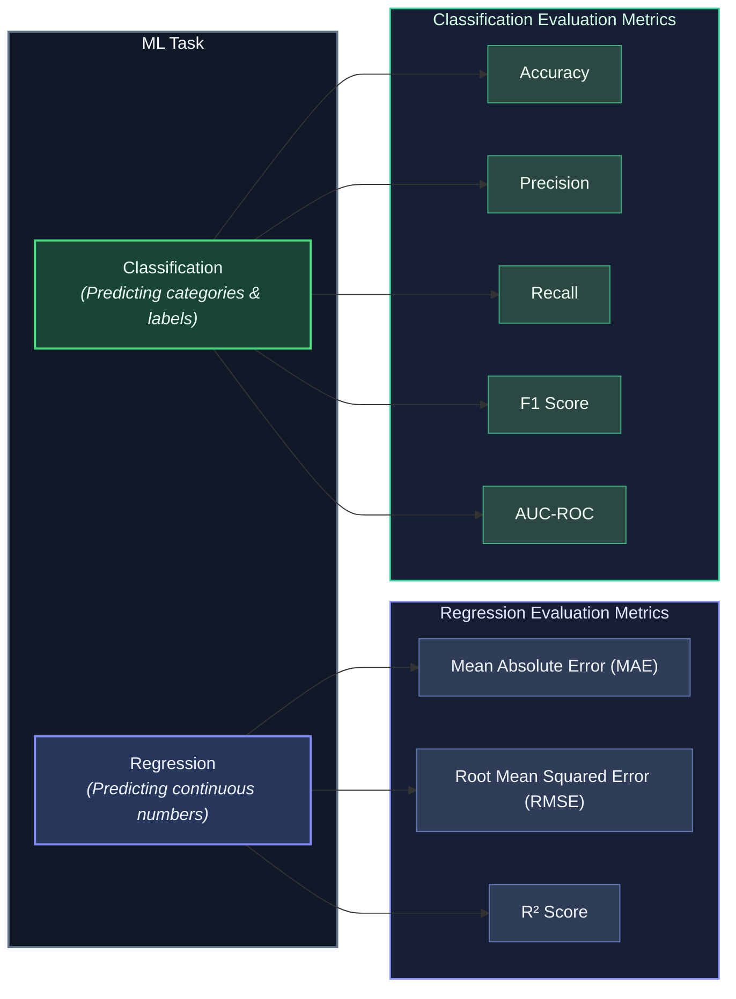
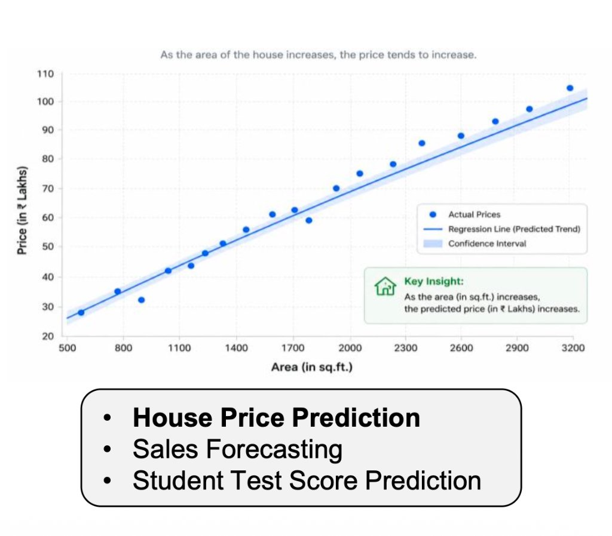
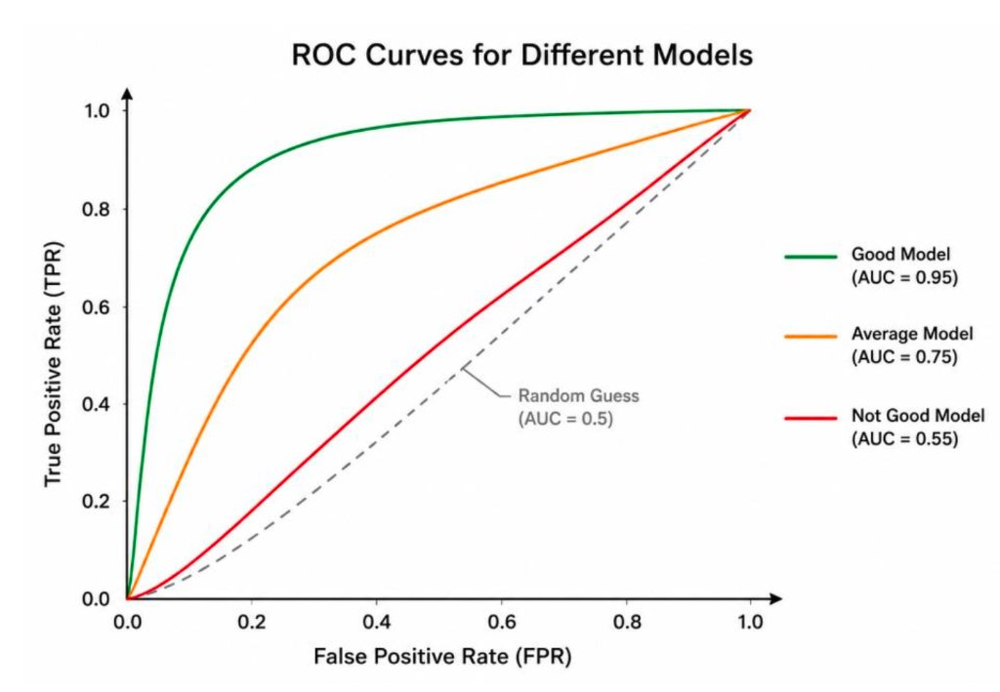

# Machine Learning Tasks, Model Types & Evaluation Metrics

When starting out in machine learning, people often get confused between a **Task Type** and a **Model Type**.

- **An ML Task Type** defines **what problem** you are trying to solve and the format of the output you expect.
- **An ML Model Type** is the **algorithm or mathematical engine** you choose to solve that task.

{: .note }
> **The Golden Rule to Remember:**  
> The easiest way to identify an ML task is to ask: **"What kind of output does the model produce?"**  
> - If it outputs a category (e.g., `Spam` vs `Not Spam`) $\longrightarrow$ It is a **Classification** task.  
> - If it outputs a continuous number (e.g., `\$350,000`) $\longrightarrow$ It is a **Regression** task.  
> - If it outputs future numbers over a timeline $\longrightarrow$ It is a **Forecasting** task.  
> - If it outputs natural groups without labels $\longrightarrow$ It is a **Clustering** task.

In this guide, we break down the core machine learning tasks, the model families used to solve them, and how each task connects to its specific **evaluation metrics**.

---

## 1. Supervised Learning Tasks

In Supervised Learning, every training example comes with a known answer key (labels). The primary supervised task types are:

### 1. Classification (Predicting Discrete Categories)
Predicts a discrete class label or bucket:
- **Binary Classification:** Choosing between two exclusive classes (`Spam` vs. `Not Spam`, `Fraud` vs. `Legitimate`).
- **Multiclass Classification:** Choosing between three or more mutually exclusive classes (e.g., routing a customer ticket to `Billing`, `Technical`, or `Sales`).
- **Multi-label Classification:** Assigning multiple tags to a single item (e.g., tagging a blog post with both `[Python, DevOps, Machine Learning]`).

### 2. Regression (Predicting Continuous Numbers)
Predicts an unbroken numerical quantity along a continuous scale:
- Predicting the exact dollar price of a home.
- Predicting the temperature in Celsius.
- Predicting travel time in minutes.

### 3. Forecasting (Time-Series Predictions)
Predicts future numerical values over time using chronological historical data:
- Predicting hourly electricity demand across a power grid for the next 48 hours.
- Predicting quarterly retail sales based on historical seasonal trends.

### 4. Ranking & Recommendation (Ordering by Relevance)
Orders a list of items based on relevance for a query, or suggests items based on user behavior:
- **Search Ranking:** Google ranking the top 10 web pages matching your search query.
- **Recommendations:** Netflix recommending movies or Spotify generating a weekly discovery playlist based on acoustic similarity and listening history.

---

## 2. Unsupervised & Specialized Tasks

When data has no predefined target labels, the machine learns by discovering intrinsic patterns:

### 1. Clustering
Groups unlabeled data points into clusters based on geometric or statistical similarity:
- Segmenting 100,000 customers into behavioral personas (`bargain hunters`, `weekend shoppers`) for marketing campaigns.

  

### 2. Anomaly Detection
Identifies rare data points, extreme outliers, or unusual patterns that deviate from normal baseline behavior:
- Spotting an unusual server CPU spike that indicates a cyberattack or memory leak.
- Flagging an international credit card charge that doesn't fit a user's normal routine.

  

### 3. Dimensionality Reduction
Simplifies complex data by reducing the number of input features while retaining the key information and structure:

- **Key Benefits:**
  - **Preserves Critical Information:** Compresses hundreds of columns into fewer, high-signal components while throwing away noise.
  - **Reduces Storage & Compute Costs:** Cuts down storage footprint and memory requirements.
  - **Speeds Up Training & Inference:** Fewer features mean models train and serve predictions much faster.
- **Common Techniques:** **PCA (Principal Component Analysis)**, **t-SNE**, and **UMAP**.
- **Real-World Examples:**
  - **Feature Reduction Before Training:** Condensing hundreds of correlated metrics into 10–20 composite features to boost model accuracy.
  - **Image Compression:** Compressing image data for faster transmission while maintaining recognizable features.
  - **Data Visualization:** Projecting multi-dimensional data down to 2D or 3D plots so teams can visually inspect clusters and patterns.

### 4. Object Detection & Generation
- **Object Detection:** Identifies what objects appear in an image and draws precise bounding boxes around them (e.g., self-driving cars identifying pedestrians and stop signs).
- **Generative Synthesis:** Synthesizes brand-new text, images, or audio (e.g., LLMs drafting essays, Diffusion models creating artwork).

---

## 3. Real-World Examples by Task Type

{: .tip }
> Here is a quick reference table of everyday examples for the four most common machine learning tasks:

| ML Task Type | What It Predicts | Real-World Examples |
| :--- | :--- | :--- |
| **Classification** | Discrete categories / labels | 1. **Spam Detection:** Sorting incoming emails into `Spam` or `Inbox`. 2. **Medical Diagnosis:** Identifying whether a skin lesion image is `Benign` or `Malignant`. 3. **Fraud Detection:** Flagging a transaction as `Legitimate` or `Fraudulent`. |
| **Regression** | Continuous numerical quantities | 1. **Real Estate Pricing:** Estimating the exact market value of a home based on square footage, location, and bedrooms. 2. **Ride-Share Fare Estimation:** Calculating trip price based on distance, traffic, and surge demand. 3. **Crop Yield Prediction:** Estimating tons of wheat produced per acre based on rainfall and soil nitrogen. |
| **Clustering** | Groups of similar data points (no labels) | 1. **Customer Segmentation:** Grouping shoppers into marketing personas based on spending habits. 2. **Music Recommendation:** Grouping songs with similar tempo, mood, and acoustics into automated playlists. 3. **Document Organization:** Grouping thousands of news articles into emerging topics without manual tagging. |
| **Forecasting** | Numerical trends over future time | 1. **Weather Prediction:** Forecasting daily temperatures and rainfall for the upcoming week. 2. **Retail Inventory Demand:** Estimating how many winter jackets a retail store will sell next November. 3. **Energy Grid Load:** Predicting citywide hourly electricity consumption to prevent blackouts. |

---

## 4. Model Types: The 4 Core Algorithm Families

While a **Task Type** defines the problem you are solving, a **Model Type** is the specific algorithm or mathematical architecture used to solve it.

### 1. Linear & Statistical Models
*Best for simple, fast, and easily explainable baselines:*
- **Linear Regression:** Draws a straight line through data points to predict continuous numbers ($y = wx + b$).
- **Logistic Regression:** Passes linear calculations through an S-shaped (sigmoid) curve to output probabilities between 0% and 100% for binary classification.
- **Naive Bayes:** Uses basic probability rules (Bayes' Theorem) to classify text, such as early email spam filters.

### 2. Tree-Based & Ensemble Models
*The gold standard for structured, tabular enterprise data (spreadsheets, SQL databases):*
- **Decision Trees:** Splits data step-by-step using a flowchart of simple yes/no questions (e.g., `If salary < $50k and tenure > 3 years...`).
- **Random Forest:** Combines hundreds of independent decision trees, each trained on different random subsets of data, and takes a majority vote to improve stability.
- **Gradient Boosted Trees (XGBoost, LightGBM):** Builds decision trees sequentially, where each new tree specifically focuses on correcting the errors made by the previous trees. Extremely fast and highly accurate.

### 3. Distance & Boundary Models
*Best for smaller datasets with clear geometric clustering:*
- **K-Nearest Neighbors (KNN):** Looks at the $K$ closest data points in the vector space and assigns the most common label among them.
- **Support Vector Machines (SVM):** Finds the widest possible decision street (hyperplane) separating two distinct classes in multi-dimensional space.
- **K-Means Clustering:** Groups unlabeled data points into $K$ distinct clusters around mathematical center points (centroids).

### 4. Neural Networks (Deep Learning)
*Best for complex, unstructured data like images, audio, video, and natural language:*
- **Convolutional Neural Networks (CNNs):** Uses sliding grid filters (kernels) to detect visual patterns, textures, and edges in images.
- **Recurrent Neural Networks (RNNs / LSTMs):** Designed with internal memory loops to process sequential data where past order matters (e.g., audio transcripts, speech recognition).
- **Transformers:** Uses self-attention mechanisms to process entire sequences of text or tokens in parallel. Powers modern Large Language Models (LLMs) like GPT, Claude, and Gemini.

---

## 5. ML Tasks & Model Evaluation Metrics

You cannot grade an essay with a thermometer, and you cannot grade a temperature model with accuracy! 

Every machine learning task requires its own dedicated **evaluation metrics**:

Let's break down the metrics mapped in the diagram:

---

### Regression Evaluation Metrics (Measuring Numerical Distance)

In Regression, the model predicts numbers (e.g., house prices, sales, student scores). We evaluate it by measuring **how far off** its guesses are from the true values:

  

#### 1. Mean Absolute Error (MAE)
$$\text{MAE} = \frac{1}{N} \sum |y - \hat{y}|$$
- **What it means:** The average magnitude of error in original, real-world units.
- **Example:** If predicting house prices and $\text{MAE} = \$20,000$, it means: *"On average, our model's price estimates are off by about \$20k."* Very intuitive for business stakeholders.

#### 2. Mean Absolute Percentage Error (MAPE)
$$\text{MAPE} = \frac{100\%}{N} \sum \left| \frac{y - \hat{y}}{y} \right|$$
- **What it means:** Measures the average percentage mistake relative to actual values.
- **Example:** If $\text{MAPE} = 8\%$, on average, house price predictions are off by about **8%**.

#### 3. Root Mean Squared Error (RMSE)
$$\text{RMSE} = \sqrt{\frac{1}{N} \sum (y - \hat{y})^2}$$
- **What it means:** Squares errors before averaging and then takes the square root. Because errors are squared, **large errors become MUCH larger**.
- **When to use:** When making a giant mistake is much worse than making several small ones.

#### 4. $R^2$ Score (Coefficient of Determination)
$$R^2 = 1 - \frac{\text{Sum of Squared Residuals}}{\text{Total Sum of Squares}}$$
- **What it means:** Measures how well the model explains the variation in the data (higher is better, maximum is 1.0).
- **Example:** If $R^2 = 0.85$, then **85% of the variation in house prices** can be explained by features like area, location, and bedrooms. A score of $0.0$ means the model performs no better than guessing the average.

---

### Classification Evaluation Metrics (Measuring Categorical Accuracy)

In Classification, predictions are labels. We evaluate how often the model is right and what kind of mistakes it makes:

#### 1. Accuracy
$$\text{Accuracy} = \frac{\text{Correct Predictions}}{\text{Total Predictions}}$$
- **What it means:** The overall percentage of correct guesses.
- **The Catch:** As covered in our training guide, accuracy is **dangerous on imbalanced data**. If 99% of emails are not spam, a dummy model that marks every email as *"Inbox"* has 99% accuracy while catching zero spam!

#### 2. Precision
$$\text{Precision} = \frac{\text{True Positives}}{\text{True Positives} + \text{False Positives}}$$
- **What it means:** When the model sounds the alarm (predicts positive), how often was it actually right?
- **Example:** Out of all emails the model flagged as spam, 95% were truly spam (5% were legitimate emails sent to spam by mistake).

#### 3. Recall (Sensitivity)
$$\text{Recall} = \frac{\text{True Positives}}{\text{True Positives} + \text{False Negatives}}$$
- **What it means:** How many actual positive cases in reality were correctly detected?
- **Example:** Out of all fraudulent transactions that occurred, the model detected 92% of them.

#### 4. F1 Score
$$\text{F1} = 2 \times \frac{\text{Precision} \times \text{Recall}}{\text{Precision} + \text{Recall}}$$
- **What it means:** The harmonic balance between Precision and Recall. It prevents a model from looking good by artificially sacrificing one metric for the other.

#### 5. AUC-ROC (Area Under the Receiver Operating Characteristic Curve)
- **What it means:** Shows how well a classification model distinguishes between positive and negative classes across all possible decision thresholds.
- **Key Insight:** **Higher AUC = Better separation capability.**
- A score of **$0.5$** represents random guessing (like flipping a coin).
- A score of **$0.95+$** represents a high-performing classifier that cleanly separates positives from negatives.

  

---

## Summary Matrix

{: .important }
> Here is how task types, model families, and metrics connect in real-world engineering:

| ML Task Type | Goal | Popular Algorithm Families | Key Evaluation Metrics |
| :--- | :--- | :--- | :--- |
| **Classification** | Predict category / label | Logistic Regression, Random Forest, XGBoost, Neural Nets | **Precision, Recall, F1-Score, AUC-ROC**, Accuracy |
| **Regression** | Predict continuous number | Linear Regression, Ridge, Random Forest, LightGBM | **MAE, RMSE, $R^2$ Score** |
| **Forecasting** | Predict numbers over time | ARIMA, Prophet, LSTMs, Temporal Fusion Transformers | **MAE, MAPE, RMSE** |
| **Clustering** | Group unlabeled data | K-Means, DBSCAN, Hierarchical Clustering | **Silhouette Score, Inertia** |

Now that you know how to match task types to algorithms and evaluation metrics, where does the fuel to train these models come from?

In the next article, we explore **[Data Collection & Data Preparation: Fueling the Machine Learning Engine](/docs/ml/basics/data-collection-and-preparation/)**.
