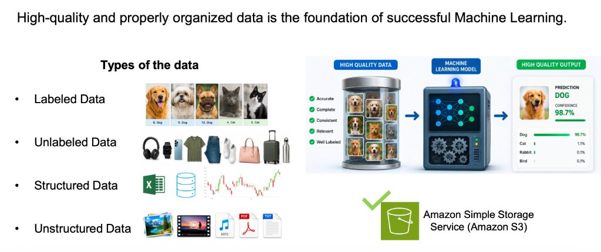
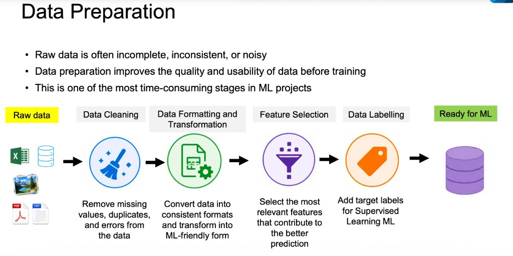
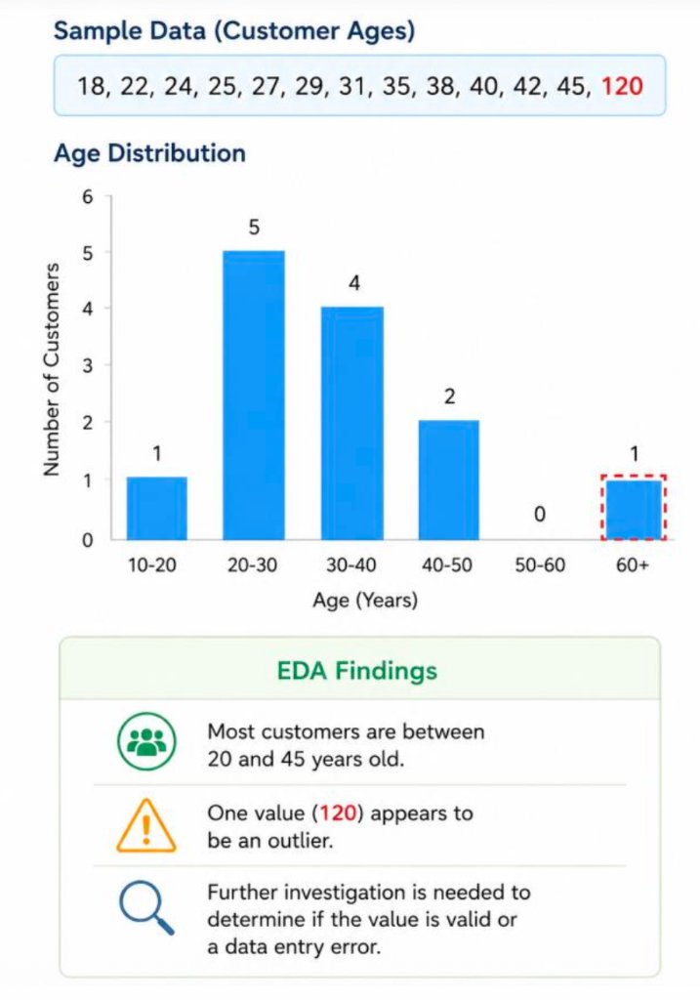

# Data Collection & Data Preparation: Fueling the ML Engine

There is an unbreakable rule in machine learning: **"Garbage in, garbage out."**

If you feed an algorithm noisy, incomplete, or biased data, it will produce noisy, untrustworthy predictions. No complex neural network can compensate for bad data.

In enterprise engineering, data scientists and MLOps teams spend **80% of their time collecting, exploring, and preparing data**, and only 20% writing model code.


In this guide, we break down the different types of data, the end-to-end data preparation pipeline, **Exploratory Data Analysis (EDA)**, **Correlation Matrices**, and how to safely partition data for training.

---

## 1. Data Types & The Quality Equation

High-quality, properly organized data is the bedrock of every successful machine learning model.

<p align="center">
  
</p>

### The 4 Major Types of Data

As shown on the left side of the diagram, enterprise data comes in four distinct flavors:

1. **Labeled Data:**
   - Data points paired with their known target answer.
   - *Example:* Photos of animals tagged with labels: `"Dog"`, `"Cat"`. (Essential for Supervised Learning).
2. **Unlabeled Data:**
   - Raw data points without any tags or answers.
   - *Example:* An e-commerce product catalog containing headphones, smartphones, shirts, and luggage with no categories assigned yet.
3. **Structured Data:**
   - Highly organized data that fits neatly into rows and columns with clear data types.
   - *Example:* Excel spreadsheets, SQL databases, financial stock candlestick tables, and transaction logs.
4. **Unstructured Data:**
   - Freeform, sensory data that does not fit into a simple grid.
   - *Example:* High-resolution images, video files, audio MP3 recordings, PDF documents, and unparsed text.

### The High-Quality Data Equation
Look at the right side of the diagram:
$$\text{High-Quality Data} \longrightarrow \text{Machine Learning Model} \longrightarrow \text{High-Quality Output}$$

To generate high-confidence predictions (like `Prediction: DOG (98.7%)`), your data must check five essential boxes:
- **Accurate:** Correct values without corrupted entries.
- **Complete:** Minimal missing cells and holes.
- **Consistent:** Standardized formats (e.g., dates formatted consistently as `YYYY-MM-DD`).
- **Relevant:** Features that genuinely influence the target outcome.
- **Well-Labeled:** Ground-truth labels verified by reliable processes.

In modern cloud environments, these vast datasets are stored in scalable object stores like **Amazon Simple Storage Service (Amazon S3)** or Google Cloud Storage before ingestion.

---

## 2. The Data Preparation Pipeline

Raw data pulled from production databases, spreadsheets, and event streams is almost always incomplete, inconsistent, and noisy. 

Before any model training begins, the data must pass through the **Data Preparation Pipeline**:

<p align="center">
  
</p>

### The 5 Essential Stages:

1. **Data Cleaning:** Removes duplicate records, fills or drops missing values, and fixes corrupted text.
2. **Data Formatting & Transformation:** Converts text columns into numbers (encoding) and standardizes numerical ranges (scaling).
3. **Feature Selection:** Drops redundant or unhelpful columns so the model focuses only on strong signals.
4. **Data Labelling:** Ensures every sample has an accurate ground-truth label for supervised training.
5. **Ready for ML:** Stores the clean, versioned dataset in a central feature store ready for training algorithms.

---

## 3. Exploratory Data Analysis (EDA)

Before building a model, data scientists conduct **Exploratory Data Analysis (EDA)**.

{: .note }
> **What is EDA?**  
> EDA is the detective work of analyzing, visualizing, and summarizing a dataset to understand its characteristics, uncover hidden patterns, and spot potential flaws before writing training code.

### Common EDA Activities:
- **Understand Data Distributions:** Are values evenly spread out, or are they skewed toward one extreme?
- **Identify Missing Values & Outliers:** Which columns have empty cells, and are there impossible values?
- **Explore Relationships Between Features:** Check which features correlate with each other using a **Correlation Matrix**.
- **Verify Class Balance & Representation:** Confirm that all customer groups, demographics, and target classes are adequately represented to prevent biased or unfair models.

---

## 4. Spotting Outliers: The Customer Age Example

One of the most critical discoveries during EDA is finding **outliers**—data points that deviate drastically from the rest of the dataset.

Look at this real-world example of analyzing customer ages:

<p align="center">
  
</p>

### Walking Through the Example:

1. **Sample Customer Ages:**
   $$18, 22, 24, 25, 27, 29, 31, 35, 38, 40, 42, 45, \mathbf{120}$$

2. **The Distribution Chart:**
   - Age 10–20: 1 customer
   - Age 20–30: 5 customers
   - Age 30–40: 4 customers
   - Age 40–50: 2 customers
   - Age 50–60: 0 customers
   - Age 60+: **1 customer (Age = 120)**

3. **Key EDA Findings:**
   - **Typical Customer:** Most customers are between **20 and 45 years old**.
   - **The Outlier:** One recorded value is **120**.
   - **Action Needed:** An age of 120 is physically possible but statistically improbable. A data engineer must investigate: is this a genuine centenarian customer, or did someone accidentally type `120` instead of `20`?

{: .warning }
> **Why Outliers Matter:** If left untreated, an extreme outlier like `120` will pull the average age from **31 years** up to **38 years**, skewing linear regression weights and harming model accuracy!

---

## 5. The Correlation Matrix: Measuring Feature Relationships

During EDA, we need to know how features interact with each other. We use a **Correlation Matrix**.

{: .note }
> **What is a Correlation Matrix?**  
> A Correlation Matrix is a table showing the statistical correlation coefficient between pairs of features.  
> It answers the question: *"When feature A goes up, what does feature B do?"*

### How to Read Correlation Scores:

$$\begin{array}{ccc}
\mathbf{-1.0} & \mathbf{0.0} & \mathbf{+1.0} \\
\text{Perfect Negative Correlation} & \text{No Relationship} & \text{Perfect Positive Correlation} \\
\text{(One goes up, other goes down)} & \text{(Completely independent)} & \text{(Both go up together)}
\end{array}$$

### Real Estate Example Correlation Matrix:

Consider a dataset for predicting house prices based on **House Size**, **Bedrooms**, and **Age**:

| Feature | House Price | House Size | Bedrooms | Age of House |
| :--- | :---: | :---: | :---: | :---: |
| **House Price** | **1.00** | **+0.89** | **+0.75** | **-0.62** |
| **House Size** | **+0.89** | **1.00** | **+0.80** | **-0.45** |
| **Bedrooms** | **+0.75** | **+0.80** | **1.00** | **-0.20** |
| **Age of House** | **-0.62** | **-0.45** | **-0.20** | **1.00** |

### What This Matrix Tells the Data Scientist:

1. **Strong Positive Correlation (+0.89):**
   - `House Size` and `House Price` have a score of $+0.89$. As square footage increases, house price almost always increases. This is a primary predictor.
2. **Negative Correlation (-0.62):**
   - `Age of House` and `House Price` have a score of $-0.62$. Older homes tend to sell for lower prices than brand-new homes.
3. **Multicollinearity Warning (+0.80):**
   - Look at the intersection between `House Size` and `Bedrooms` ($+0.80$). Houses with more bedrooms are almost always larger in square footage. Keeping both highly correlated features can sometimes confuse linear models, so engineers might drop one or combine them into a ratio.

---

## 6. Data Cleaning: Missing Values & PII Compliance

### 1. Handling Missing Data
When columns have empty (`NaN`) cells:
- **Drop Rows:** Safe if only 10 out of 100,000 records have missing entries.
- **Drop Columns:** If 85% of users never answered an optional survey question, drop that entire column.
- **Impute (Fill in):**
  - **Median:** Best for skewed numbers (like income or house prices).
  - **Mean:** Good for normal distributions.
  - **Mode:** Best for categories (fill with the most frequent value).

```python
import pandas as pd

# Fill missing house age with the median age
df['house_age'] = df['house_age'].fillna(df['house_age'].median())
```

### 2. Privacy & PII Compliance
Under data protection regulations like **GDPR** and the **DPDP Act**:
- Remove all Personal Identifiable Information (PII): names, personal phone numbers, and national IDs.
- Replace employee/customer IDs with anonymized cryptographic hashes (`usr_8f3a9b`).

---

## 7. Feature Transformation: Encoding & Scaling

Computers cannot perform matrix multiplications on strings like `"Red"`, `"Blue"`, or `"Suburban"`. Everything must be converted to numbers and leveled.

### 1. One-Hot Encoding (Words to Numbers)
For categories without a natural mathematical ranking (like `City: New York, London, Tokyo`):
$$\text{New York} \longrightarrow [1, 0, 0], \quad \text{London} \longrightarrow [0, 1, 0], \quad \text{Tokyo} \longrightarrow [0, 0, 1]$$

### 2. Feature Scaling
If one feature is `Bedrooms` (range: $1 - 5$) and another is `Square Feet` (range: $500 - 5,000$), gradient descent will spend all its energy updating the weight for square feet purely because of its numerical size.

We use **StandardScaler** to center all features around a mean of $0$ with a standard deviation of $1$:

```python
from sklearn.preprocessing import StandardScaler

scaler = StandardScaler()
df[['size_scaled', 'age_scaled']] = scaler.fit_transform(df[['size_sqft', 'age_years']])
```

---

## 8. Splitting Data & Avoiding Data Leakage

Before training begins, we split our clean dataset into two strict piles:

```
[Clean Dataset: 100%]
         │
         ├───► Training Set (80%): Used by the model to learn weights
         └───► Test Set (20%): Kept in a locked vault to simulate future unseen data
```

### What is Data Leakage? (Cheating on the Exam)
**Data leakage** occurs when information from the future or outside the training set accidentally contaminates the training features.

{: .warning }
> **Classic Example:**  
> If you are building a model to predict whether a customer will cancel their subscription, including the feature `cancellation_survey_score` is data leakage! In production, a customer only fills out a cancellation survey *after* they decide to leave.

**The Golden Rule:** The model must **never** see any feature during training that it would not have access to at the exact millisecond of making a live prediction in production.

---

## Summary

| Step | Purpose | Key Tools |
| :--- | :--- | :--- |
| **Data Types** | Distinguish between labeled/unlabeled and structured/unstructured | S3, Databases |
| **Preparation Pipeline** | Clean, format, select features, and label data | Pandas, Spark, Airflow |
| **EDA** | Discover distributions, spot outliers, and inspect correlations | Histograms, Seaborn, Box plots |
| **Correlation Matrix** | Measure relationship strength between features ($-1.0$ to $+1.0$) | Pearson Correlation, Heatmaps |
| **Outlier Detection** | Catch crazy typos (like age = 120) before they skew the model | IQR, Z-Score |
| **Data Splitting** | Partition into Train and Test sets while preventing data leakage | `train_test_split` |

Now that our data is clean, leak-free, and thoroughly explored, how do we train the model and test its performance?

In the next article, we dive into **[Model Training & Evaluation: From Algorithms to Generalization](/docs/ml/basics/model-training-and-evaluation/)**.
