# Model Training & Evaluation: Explained Simply

Once your data is clean and prepared, you arrive at the heart of machine learning: **Training and Evaluating your Model**.

The goal of training is **not** to get 100% on practice questions. A student who memorizes every practice question word-for-word will fail the final exam when new questions appear.

The true goal of machine learning is **Generalization**—learning the underlying patterns so well that the model gives accurate answers on data it has **never seen before**.

In this guide, we break down how algorithms learn parameters, how to balance underfitting and overfitting, how to tune hyperparameters, how to partition data into 3 splits, and how to grade models honestly.

---

## 1. Step 5: Model Training

**Training** is the process where a machine learning algorithm studies historical training data, learns the underlying relationships, and adjusts internal parameters (weights and biases) until its predictions match reality as closely as possible.

  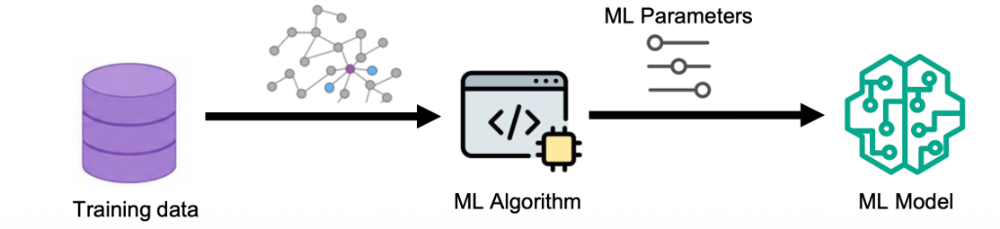

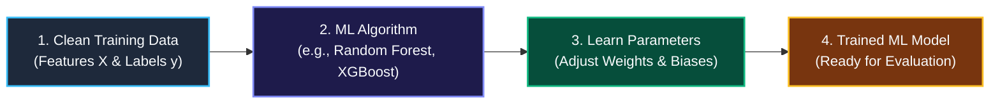

### Which Algorithm Should You Pick?

You do not need to invent complex mathematics from scratch. In industry, models belong to three main algorithm families:

| Algorithm Family | How It Works (Simple Analogy) | Best For | When to Use It |
| :--- | :--- | :--- | :--- |
| **Linear Models** (Logistic / Linear Regression) | Draws a simple straight line or boundary between groups. | Simple baselines, high explainability. | When you need an instant, easy-to-explain starting point. |
| **Tree Ensembles** (**Random Forest**, **XGBoost**) | Plays a game of *"20 Questions"*. Combines hundreds of decision trees voting together. | **Structured tables & Excel-like data** (e.g., Attrition, Fraud, Credit). | **The champion for 90% of business problems.** Highly accurate and fast. |
| **Neural Networks** (Deep Learning) | Multiple layers of artificial neurons inspired by the brain. | Messy sensory data (Images, Audio, Text). | Face unlock, speech recognition, language translation. |

{: .tip }
> **Pro Tip:** If your data lives in database tables with columns and rows, **XGBoost or Random Forest** will almost always beat deep neural networks while being much faster and cheaper to run.

---

## 2. The Goldilocks Problem: Underfitting vs. Overfitting

Every model must strike the right balance between being too simple and too complicated:

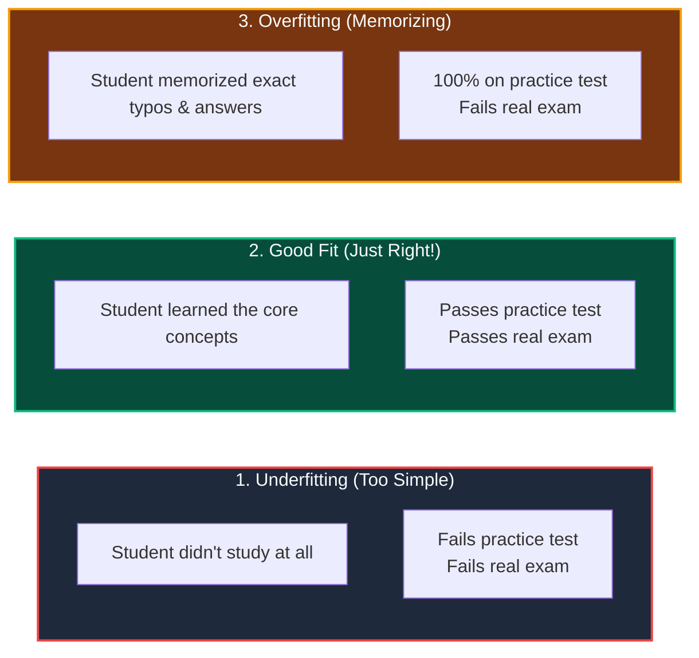

  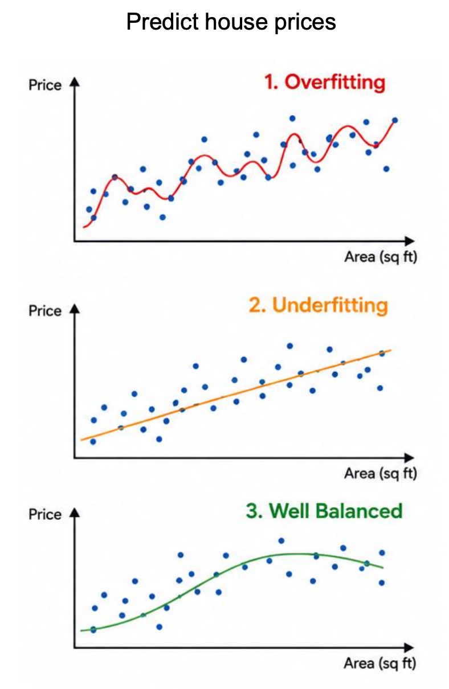

### Bias vs. Variance: The Two Competing Forces

In machine learning, model prediction errors stem from two opposing forces: **Bias** and **Variance**.

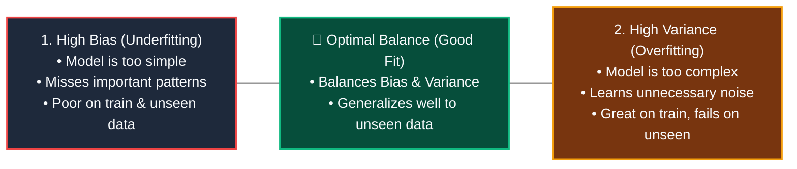

| Concept | What It Measures | Model State | Performance Behavior | Resulting Model Fit |
| :--- | :--- | :--- | :--- | :--- |
| **Bias** | Measures how much the model **misses important patterns** in the data. | **Model is too simple** | Performs **poorly on both training and unseen data**. | **Underfitting** |
| **Variance** | Measures how much the model **learns unnecessary patterns (noise)** in the data. | **Model is too complex** | Performs **well on training data, but poorly on unseen data**. | **Overfitting** |

#### 1. Bias (Underfitting)
- **Definition:** Bias measures how much the model misses important patterns in the data.
- **Model State:** The model is too simple (e.g., trying to fit a rigid straight ruler to a wavy curve).
- **Performance:** Performs poorly on both training data and unseen data.
- **The Result:** Leads to **Underfitting**.

#### 2. Variance (Overfitting)
- **Definition:** Variance measures how much the model learns unnecessary patterns (noise) in the data.
- **Model State:** The model is too complex (e.g., memorizing every outlier, typo, and quirk).
- **Performance:** Performs well on training data (e.g., 99% accuracy), but poorly on unseen data (drops to 65%).
- **The Result:** Leads to **Overfitting**.

{: .note }
> **Finding the Right Balance:**  
> A good model should maintain the **right balance between bias and variance** to generalize well on unseen data.

---

## 3. Fixing Model Fit: Overfitting vs. Underfitting

When evaluating your model's initial results, you will usually find it leans toward either overfitting or underfitting. Here is how machine learning engineers diagnose and fix model fit:

  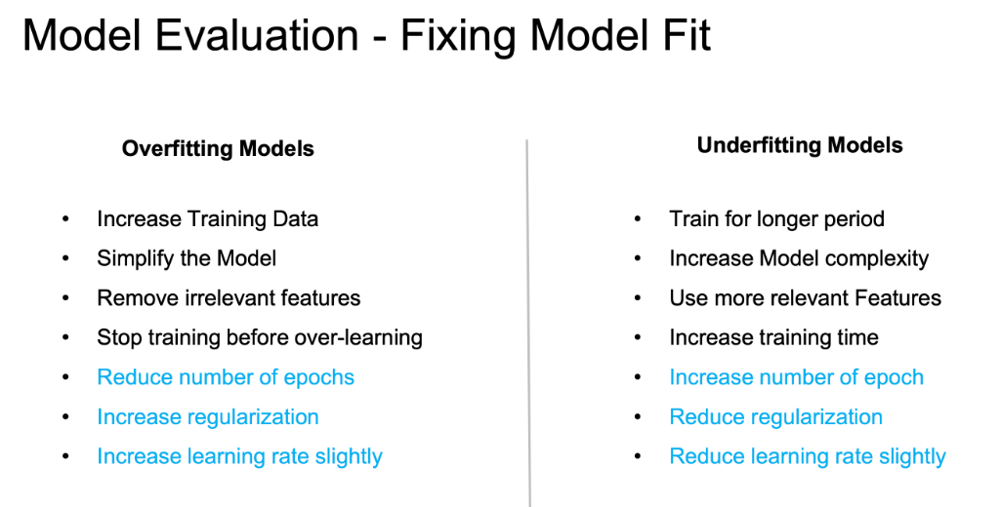

### Two Core Definitions:

- **Feature Engineering:** Creating useful, high-value predictive features from raw data (e.g., calculating `spending_to_income_ratio` or extracting `day_of_week` from timestamps).
- **Epoch:** One complete pass through the entire training dataset during the learning process.

---

## 4. ML Features vs. Parameters vs. Hyperparameters

When building machine learning models, people often confuse features, parameters, and hyperparameters. Here is the core distinction:

| Machine Learning Concept | What is it? | Example | Source | When is it set? |
| :--- | :--- | :--- | :--- | :--- |
| **Features** | Characteristics / attributes of your data used for prediction. | Area, Floors, Location for house price prediction | The training data | Before training |
| **Parameters** | Internal variables that the model calculates to map inputs to outputs. | Weights and Biases assigned during learning phase | Learned from the data | During training |
| **Hyperparameters** | External configurations that govern the learning process. | Epochs, Learning Rate, Batch Size, Max Depth | Manually configured by engineer | Before training |

---

## 5. Hyperparameter Tuning: Dialing in Optimal Performance

Different machine learning algorithms rely on different external hyperparameters:
- **Neural Networks:** Learning Rate, Batch Size, Epochs.
- **Decision Trees & Random Forests:** Max Depth, Number of Trees, Minimum Samples per Leaf.
- **Linear / Logistic Regression:** Regularization strength ($\lambda$ or $C$).

### What is Hyperparameter Tuning?

**Hyperparameter Tuning** is the process where data scientists experiment with different combinations of external knobs to find the optimal balance for peak model performance on unseen data. Tuning directly manages the trade-off between **Overfitting** and **Underfitting**.

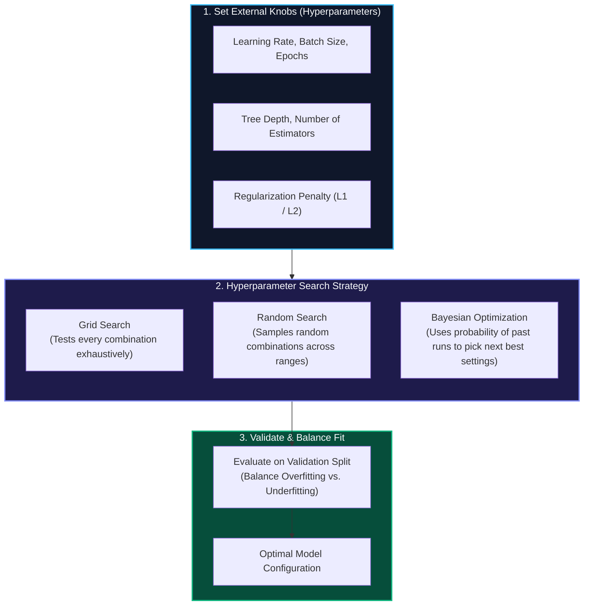

### Common Tuning Techniques:
1. **Grid Search:** Systematically tests every single possible combination of specified hyperparameter values. Thorough, but computationally expensive.
2. **Random Search:** Randomly samples combinations within specified parameter ranges. Far faster than grid search and often finds equally good results.
3. **Bayesian Optimization:** An intelligent search strategy that builds a probability model of past evaluation results to choose the next most promising hyperparameters.

---

## 5. Important Hyperparameters Deep Dive

### 1. Neural Networks & Deep Learning

#### Learning Rate
- **What it does:** Controls how much a model updates its parameters in response to estimated error after each step.
- **The Step Size Analogy:** Dictates the step size determining how fast or slow a model walks down the hill toward optimal weights.
- **Higher value:** Faster learning, but riskier—the model may take steps that are too large, overshooting or completely missing the optimal solution.
- **Lower value:** More precise learning, but training can become painfully slow or get trapped in suboptimal plateaus.

  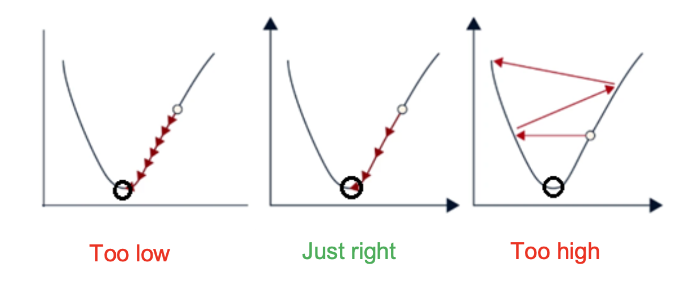

#### Batch Size
- **What it does:** The number of training samples processed by the model before updating its internal weights (common values: 16, 32, 64, 128, 256).
- **Larger batch size:** Faster training on GPUs and smoother gradient estimates, but demands more GPU memory.
- **Smaller batch size:** Slower per-epoch training, but introduces helpful noise that can improve the model's ability to generalize to unseen data.

  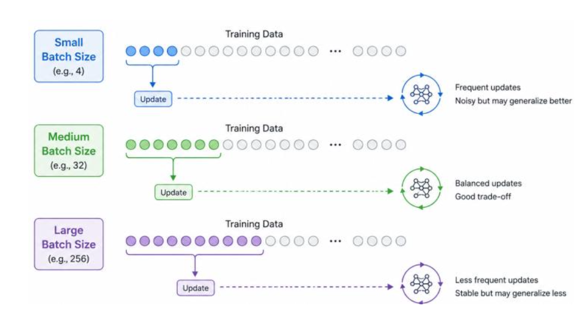

#### Epochs
- **What it does:** Each epoch represents one complete pass through the entire training dataset.
- **Too few epochs:** The model hasn't had enough practice, leading to **underfitting**.
- **Too many epochs:** The model sees the exact same training examples too many times and begins memorizing noise, leading to **overfitting**.

  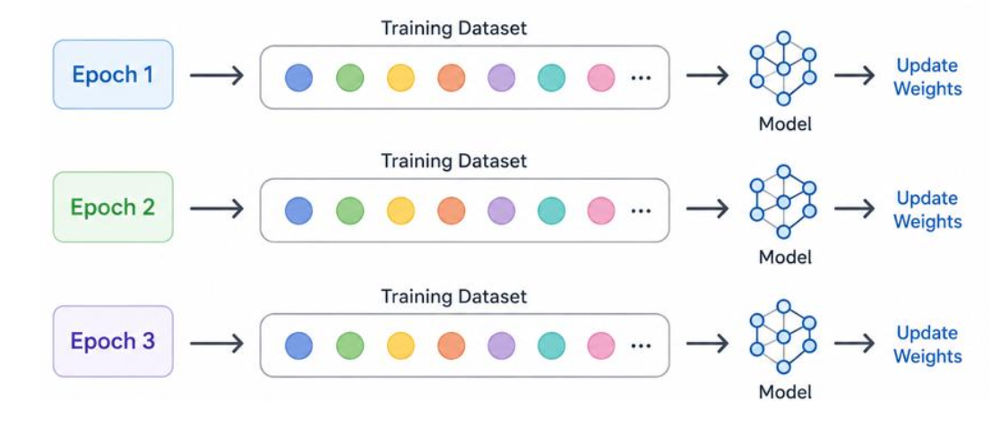

---

### 2. Decision Trees & Tree Ensembles

#### Max Depth (Decision Trees)
- **What it does:** Controls the maximum number of decision levels (splits) allowed from the root down to the leaves.
- **Higher value:** Creates a taller, more intricate tree. It captures nuanced patterns, but easily overfits by creating unique branches for single noisy rows.
- **Lower value:** Creates a shallow, simple tree. Prevents overfitting, but if set too low, the model underfits because it cannot ask enough questions.
- **The Goal:** Tune `max_depth` (e.g., between 3 and 8) to balance complexity and generalization.

  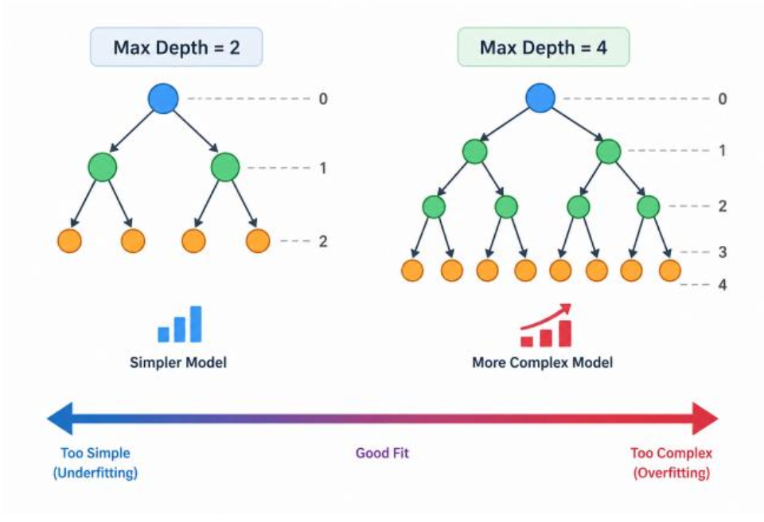

#### Number of Trees (Random Forest / Ensembles)
- **What it does:** Specifies how many individual decision trees vote together in the ensemble.
- **More trees:** Generally improves prediction accuracy and stabilizes the model by smoothing out individual tree errors (reduces variance without causing overfitting).
- **Diminishing returns:** Beyond a certain point (e.g., 200–500 trees), adding more trees provides negligible accuracy gain while increasing training time and memory usage.

  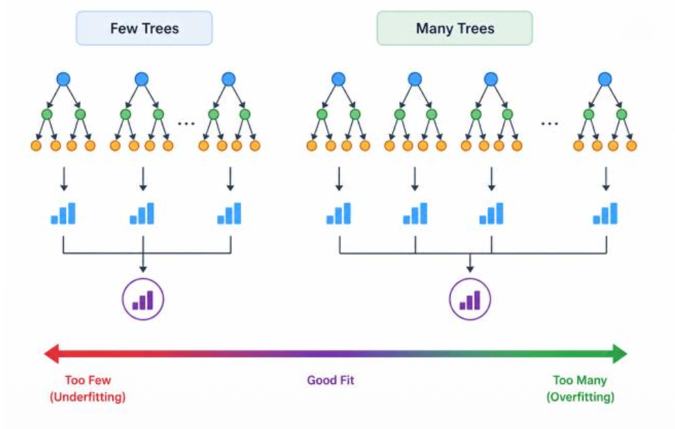

---

### 3. Linear & Logistic Regression

#### Regularization ($L_1$ Lasso / $L_2$ Ridge)
- **What it does:** Adds a mathematical penalty that prevents model coefficients (weights) from growing excessively large.
- **Why it matters:** Constrains weights during training, forcing the algorithm to focus on broad, underlying relationships rather than latching onto noisy training quirks.
- **Higher regularization:** Shrinks coefficients, producing simpler, more robust models with better real-world generalization.

  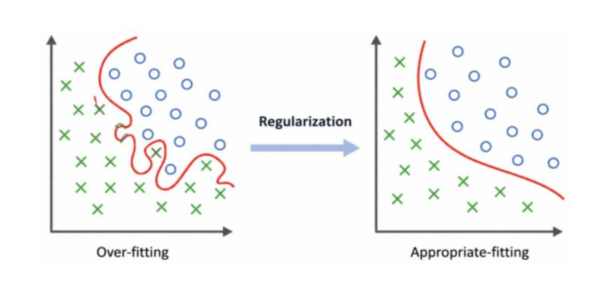

---

## 6. Step 6: Model Evaluation (Testing on Unseen Data)

{: .important }
> **What is Model Evaluation?**  
> **Model Evaluation** is the process of measuring how well a trained model performs on **unseen data**.  
> A model may perform exceptionally well on the data it studied, but fail completely when deployed in the real world, resulting in either **Overfitting** or **Underfitting**.

To prevent memorization and get an honest assessment, your dataset must be partitioned into **three distinct subsets**:

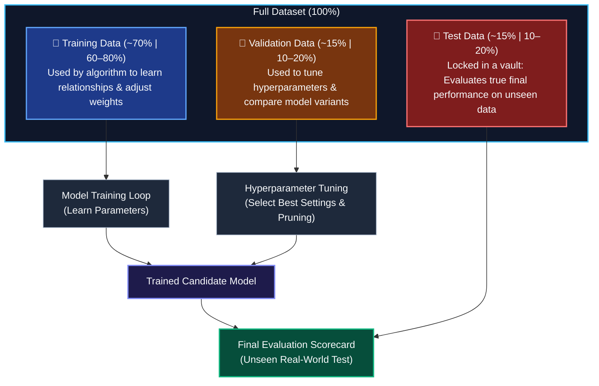

### The 3 Types of Data Used

1. **Training Data (60% – 80%, typically ~70%):**
   - **Purpose:** Used directly by the machine learning algorithm to learn patterns, correlations, weights, and decision rules.
   - **Analogy:** The textbook chapters and homework practice problems the student studies every day.

2. **Validation Data (10% – 20%, typically ~15%):**
   - **Purpose:** Used during development to tune hyperparameters (e.g., learning rates, batch size, max depth) and select the best model candidate without touching the test set.
   - **Analogy:** Practice quizzes used to test study techniques and dial in settings before the real test.

3. **Test Data (10% – 20%, typically ~15%):**
   - **Purpose:** Kept completely hidden in a locked vault until all model training and hyperparameter tuning are 100% finished. Evaluates final generalization capability.
   - **Analogy:** The official final exam. The student never sees these questions beforehand.

---

## 7. Why "Accuracy" is a Dangerous Trap!

Model performance is evaluated using metrics like **Accuracy**, **Precision**, **Recall**, **F1 Score**, **RMSE**, and **Bias/Variance analysis**. But you must pick the right metric for your problem.

Imagine our company has 100,000 employees. Each year, **3,000 employees quit** (3%) and **97,000 stay** (97%).

Now imagine a lazy "dummy" model that always predicts: *"Nobody will ever quit!"*

Let's grade this dummy model:
- Out of 100,000 employees, it guessed correctly 97,000 times.
- **Accuracy = 97%!**

{: .warning }
> A 97% accuracy sounds amazing on paper, but the model is **100% useless**! It failed to catch a single at-risk employee.  
> Whenever classes are imbalanced (like fraud, disease, or churn), **never rely on raw accuracy alone**.

---

## 8. The Confusion Matrix: The Honest Scorecard

### What is a Confusion Matrix?
- A **Confusion Matrix** is a table used to measure the performance of a classification model by comparing **predicted results** with **actual outcomes**.
- It shows exactly where the model **predicted correctly** and where the model **got confused and made mistakes**.

  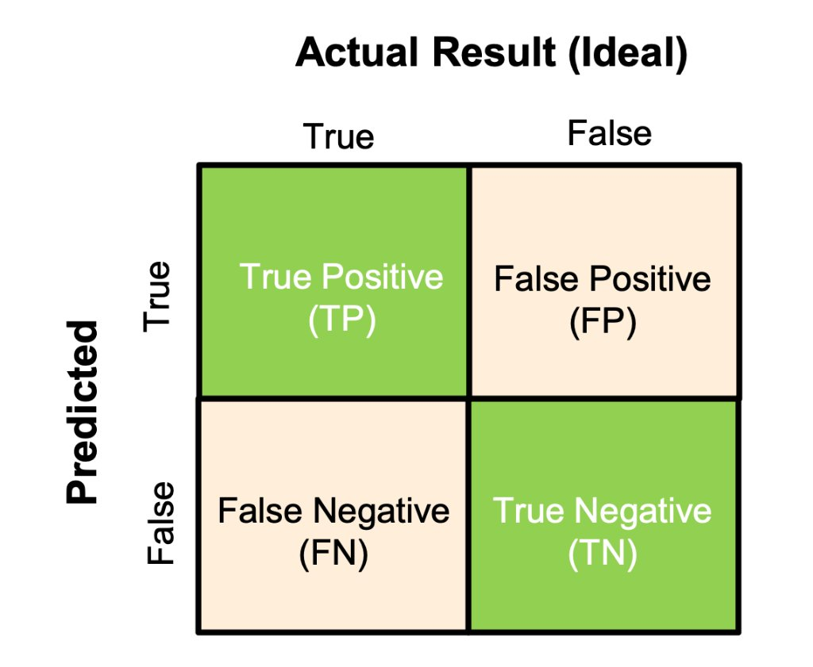

### Understanding the 4 Outcomes:

| Quadrant | Technical Meaning | Plain English Meaning | Real-World Example (Attrition / Fraud) |
| :--- | :--- | :--- | :--- |
| **TP (True Positive)** | Model Predicted **Positive** and it is actually **Positive**. | **Caught it!** Correct prediction of target event. | Model flagged an employee as leaving, and they actually quit. |
| **FP (False Positive)** | Model Predicted **Positive** but it is actually **Negative**. | **False Alarm!** Model sounded the alarm in error. | Model flagged an employee as leaving, but they stayed (false alarm). |
| **FN (False Negative)** | Model Predicted **Negative** but it is actually **Positive**. | **Missed it!** Dangerous blind spot. | Model predicted an employee would stay, but they actually left. |
| **TN (True Negative)** | Model Predicted **Negative** and it is actually **Negative**. | **Correctly Cleared.** Correct identification of normal case. | Model predicted an employee would stay, and they stayed. |

---

## 9. Model Evaluation: Classification Metrics

From the Confusion Matrix, data scientists calculate four essential classification metrics:

- **Accuracy:** How many total predictions were correct?
- **Precision:** When the model predicted positive, how often was it correct?
- **Recall:** How many actual positive cases were correctly detected?
- **F1 Score:** How well does the model balance Precision and Recall?

### Mathematical Formulas:

| Metric | Formula | What Question It Answers |
| :--- | :--- | :--- |
| **Accuracy** | $$\frac{TP + TN}{TP + TN + FP + FN}$$ | Out of all predictions, how many were right? |
| **Precision** | $$\frac{TP}{TP + FP}$$ | When the alarm sounded, how often was it real? |
| **Recall** | $$\frac{TP}{TP + FN}$$ | Out of all actual positive cases, how many did we catch? |
| **F1 Score** | $$2 \times \frac{\text{Precision} \times \text{Recall}}{\text{Precision} + \text{Recall}}$$ | What is the harmonic balance between alarm accuracy and catch rate? |

---

### Step-by-Step Worked Example: Email Spam Detection (100 Emails)

Imagine we test an email spam classifier on **100 incoming emails**:
- **Total Emails:** 100
- **Actual Spams:** 40
- **Actual Normal Emails (Not Spam):** 60

**Model Predictions Breakdown:**
- **Spam email correctly detected as Spam (TP):** **35**
- **Normal email incorrectly detected as Spam (FP):** **10** *(false alarm)*
- **Spam email missed / not detected as Spam (FN):** **5** *(slipped into inbox)*
- **Normal email correctly not detected as Spam (TN):** **50** *($60 - 10 = 50$, safely delivered)*

#### Calculations:

1. **Accuracy:**
   $$\text{Accuracy} = \frac{TP + TN}{\text{Total}} = \frac{35 + 50}{100} = \frac{85}{100} = \mathbf{85\%}$$
   - *Meaning:* 85% of all emails were correctly sorted.

2. **Precision:**
   $$\text{Precision} = \frac{TP}{TP + FP} = \frac{35}{35 + 10} = \frac{35}{45} \approx \mathbf{78\%}$$
   - *Meaning:* When the filter flagged an email as spam, it was right 78% of the time (22% were false alarms).

3. **Recall:**
   $$\text{Recall} = \frac{TP}{TP + FN} = \frac{35}{35 + 5} = \frac{35}{40} = \mathbf{88\%}$$
   - *Meaning:* The filter successfully caught 88% of all real spam emails (12% escaped to the inbox).

4. **F1-Score:**
   $$\text{F1 Score} = 2 \times \frac{\text{Precision} \times \text{Recall}}{\text{Precision} + \text{Recall}} = 2 \times \frac{0.78 \times 0.88}{0.78 + 0.88} = \frac{1.3728}{1.66} \approx \mathbf{82\%}$$
   - *Meaning:* The balanced performance grade combining catch rate and alarm accuracy is 82%.

---

### What Makes a "Good" Model? (Balanced Performance)

When grading a model, never look at a single metric in isolation. A model that scores 95% recall but 10% precision is practically useless because it flags everything as positive.

  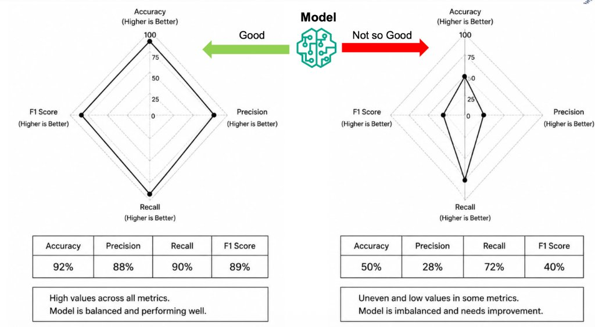

| Model Category | Accuracy | Precision | Recall | F1 Score | Diagnosis |
| :--- | :--- | :--- | :--- | :--- | :--- |
| **Good Model** | **92%** | **88%** | **90%** | **89%** | **High values across all metrics.** The model is well-balanced, reliable, and generalizes smoothly. |
| **Not so Good Model** | **50%** | **28%** | **72%** | **40%** | **Uneven and low values in key metrics.** The model is imbalanced, triggers frequent false alarms, and needs tuning. |

{: .note }
> **The Golden Rule of Model Evaluation:**  
> A good model has **consistently high values across Accuracy, Precision, Recall, and F1 Score**.

---

### AUC-ROC: Measuring Class Separation

For binary classification problems, models output a continuous probability score (e.g., 82% probability of churn) before converting it into a discrete Yes/No label based on a cutoff threshold.

{: .important }
> **What is AUC-ROC?**  
> **AUC-ROC** (*Area Under the Curve – Receiver Operating Characteristic*) measures how well a classification model distinguishes between positive and negative classes across all possible decision thresholds.  
> **Higher AUC = Better separation capability.**

  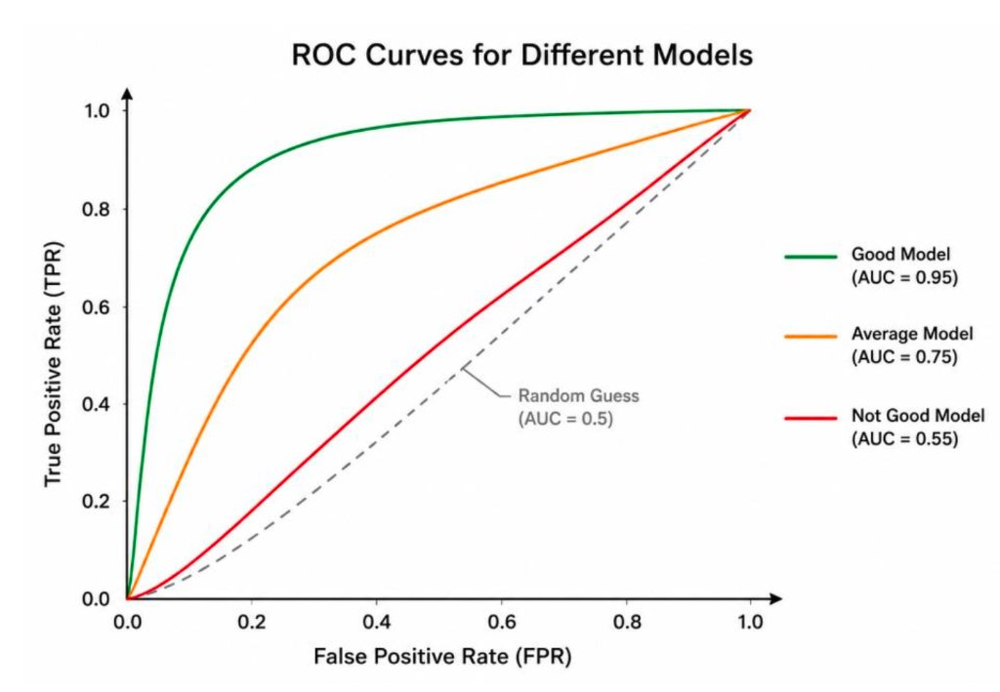

- **Good Model ($\text{AUC} = 0.95$):** The curve arches steeply toward the top-left corner, proving the model cleanly separates positives from negatives with minimal false alarms.
- **Average Model ($\text{AUC} = 0.75$):** Shows reasonable separation, but with some overlap between classes.
- **Not Good Model ($\text{AUC} = 0.55$):** Hugs close to the baseline, indicating poor distinction.
- **Random Guess ($\text{AUC} = 0.50$):** The diagonal dashed line, equivalent to a pure coin toss.

---

## 10. Model Evaluation: Regression Metrics

While classification evaluates category labels, **Regression Metrics** evaluate models that predict **continuous numerical values**.

Common regression tasks include:
- **House Price Prediction:** Estimating selling price based on square footage, location, and bedrooms.
- **Sales Forecasting:** Predicting upcoming revenue and demand levels.
- **Student Test Score Prediction:** Estimating exam performance based on study hours and attendance.

  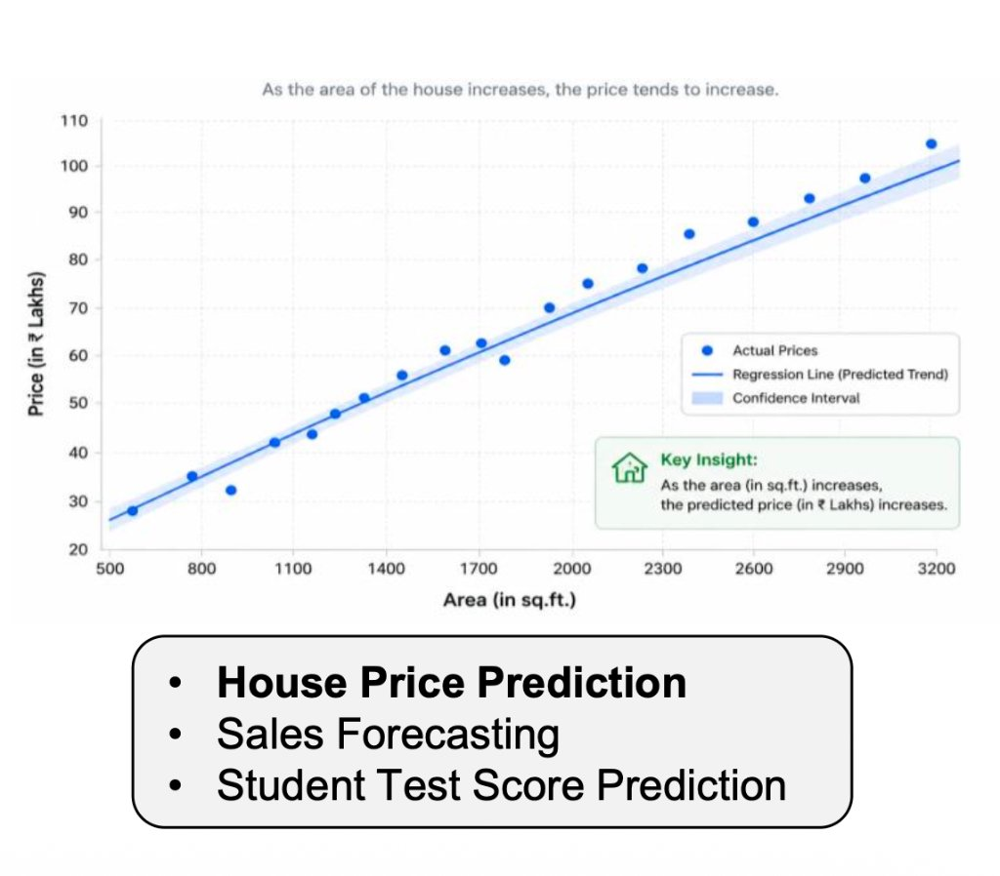

### The 4 Core Regression Metrics:

| Metric | Full Name | How It Works | Intuitive Real-World Example |
| :--- | :--- | :--- | :--- |
| **MAE** | **Mean Absolute Error** | The average absolute distance between actual and predicted values. Expressed directly in real units. | If $\text{MAE} = \$20,000$, on average, the predicted house price is off by about **\$20k**. |
| **MAPE** | **Mean Absolute Percentage Error** | Measures the average percentage mistake relative to actual values. | If $\text{MAPE} = 8\%$, on average, house price predictions are off by about **8%**. |
| **RMSE** | **Root Mean Squared Error** | Squares errors before averaging (then takes square root). Because mistakes are squared, **large errors become MUCH larger**. | Heavily penalizes giant blunders. Being off by \$100k once hurts your RMSE score much more than being off by \$10k ten times. |
| **$R^2$ Score** | **Coefficient of Determination** | Measures how well the model explains the variance in the target data. (Higher is better, maximum is 1.0). | If $R^2 = 0.85$, **85% of the variation in house prices** is explained by features like area, location, and bedrooms. |

---

## Summary

- **Pick the right tool:** Tree ensembles (Random Forest, XGBoost) dominate tabular business data; neural networks shine on images and text.
- **Fixing Model Fit:** Fix overfitting by adding training data, simplifying models, pruning, and applying regularization; fix underfitting with feature engineering, deeper models, and more epochs.
- **Hyperparameters:** External knobs (learning rate, batch size, max depth, regularization) set by engineers to steer training and balance fit.
- **Tuning Strategies:** Grid Search (exhaustive), Random Search (fast & practical), and Bayesian Optimization (smart probabilistic exploration).
- **The 3 Data Splits:** Train (60–80%) to learn, Validation (10–20%) to tune hyperparameters, and Test (10–20%) to grade on unseen data.
- **Classification Scorecard:** Always evaluate **Recall**, **Precision**, **F1-Score**, and **AUC-ROC** rather than relying on raw accuracy on imbalanced data.
- **Regression Scorecard:** Track **MAE** and **MAPE** for intuitive business understanding, **RMSE** to detect severe blunders, and **$R^2$ Score** to measure explained variance.

Now that our model is trained, tuned, and thoroughly evaluated on unseen test data, how do we deploy it to production and serve predictions?

In our final article, we explore **[Model Inference, Production Evaluation & Optimization](/docs/ml/basics/model-inference-and-optimization/)**.
