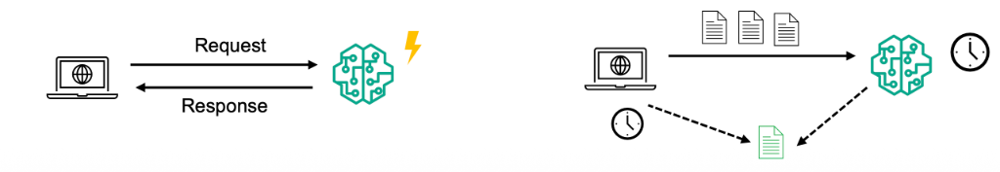
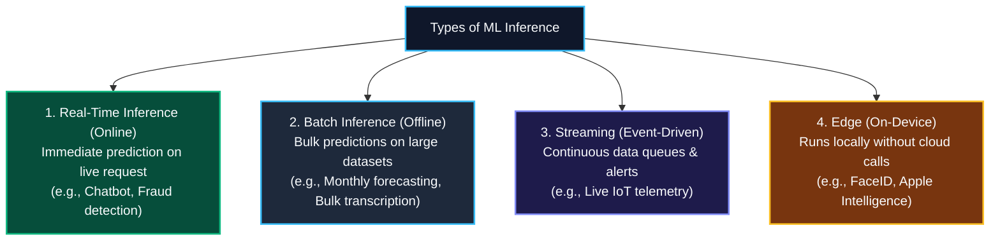
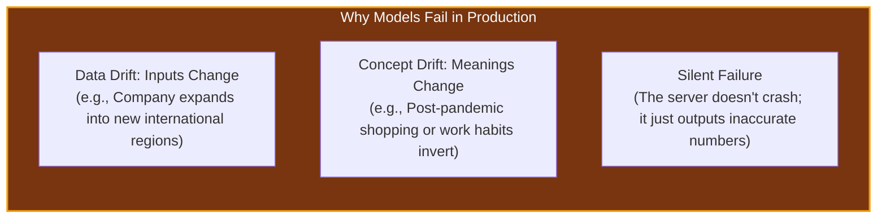
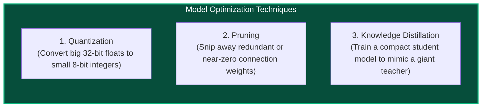
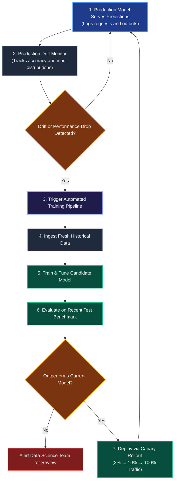

# Model Inference, Production Evaluation & Optimization: Explained Simply

Training a machine learning model on your laptop is only half the journey. 

In real life, a model sitting inside a Jupyter Notebook creates zero business value. It only begins making an impact when deployed to production, answering questions and making predictions for real users every single day.

This final chapter explores **Model Inference** (putting models to work), **Production Monitoring** (watching for models getting rusty over time), and **Optimization** (making models smaller, faster, and cheaper to run).

---

## 1. What is Model Inference?

{: .note }
> **In Simple Words:**  
> **Training** is when a student studies textbooks in school.  
> **Inference** is graduation day—when the model goes to work and uses what it learned to make predictions on **brand-new, unseen data**.

Once an ML model is trained and validated, it is deployed to serve predictions across three primary hosting environments:

- **Cloud Environments:** Highly scalable, managed platforms (e.g., AWS SageMaker, Google Vertex AI, Azure ML, or serverless container endpoints) for global accessibility and auto-scaling.
- **On-Premises Environments:** Private enterprise data centers and servers, required when data privacy, compliance, or regulations prevent sensitive information from leaving local networks.
- **Edge Environments:** Directly on physical hardware (e.g., smartphones, smart cameras, IoT sensors, cars) with zero network dependency and zero transmission latency.

---

## 2. Types of ML Inference: How Predictions Are Served

In production, models process requests and deliver responses in different ways based on how quickly users or systems need the answers:

  

### Real-Time Inference (Online / Synchronous)

- **How it works:** A user or application sends an API request (e.g., HTTP POST), and the model generates and returns an **immediate prediction** in milliseconds while the user waits.
- **Model Availability:** The model **must be running continuously 24/7** on active compute instances to serve incoming requests anytime.
- **Latency:** Ultra-low (typically **under 50 to 100 milliseconds**).
- **Common Use Cases:**
  - **Chatbots & Virtual Assistants:** Answering user prompts in live dialogue.
  - **Credit Card Fraud Detection:** Approving or declining a transaction before the card reader beeps.
  - **E-Commerce Search & Recommendations:** Showing personalized product suggestions while a shopper browses.
  - **Ride-Share Pricing:** Calculating trip fares instantly when a user enters a destination.

### Batch Inference (Offline / Asynchronous)

- **How it works:** Predictions are computed on **large datasets in offline mode**. A scheduled job or pipeline wakes up, scores thousands or millions of records at once, saves the results to a database or file store, and finishes.
- **Model Availability:** The model **only needs to run when the batch job executes**. Compute resources can be automatically spun up, used, and shut down.
- **Latency:** Non-immediate (takes minutes to hours; nobody is waiting on a loading screen).
- **Common Use Cases:**
  - **Monthly Forecasting:** Predicting inventory demand, revenue forecasts, or energy grid consumption for the coming month.
  - **Bulk Audio/Video Transcription:** Transcribing thousands of customer service call recordings overnight.
  - **Customer Churn & Attrition Scoring:** Scoring an entire employee or customer base once a week to flag flight risks for account managers.
  - **Personalized Email Newsletters:** Pre-computing weekly recommendation emails for millions of subscribers.

### Real-Time vs. Batch Inference: Direct Comparison

| Feature | Real-Time Inference | Batch Inference |
| :--- | :--- | :--- |
| **Prediction Speed** | **Immediate** (< 100 milliseconds) | **Offline / Scheduled** (Minutes to hours) |
| **Model Uptime** | **Must run 24/7** on active servers | **Runs only when required** (On-demand) |
| **Input Format** | Single requests / payloads via APIs | Bulk files, CSVs, Parquet, or database tables |
| **Infrastructure Cost** | Higher (Standing compute instances) | Lower (Ephemeral resources spun down after jobs) |
| **System Complexity** | High (Requires load balancers, caching, failover) | Moderate (Scheduled orchestrators like Airflow/Cron) |
| **Primary Examples** | Chatbots, Fraud detection, Payment checks | Monthly forecasting, Bulk transcription, Churn scores |

---

## 3. The "Day 2" Problem: Why Models Get Rusty

In traditional software engineering, if code compiles and tests pass today, it will continue working cleanly for years.

In machine learning, **models begin decaying the moment they are deployed**. 

Why? Because human habits, market conditions, and the real world constantly change!

### The Two Types of Drift:

1. **Data Drift (The Inputs Change):**
   - The statistical distribution of incoming production data diverges from what the model saw during training.
   - *Example:* An employee attrition model was trained on headquarters staff in the US. The company then opens a large remote branch in Japan with different overtime patterns and holiday norms. The inputs look alien to the model.

2. **Concept Drift (The Rules Change):**
   - The mathematical relationship between input features and the target label changes over time.
   - *Example:* In 2019, working 100% remotely may have been a strong signal of an employee disengaging. After 2020, remote work became standard practice. A model relying on remote hours as a flight-risk signal began making incorrect predictions.

{: .warning }
> **Why ML Failures Are Dangerous (Silent Failures):**  
> When traditional software breaks, it crashes, throws an exception, and notifies on-call engineers.  
> When an ML model decays, **it does not crash**. It returns HTTP status `200 OK` and a number. It's just that the number is completely wrong! This is why proactive production monitoring is essential.

---

## 4. Model Optimization: Making Models Faster and Cheaper

Modern models—especially deep neural networks and Large Language Models—can be massive in size and expensive to host on GPU servers. **Model Optimization** shrinks models so they run faster and cost less.

### 1. Quantization (The Audio/MP3 Compression of AI)
- In standard training, mathematical weights are stored as 32-bit floating-point numbers (**FP32**).
- **Quantization** rounds these numbers down to lightweight 8-bit integers (**INT8**) or 4-bit formats.
- **The Result:** The model file size shrinks by **$4\times$**, fits on commodity CPUs or mobile chips, and runs **$2\times$ to $4\times$ faster**, with almost zero noticeable drop in accuracy!

### 2. Pruning (Trimming the Dead Leaves)
Large neural networks often contain millions of weights that contribute very little to the final decision. Pruning removes these unimportant connections, producing a sparse, lightweight model that consumes significantly less memory.

### 3. Knowledge Distillation (Teacher to Student)
A large, highly accurate "Teacher" model (which is too slow and expensive for real-time serving) is used to train a compact "Student" model. The student learns to reproduce the teacher's outputs at a fraction of the compute cost.

---

## 5. The Continuous Retraining Loop

To ensure models stay accurate as the world shifts, production teams establish an automated **Continuous Retraining (CT)** loop:

### Safe Deployments: The Canary Rollout
Production models are never swapped for 100% of live users at once:
1. **Canary Phase:** Route **2% to 5% of incoming traffic** to the new candidate model.
2. **Telemetry Check:** Monitor latency, error rates, and output distributions for anomalies over 24 hours.
3. **Gradual Ramp:** Increase traffic to 25%, 50%, and finally 100% once stability is confirmed.

---

## Complete Series Wrap-Up

Congratulations! You have now walked through the complete foundation of Artificial Intelligence and Machine Learning:

| Step | Core Concepts Learned | Key Takeaway |
| :--- | :--- | :--- |
| **[1. Overview](/docs/ml/basics/ai-ml-dl-genai-overview/)** | AI, ML, Deep Learning & Generative AI | AI is the goal; ML is learning from data; DL is brain-like layers; GenAI creates content. |
| **[2. How Machines Learn](/docs/ml/basics/how-machines-learn/)** | Weights, Loss Functions, Gradient Descent | Machines learn by trial and error, adjusting mathematical knobs to minimize mistakes. |
| **[3. ML Lifecycle](/docs/ml/basics/machine-learning-lifecycle/)** | 7-Stage Iterative ML Roadmap | ML is a team sport and an iterative loop, not a one-and-done software build. |
| **[4. Problem Framing](/docs/ml/basics/business-problem-and-ml-framing/)** | Business Discovery & Learning Paradigms | Always start with real business pain points and evaluate the true cost of false alarms. |
| **[5. ML Tasks & Models](/docs/ml/basics/ml-tasks-and-model-types/)** | Task Types, Model Families & Metrics | Match problem outputs to tasks (classification, regression), pick suitable algorithms, and track the right metric. |
| **[6. Data Prep](/docs/ml/basics/data-collection-and-preparation/)** | Cleaning, EDA, Features & Leakage | 80% of ML work is data hygiene: cleaning outliers, correlation analysis, and preventing data leakage. |
| **[7. Training & Evaluation](/docs/ml/basics/model-training-and-evaluation/)** | 3-Way Splits, Overfitting, Confusion Matrix | Train (~70%), Validate (~15%), Test (~15%); avoid memorization; never trust raw accuracy on imbalanced data. |
| **[8. Production & Optimization](/docs/ml/basics/model-inference-and-optimization/)** | Real-Time vs Batch, Drift & Quantization | Serve predictions online or offline; monitor for silent drift; optimize with quantization and canary deployments. |

You now possess a clear, structured, and practical understanding of how machine learning systems are conceived, built, evaluated, and operated in the real world.
