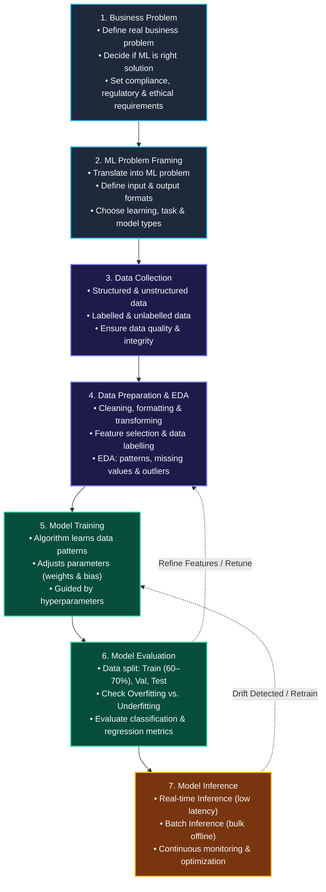

# Recap: What We Learnt & Quick Cheat Sheet

This summary brings together everything covered across the **Basics of AI and ML** series into a single quick-reference cheat sheet.

---

## 1. Recap - What We Learnt

- **AI, ML, Deep Learning and Generative AI:** Core terminologies and relationships.
- **Machine Learning Lifecycle:** A continuous end-to-end journey from problem discovery to serving predictions:

### Detailed Lifecycle Stages:
- **Business Problem:** Define business problem, decide if ML is a right solution, Also define compliance, regulatory and ethical requirements.
- **ML Problem Framing:** Translate Business problem into Machine learning problem. Define input and output, decide model evaluation criteria, decide on ML learning types, ML task types and model types.
- **Data Collection:** Structured, unstructured, labelled, unlabeled data. Importance of data quality.
- **Data Preparation:** Data cleaning, formatting and transformation, feature selection, data labelling.
- **Exploratory Data Analysis (EDA):** Understand data, identify patterns, outliers, missing values and relationships between features.
- **Model Training:** Model learns the data pattern and adjust internal parameters (e.g. weights and bias).
- **Model Evaluation:** Evaluating model accuracy. Training data (60-70%), Validation data and Test data.
- **Model Inference:** Using ML model for prediction. Real-time inference, Batch Inference.
- **Model Evaluation and Optimization:** Model fit, Hyperparameters, Classification and regression metrics.

---

## 2. ML Learning Types

| Learning Type | Characteristics | Key Details |
| :--- | :--- | :--- |
| **Supervised Learning** | Labelled data | Learns from historical outcomes and known answers. |
| **Unsupervised Learning** | Unlabelled data | Discovers hidden patterns and structure on its own. |
| **Reinforcement Learning** | Environment interaction | Learns through trial and error using rewards and penalties. |
| **Semi-supervised Learning** | Hybrid dataset | Uses a small amount of labelled data combined with a large amount of unlabelled data. |
| **Self-supervised Learning** | Unlabelled, unstructured data | Automatically generates its own labels; used for building Foundation models. |

---

## 3. ML Task Types

| Task Type | Description | Common Applications |
| :--- | :--- | :--- |
| **Regression** | Predicts continuous numerical values | Predict, estimate, forecast continuous values (e.g., prices, demand). |
| **Classification** | Predicts discrete categories | Categorise items into classes (e.g., Spam vs. Not Spam, Yes vs. No). |
| **Clustering** | Groups similar items | Discovers natural groupings (e.g., customers, documents, topics). |
| **Association Rule Learning** | Finds relationships among items | Identifies items frequently bought together. |
| **Anomaly Detection** | Identifies unusual patterns | Detects unusual behaviour and outliers (e.g., equipment faults). |
| **Dimensionality Reduction** | Compresses feature space | Reduces number of features while preserving information; reduces model size, complexity, and cost (e.g., customer behaviour analysis, image compression). |

---

## 4. ML Use Cases and ML Techniques

The table below maps common real-world use cases to their respective machine learning techniques:

| Use Case / Example | ML Technique |
| :--- | :--- |
| House price prediction | Regression (Supervised Learning) |
| Spam detection | Classification (Supervised Learning) |
| Customer segmentation | Clustering (Unsupervised Learning) |
| Frequently bought together products | Association Rule Learning (Unsupervised Learning) |
| Network intrusion detection | Anomaly Detection (Unsupervised Learning) |
| Group news articles by topic | Topic Modelling (Unsupervised Learning) |
| Recognize cats and dogs in images | Image Classification (Deep Learning) |
| Detect pedestrians in self-driving cars | Object Detection (Computer Vision) |
| Convert speech to text | Speech Recognition (Deep Learning) |
| Extract names, locations, organizations etc. from text | Named Entity Recognition (NER) (Deep Learning) |
| Generate new text, image, video or audio | Content generation (Generative AI) |
| Fill in the missing parts of the image or audio | Image Inpainting (Generative AI) |

---

## 5. ML Model, Algorithm & Architecture Types

| Model / Algorithm Type | How It Works & Characteristics | Typical Applications |
| :--- | :--- | :--- |
| **Linear Regression** | Predictions made through mathematical formulas; high explainability. | Continuous numeric estimation baselines. |
| **Decision Tree** | Predictions made through a series of decisions; simple model with high explainability. | Transparent rules-based classification and regression. |
| **Random Forest** | Combines multiple decision trees; delivers accurate and stable predictions. | Tabular business data, customer churn, risk scoring. |
| **Neural Network** | Highly accurate predictions; complex models with low explainability. | Computer Vision, Natural Language Processing (NLP). |
| **Deep Learning** | Highly complex multi-layered models. | Used for building generative AI models, speech, and vision systems. |

---

## 6. ML Inference Types

| Inference Type | Description | Best Suited For |
| :--- | :--- | :--- |
| **Real-time Inference** | Immediate predictions returned on demand. | Applications requiring low latency and quick response (e.g., chatbots, fraud detection). |
| **Batch Inference** | Offline predictions processed in bulk. | Large volumes of data and requests when instant results are not required. Cheaper compared to real-time inference. |

---

## 7. Model Hyperparameters, Model Fit, Bias & Variance

### Model Hyperparameters
- **Hyperparameters:** Configuration settings set before training that control the ML training and learning process.
- **Learning Rate:** Controls how quickly the model learns.
- **Epochs:** Number of complete passes through the training data.
- **Regularization:** Prevents overfitting by reducing model complexity.
  - *Increase Regularization* to fix **Overfitting** models.
  - *Decrease Regularization* to fix **Underfitting** models.

### Model Fit
- **Overfitting:** The model learns noise and performs well on training data but poorly on unseen data.
- **Underfitting:** The model is too simple and fails to learn important patterns from the data.

### Bias and Variance
- **Bias:** Measures how much the model misses important patterns in the data. High bias leads to model underfitting $\to$ **Increase model complexity to fix bias.**
- **Variance:** Measures how much the model learns unnecessary patterns (noise) in the data. High variance leads to model overfitting $\to$ **Reduce model complexity to fix variance.**
- **Generalization:** Good models balance Bias and Variance for better generalization on unseen data.

---

## 8. Model Evaluation Metrics

### Classification Task Metrics
- **Confusion Matrix:** Compares Actual vs. Predicted outcomes across True Positives (TP), False Positives (FP), False Negatives (FN), and True Negatives (TN).
- **Accuracy:** Overall prediction correctness. Higher is better:
  $$\text{Accuracy} = \frac{TP + TN}{TP + TN + FP + FN}$$
- **Precision:** When the model predicted Positive, how often was it correct? Higher is better:
  $$\text{Precision} = \frac{TP}{TP + FP}$$
- **Recall:** How many actual Positive cases were detected? Higher is better:
  $$\text{Recall} = \frac{TP}{TP + FN}$$
- **F1 Score:** Balanced measure of Precision and Recall. Higher is better:
  $$\text{F1 Score} = 2 \times \frac{\text{Precision} \times \text{Recall}}{\text{Precision} + \text{Recall}}$$

### Regression Task Metrics
- **MAE / MAPE:** Average prediction error in regression models. Lower is better.
- **RMSE:** Penalizes larger prediction errors more heavily. Lower is better.
- **$R^2$ Score:** Measures how well the model explains variation in the data. Higher is better ($\le 1.0$).

---

## 9. Popular AI/ML Models (Good to Know)

- **RLHF (Reinforcement Learning from Human Feedback):** Uses human feedback to align model outputs with human preferences. Commonly used in chatbots or virtual assistants to align with human preferences.
- **BERT (Bidirectional Encoder Representations from Transformers):** Language model designed to understand the meaning and context of text. Used for sentiment analysis and Named Entity Recognition (NER) to identify people, companies, and locations in text.
- **XGBoost (Extreme Gradient Boosting):** High-performance tree ensemble used for classification and regression problems such as customer churn prediction and credit risk assessment.
- **SVM (Support Vector Machine):** Finds an optimal boundary between classes. Primarily used for classification tasks like spam vs. not-spam, fraud detection, and customer classification.
- **CNN (Convolutional Neural Network):** Deep learning model commonly used for image recognition and computer vision applications, such as identifying faces, cats, cars, and diseases.
- **RNN (Recurrent Neural Network):** Neural network designed for sequential data. Useful for speech recognition, time-series forecasting, and weather forecasting.
- **ResNet (Residual Neural Network):** Deep CNN architecture that improves image recognition by enabling very deep neural networks. Used for object detection in images.

---

## 10. Generative Models (Good to Know)

- **WaveNet:** Deep learning model used for generating realistic speech and audio waveforms.
- **GAN (Generative Adversarial Network):** Deep learning technique used to generate realistic synthetic content such as images and videos.
- **GPT (Generative Pre-trained Transformer):** Foundation model that generates human-like text, code, and conversational responses.
